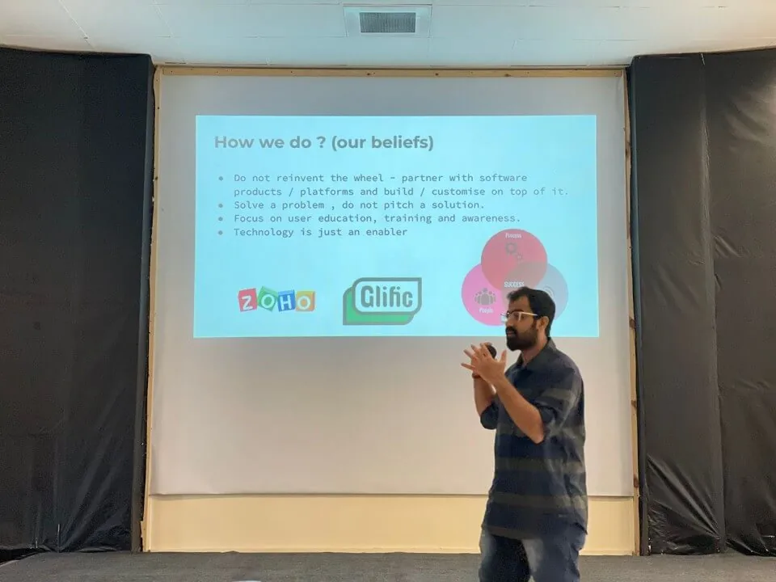
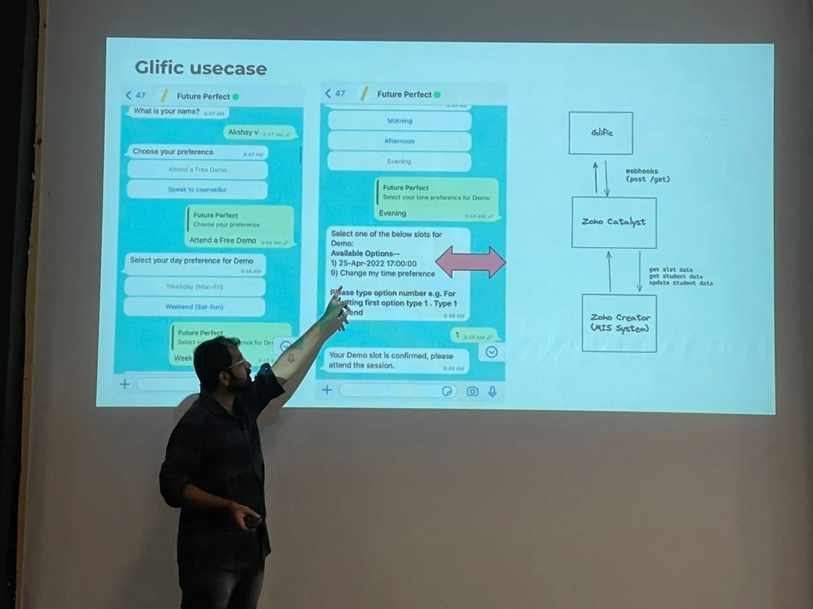
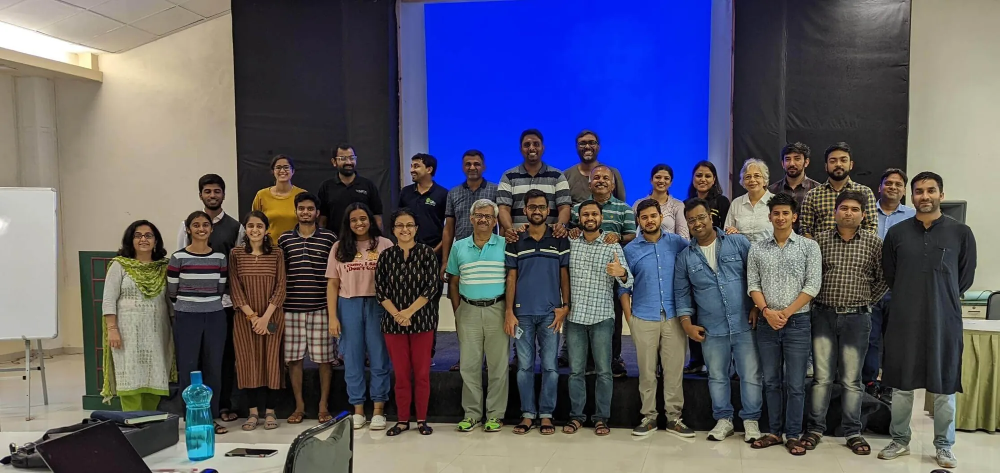

It’s been long since I wrote a blog, but got fascinated by the idea when one of my friends reached out asking if I was participating in the Tech4Dev Sprint by reading [Lobo’s article](https://chintugudiya.org/blog/tech4dev-2-0-sprints-are-off-the-starting-block-welcome-to-garudmaachi/)! Small world indeed. The development sector is even smaller! Here's me decoding the amazing experience we had at GarudMaachi, Pune.

Our journey to GarudMaachi started with [Arun Kadekodi](https://www.linkedin.com/in/arunkadekodi/) from [Soft Corner](https://www.soft-corner.com/) and Gayathri from HyperVerge Academy. Arun walked us through his journey of building his company in the late 90s. One thing which struck me hard was the exorbitantly high hardware prices. Computer usage time per hour used to be Rs.2000-3000/ hr, imagine the pressure on the developer to ship a code within the time limits! Also, as the youngest person in the sprint, loved the way Arun approached life, and work, and how he enjoyed both of them. The sprint had folks from NGOs ([Key Education Foundation](https://www.keyeducationfoundation.org/) (KEF), [VOPA](https://vopa.in/), [The Apprentice Project](https://www.theapprenticeproject.org/) (TAP), [Slam Out Loud](https://slamoutloud.com/), [Lend a Hand India](https://lendahandindia.org/), [Reap Benefit](https://reapbenefit.org/), [Shelter Associates](https://shelter-associates.org/), [Avanti Fellows](https://www.avantifellows.org/), and [Indus Action](https://www.indusaction.org/)), Ecosystem Partners ([Goalkeep](https://www.goalkeep.net/), [Avni](https://avniproject.org/about/), [Glific](https://glific.org/), [HyperVerge Academy](https://www.hyperverge.co/) and [Dasra](https://www.dasra.org/))

Of all the interesting conversations we had, the one I had with Lobo on Tuesday during our morning hike was super special. We discussed how to bring the technology lens to the non-profit sector, how a lot of organisations still make technology decisions based on a friend/volunteer's opinion and how everyone wants to build an Uber. There needs to be more amplification of voices, learnings and resources on what works and what doesn't and how everyone doesn't need to reinvent the wheel.

This week was extra special as it’s been two years since I started EdZola. It is extremely gratifying to see how far we have come and we’re just getting started!

## I had given a talk about EdZola in the sprint, and some of the things I talked about include:

- Our partnership with Zoho and how Zoho can be [beneficial for non-profits](https://www.edzola.com/zoho-for-impact). We also discussed some of the samples of our work so far.
- How low-code platforms like Zoho Creator can also create impact at scale. Read more about how our project with the [Future Perfect Program](https://fp.thenudge.org/) reached a scale of around 40K students at its peak [here](https://www.edzola.com/the-nudge-future-perfect).
- How to bring computational thinking/tech skills to the non-profit sector. The underlying question being: Can anyone build apps? How the concept of [Citizen Development](https://www.techtarget.com/searchsoftwarequality/definition/citizen-development) is increasing worldwide and we will need more adopters of tech in the development sector.

Do go through the entire deck [here](https://go.edzola.com/tech4dev).

My learnings from the Sprint include

- **Power of a collective** - We had developers, product architects, program leads from Non-Profits, thought leaders and other ecosystem enablers, most of them who had the vision of enabling technology in the social sector. It was wonderful to witness conversations, brainstorming sessions and ideas on how we can move forward as an ecosystem.
- **Power of Open Source** - It was great to see the depth of work done by Glific, Avni and Plio in person. And open-source, as an ideology makes more and more sense to me for folks to come together and build rather than reinvent the wheel. My personal takeaway includes how we can make our work open source so that other non-profits can learn and contribute on top of it.
- **Practical Know-How's -** During presentation of NGOs on how they are leveraging Glific and other tools, it was great to see innovative ways on how organisations use the platforms to drive engagement, user adoption, etc This was a learning experience for most NGOs who were battling similar challenges.
- **Amplifying our voices** **-** On one of the days, We had [Parveen Bhardwaj](https://www.linkedin.com/in/parveenbhardwaj08/?originalSubdomain=in&lipi=urn%3Ali%3Apage%3Ad_flagship3_pulse_read%3BeBofvLalQDma630JbXfXmg%3D%3D) give a small visit and shared about his digital transformation journey at Swades Foundation. One thing which he pointed out was, that when he started this journey, he was not able to find many details about Tech4Good Projects or Ecosystems in spite of Googling / asking around. Even if there were, they were expensive and out of reach for most NGOs. How do we further amplify our efforts so that more and more non-profits can benefit from the work?

I'd like to thank Tech4Dev Team for the invite, and hoping to attend the next Sprint along with my tech team for even more in-depth discussions and experiments. Along with our efforts in leveraging Zoho For Impact, we will also start to explore open-source platforms like Avni, Kobo ToolBox, Metabase, and Frappe by ERPNext to see how they can benefit a large set of organisations.

I can go on and on about the Sprint, about the rain trek, food from different states and in detail about the different sessions. A few folks have already written about them [here](https://chintugudiya.org/blog/), Please do read them!
