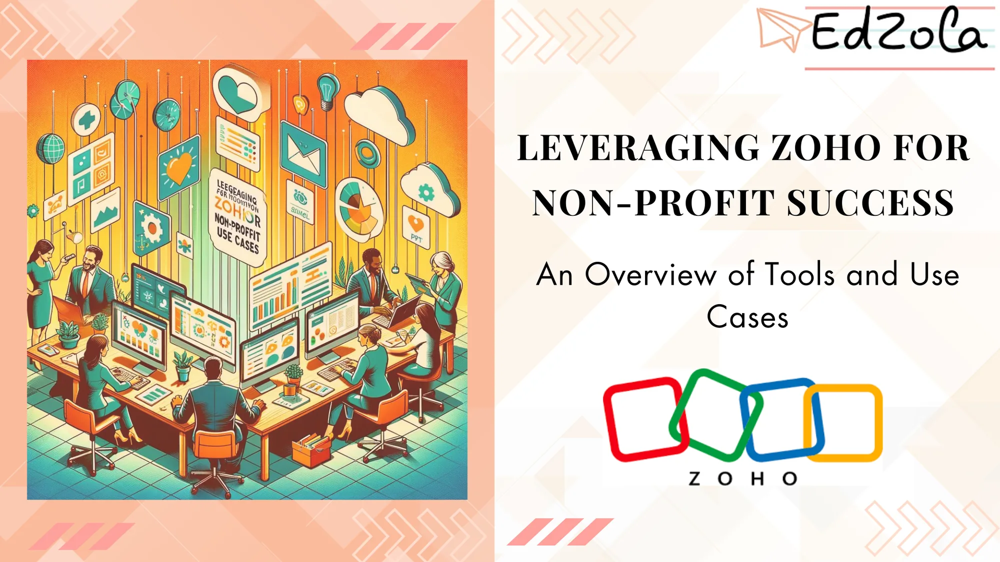

In an increasingly digital age, non-profit organizations are seeking innovative solutions to streamline their operations, engage with donors, and maximize their impact. One such solution that has gained traction in the non-profit sector is Zoho, a comprehensive suite of tools designed to meet the unique needs of non-profit organizations. In this article, we will explore the extensive range of tools offered by Zoho and delve into real-world use cases that highlight their effectiveness in the non-profit sector.

## **Understanding Zoho: A Comprehensive Tool for Non-Profits**

Before we dive into the specific tools and use cases, let's take a moment to understand what Zoho is and how it can benefit non-profit organizations. Zoho is a c**loud-based software provider** that offers a wide range of applications designed to streamline business processes. What sets Zoho apart is its commitment to flexibility that allows us to build custom solutions tailored specifically for non-profits.

### What is Zoho and How Can It Benefit Non-Profits?

Zoho provides non-profit organizations with a suite of tools that help them manage their operations efficiently. From donor management and accounting to fundraising and marketing, Zoho offers a holistic approach to non-profit management. By leveraging Zoho's tools, non-profits can consolidate their data, streamline their processes, and ultimately make a greater impact. Let's explore some of the specific tools within the Zoho suite.

[Explore Zoho Products](https://www.edzola.com/zoho-products)
> ***Non-profit organizations often struggle with managing their operations effectively. Zoho provides an all-in-one solution that addresses their key pain points.***

### Key Zoho Platforms for Non-Profit Organizations

Let's take a closer look at some of the key features of Zoho that make it an invaluable tool for non-profit organizations:

### Zoho Creator: Data Management Solution

Zoho Creator offers a versatile platform for non-profits, enabling efficient management of donor databases, event planning, and project execution. Its user-friendly interface allows for the easy creation of custom applications, aiding in donation tracking and reporting. By integrating with other Zoho products, it provides a comprehensive solution for non-profits to streamline operations, enhance communication, and effectively utilize resources, all accessible from the cloud for increased flexibility and mobility.

[Explore Zoho Creator](https://www.edzola.com/zoho-products/zoho-creator)

### Zoho CRM: Streamlining Donor Management

Zoho CRM provides non-profit organizations with a centralized platform to manage donor relationships. With features such as contact management, campaign tracking, and integration with popular email marketing tools, non-profits can effectively engage with donors and nurture long-term relationships.

[Explore Zoho CRM](https://www.edzola.com/zoho-products/zoho-crm)

### Zoho Books: Simplifying Non-Profit Accounting

Accounting is often a complex and time-consuming task for non-profits. Zoho Books simplifies this process by providing organizations with a user-friendly platform to manage their financials. With features such as automated invoicing, expense tracking, and real-time financial reporting, non-profits can gain a clear and accurate picture of their financial health.

> ***Zoho Books revolutionized our financial management.***

[Explore Zoho Books](https://www.edzola.com/zoho-products/zoho-books)

### Zoho People: HRMS Solution

Non-profits can leverage Zoho People to streamline their human resources processes, enabling efficient management of volunteer and staff databases, simplifying recruitment, and enhancing training programs. This cloud-based HR solution offers customizable features for attendance tracking, performance appraisals, and time-off management, aligning HR operations with the unique needs of the non-profit sector.

[Explore Zoho People](https://www.edzola.com/zoho-products/zoho-people)

### Zoho Campaigns: Enhancing Fundraising Efforts

To maximize their fundraising efforts, non-profit organizations need to stay connected with their supporters. Zoho Campaigns empowers non-profits to create targeted email campaigns, automate follow-ups, and track campaign performance, ensuring that they are effectively engaging with their donor base.

**Dig Deeper:** [**Introduction to Email Marketing Automations for Nonprofits**](https://www.edzola.com/post/introduction-to-email-marketing-automations-for-nonprofits)

[Explore Zoho Campaigns](https://www.edzola.com/zoho-products/zoho-campaigns)

## **Implementing Zoho in Your Non-Profit**

Now that you have gained an understanding of the value that Zoho can bring to your non-profit organization, If you're a small non-profit, [Zoho One](https://www.edzola.com/post/zoho-one-for-non-profits) is the right platform for you.

### Steps to Get Started with Zoho

1. **Evaluate your organization's needs:** Identify the pain points and areas where Zoho's tools can make a difference in your organization's operations.

2. **Choose the right Zoho products:** Select the Zoho tools that align with your organization's specific requirements. It's important to customize your choice to fit your unique needs.

3. **Plan for implementation:** Develop an implementation plan and timeline, ensuring that all stakeholders are involved and informed throughout the process.

### Tips for Maximizing Zoho's Potential

1. **Invest in training:** Provide your staff with comprehensive training on how to effectively use Zoho. This will ensure that they are maximizing the full potential of the tools available.

2. **Customize to fit your needs:** Take advantage of Zoho's customization capabilities to tailor the tools to your organization's unique processes and requirements.

3. **Leverage Zoho Creator:** Zoho Creator is a powerful tool that allows non-profits to build custom solutions that integrate seamlessly with other Zoho applications. This enables organizations to create workflows, automate processes, and develop custom applications without the need for extensive coding knowledge.

**For further Insights, Let's deep dive into this video****:** [**Streamlining Nonprofit's data stack with Zoho Creator**](https://www.youtube.com/watch?v=KgNaNAJ0KS4)

## **Ensuring Success with Zoho**

After implementing Zoho in your non-profit organization, it is essential to continuously monitor and evaluate its impact:

### Monitoring and Evaluating Zoho's Impact

Regularly analyze key metrics such as donor retention, fundraising revenue, and operational efficiency to gauge the effectiveness of your Zoho implementation. Use this data to identify areas for improvement and further optimization.

Additionally, staying updated with the latest Zoho features and enhancements is crucial. Regularly explore Zoho's resources, attend webinars, and connect with the non-profit community to learn from others' experiences and stay ahead of the curve.

### Troubleshooting Common Issues with Zoho

While Zoho offers robust and reliable tools, occasional issues may arise. In such cases, it's important to have a designated point of contact within your organization who can troubleshoot issues or reach out to Zoho's support team for assistance. Additionally, leveraging online forums and discussion boards can often provide quick solutions to common challenges.

## Long-Term Benefits of Using Zoho in Non-Profits

By leveraging Zoho's suite of tools, non-profit organizations can streamline their operations, maximize their fundraising efforts, and ultimately increase their impact. With customizable solutions, comprehensive support, and an unwavering commitment to non-profits, Zoho remains a valuable partner for organizations striving to make a difference.

In conclusion, Zoho offers a comprehensive suite of tools tailored for non-profit use. From donor management and accounting to fundraising and marketing, Zoho empowers non-profit organizations to optimize their operations and drive their mission forward. By implementing Zoho, non-profits can unlock their full potential and make a lasting impact in the communities they serve.

## Getting Started with EdZola

> ***Let's innovate with purpose and use technology as a force for good.***

Every nonprofit is unique, and one size does not fit all when it comes to data solutions. At [EdZola](https://www.edzola.com/), we specialize in creating customized solutions that align with your organization’s specific goals and needs. Our team works closely with you to identify pain points, develop a tailored plan, and implement the right tools to maximize your impact.

[Let's Connect](https://www.edzola.com/contact)
