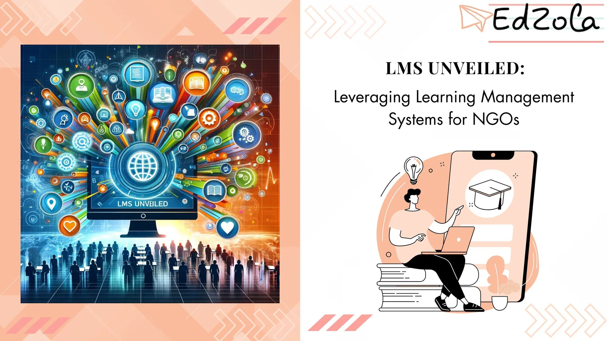

Non-profit organizations (NGOs) play a crucial role in addressing societal challenges and uplifting communities. One area where NGOs have a tremendous opportunity for impact is skill development and training programs. To effectively manage such initiatives, NGOs can harness the power of Learning Management Systems (LMS). This article aims to provide a comprehensive understanding of LMS and its potential to revolutionize the skilling landscape for NGOs.

## **Understanding Learning Management Systems (LMS)**

### Defining LMS and Its Core Features

A Learning Management System (LMS) is a software application that enables organizations to create, deliver, and track training programs efficiently. **It serves as a centralized platform for managing courses, conducting assessments, and tracking learner progress.** LMSs offer a wide range of features, including content management, curriculum design, learner analytics, and collaborative tools.

One key aspect of LMS is its ability to provide personalized learning experiences. Through the use of adaptive learning technology, LMS platforms can tailor course content and assessments to meet the unique needs and learning styles of individual users. This personalized approach not only enhances the learning experience but also improves knowledge retention and engagement.

Dig Deeper: [Why Non-Profits Should Invest in a Learning Management System](https://freshlearn.com/blog/non-profits-invest-in-learning-management-system/)

### The Role of LMS in Non-Profit Organizations

NGOs face unique challenges when it comes to implementing effective skilling programs. Limited resources, geographical dispersal, and disparate learner demographics can make traditional training models impractical. Herein lies the pivotal role of LMS in enabling NGOs to streamline their training efforts and overcome these hurdles effectively.

Explore More: [Building Effective Skilling MIS for Livelihood NGOs: Key Components and Best Practices](https://www.edzola.com/post/building-effective-skilling-mis-for-livelihood-ngos-key-components-and-best-practices)

LMS platforms can help non-profit organizations demonstrate the impact of their training programs through robust reporting and analytics features. By **tracking key metrics such as course completion rates, assessment scores, and learner feedback, NGOs can assess the effectiveness of their training initiatives and make data-driven decisions to continuously improve their programs.** This data-driven approach not only enhances accountability and transparency but also helps attract potential donors and supporters who seek measurable results from their contributions.

## **The Benefits of LMS for NGOs**

### Streamlining Training and Development

One of the primary advantages of LMS is its ability to streamline the entire training and development process. With user-friendly interfaces and intuitive navigation, learners can access training modules anytime, anywhere, eliminating the constraints of physical presence. Moreover, LMS allows NGOs to create customized learning paths for different learner groups, ensuring personalized and effective training.

Expanding on the concept of streamlining training and development, LMS also offers the benefit of scalability. NGOs can easily scale their training programs to accommodate a growing number of learners without incurring significant additional costs. This flexibility is particularly advantageous for NGOs operating in dynamic environments where the demand for training may fluctuate.

### Enhancing Collaboration and Communication

**LMS fosters collaboration and communication among learners, trainers, and other stakeholders. Discussion forums, group projects, and real-time messaging features provide platforms for learners to interact, share insights, and seek clarification.** This collaborative environment promotes knowledge exchange and peer learning, enriching the skilling experience for all participants.

Probe Further: [Unlocking Growth and Engagement: Empower Your Nonprofit with a Collaborative Learning LMS](https://www.learnworlds.com/collaborative-learning-lms/)

LMS can facilitate global collaboration among NGOs operating in different regions. By leveraging features such as virtual classrooms and webinars, organizations can connect their geographically dispersed teams for synchronous learning experiences. This interconnectedness not only enhances knowledge sharing but also fosters a sense of community and shared purpose among participants.

### Tracking Progress and Performance

NGOs often struggle with monitoring and evaluating the impact of their skilling programs. LMS addresses this challenge by offering powerful tracking and reporting tools. By capturing data on learner progress, performance, and completion rates, NGOs gain valuable insights into program effectiveness. **This data-driven approach enables them to make data-backed decisions, identify knowledge gaps, and refine training content.**

In addition to tracking individual progress, LMS can also provide aggregate data that allows NGOs to analyze trends and patterns across their entire learning ecosystem. By identifying common areas of strength and weakness, organizations can strategically allocate resources to enhance overall program outcomes and maximize the impact of their training initiatives.

## **Choosing the Right LMS for Your NGO**

### Key Factors to Consider

While the benefits of LMS are undeniable, NGOs should carefully evaluate their specific needs before selecting an LMS for their skilling programs. **Factors such as scalability, ease of integration with existing systems, cost, user-friendliness, and technical support must be taken into account.** Additionally, NGOs should prioritize LMS platforms with robust data security measures to safeguard sensitive learner information. And another most important factor is choosing the right tool.=

### Evaluating Different LMS Providers

NGOs should leverage comparison frameworks and seek demonstrations from potential LMS providers to determine the best fit for their requirements. Aligning the LMS features with the organization's needs and opting for a provider with a proven track record in the non-profit sector is crucial for a successful implementation.

## Explore Tools to Enhance Your Learning Management System (LMS)

### Zoho Learn

Zoho Learn is a platform designed to facilitate knowledge sharing and online training within organizations. It aims to provide a centralized solution for creating, managing, and delivering training content to employees, customers, or other stakeholders.

[Explore Zoho Learn](https://www.zoho.com/learn/)

### Zoho Trainer Central

Trainer Central is an all-in-one training platform that enables trainers to create, publish, sell, and administer online courses. It provides a website builder, payment system, and multiple options to create online courses.

[Explore Zoho Trainer Central](https://www.trainercentral.com/)

### Moodle

Moodle is an open-source learning platform widely used by nonprofits and educational institutions worldwide. It offers a range of features for course management, content creation, assessments, and collaboration. Being open-source, it's highly customizable and cost-effective, making it a popular choice for organizations with limited budgets.

[Explore Moodle](https://moodle.org/)

### Litmos

Litmos is a cloud-based learning platform suitable for nonprofits seeking a scalable and easy-to-use solution. It offers features for course creation, assessments, certifications, and reporting. SAP Litmos also provides mobile access and integration capabilities with CRM systems, making it suitable for nonprofits focused on employee training and development.

[Explore Litmos](https://www.litmos.com/)

### TalentLMS

TalentLMS is a user-friendly and affordable LMS suitable for nonprofits of all sizes. It offers features such as course creation, multimedia support, gamification, and analytics. TalentLMS also provides customization options, mobile access, and integration with other software tools, making it a versatile choice for nonprofit organizations.

[Explore TalentLMS](https://www.talentlms.com/)

## Getting Started with EdZola

> ***Let's innovate with purpose and use technology as a force for good.***

Every nonprofit is unique, and one size does not fit all when it comes to data solutions. At [EdZola](https://www.edzola.com/), we specialize in creating customized solutions that align with your organization’s specific goals and needs. Our team works closely with you to identify pain points, develop a tailored plan, and implement the right tools to maximize your impact.

[Let's Connect](https://www.edzola.com/contact)
