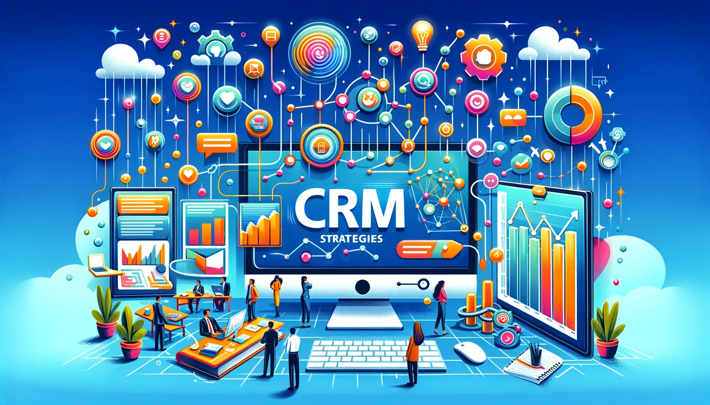

In the world of non-profit organizations, donor retention is a crucial aspect of maintaining financial stability and achieving long-term success. By establishing strong relationships with donors and maximizing their engagement, non-profits can ensure a steady stream of support for their causes. This is where CRM strategies come into play. Customer Relationship Management (CRM) is not just for businesses - it is an invaluable tool for non-profits as well.

## **Understanding Donor Retention**

Donor retention refers to the ability of non-profit organizations to keep their existing donors engaged and committed to their cause over a sustained period of time. It is a critical metric that directly impacts the financial health and overall success of non-profits.

### The Importance of Donor Retention

The importance of donor retention cannot be overstated. Acquiring new donors can be expensive and time-consuming. On the other hand, retaining existing donors is much more cost-effective and leads to higher lifetime value. Donors who have already invested in your organization are more likely to donate again and make larger contributions over time. By focusing on donor retention, non-profits can ensure a stable and sustainable source of funding for their programs and initiatives.

### Key Metrics in Donor Retention

There are several key metrics that non-profits should track to measure their donor retention efforts. One such metric is the donor retention rate, which measures the percentage of donors who continue to contribute to an organization year after year. Other important metrics include the average gift size, the frequency of donations, and the donor engagement level. By analyzing these metrics, non-profits can identify areas for improvement and implement targeted strategies to enhance donor retention.

## **Exploring CRM Strategies**

CRM strategies involve the utilization of technology and data-driven approaches to manage relationships with donors. With the right CRM tools, non-profits can streamline and enhance their donor management processes, resulting in improved donor retention rates and increased fundraising effectiveness.

**Explore further:** [**An IT perspective on the best way to implement a nonprofit CRM**](https://www.nten.org/blog/it-perspective-nonprofit-crm-implementation)

### What is a CRM Strategy?

A CRM strategy is a comprehensive plan that outlines how an organization will utilize **CRM tools and techniques to build and maintain strong relationships with its donors.** It involves the collection, organization, and analysis of donor data to gain insights into donor behavior, preferences, and engagement levels. By leveraging this information, non-profits can personalize their communications, tailor their fundraising campaigns, and implement strategies to foster long-term donor loyalty.

### Benefits of CRM for Non-Profits

Implementing a CRM strategy offers several benefits for non-profit organizations. Firstly, **it enables non-profits to centralize donor data, making it easily accessible and actionable**. This allows for more efficient **donor management, as staff members can quickly retrieve donor information, track interactions, and maintain accurate records.** Secondly, CRM tools provide valuable insights into donor behavior, allowing non-profits to segment their donor base and deliver targeted communication and appeals. Lastly, CRM strategies enhance donor engagement by personalizing the donor experience and ensuring timely and relevant communication.

## **Implementing CRM Strategies for Donor Retention**

Implementing a CRM strategy requires careful planning and consideration. Non-profits must identify the right CRM tools that align with their needs and budget. There are several CRM software options tailored specifically for non-profits, such as Salesforce Nonprofit Cloud, Bloomerang, and DonorPerfect. These tools offer features like donor database management, communication automation, and fundraising campaign tracking, empowering non-profits to effectively manage their donor relationships.

### Identifying the Right CRM Tools

When selecting a CRM tool, non-profits should consider factors such as ease of use, **scalability, integration capabilities, and cost.** It is essential to choose a CRM solution that aligns with the organization's goals and strategies. Additionally, non-profits should seek out CRM providers that offer training and support to ensure a smooth transition and maximum utilization of the CRM system.

[Explore Zoho CRM](https://edzola.com/zoho-products/zoho-crm)

### Integrating CRM into Your Non-Profit Operations

Integrating CRM into the day-to-day operations of a non-profit organization is crucial for maximizing its effectiveness. This involves training staff members on how to use the CRM platform, establishing standardized data entry and tracking processes, and creating workflows that ensure consistent communication and follow-up with donors. It is also important to regularly monitor and analyze key CRM metrics to assess the impact of the CRM strategy and make necessary adjustments.

## **Optimizing CRM for Donor Engagement**

Once the CRM strategy is in place and the CRM system is integrated into non-profit operations, it is time to focus on optimizing donor engagement. Effective donor engagement is the key to building lasting relationships and maximizing donor retention rates.

### Personalizing Donor Communication with CRM

A personalized approach to donor communication is essential for fostering long-term donor loyalty. With CRM tools, non-profits can segment their donor base based on various criteria and tailor their messages accordingly. By sending personalized emails, letters, and invitations, non-profits can make donors feel appreciated and valued. Additionally, **CRM systems enable non-profits to automate communication workflows, ensuring that donors receive timely updates and opportunities to engage.**

### Tracking Donor Interactions through CRM

Tracking donor interactions is another crucial aspect of optimizing CRM for donor engagement. **CRM systems allow non-profits to record and monitor donor activities, such as event attendance, volunteer work, and social media interactions.** By tracking these interactions, non-profits can gain insights into donor interests and preferences, enabling them to create targeted engagement opportunities that resonate with donors.

## **Evaluating the Success of Your CRM Strategy**

Once a CRM strategy has been implemented and optimized, it is essential to evaluate its effectiveness and make any necessary adjustments. This involves regularly measuring key CRM metrics to assess the impact of the strategy on donor retention rates and fundraising outcomes.

### Measuring CRM Effectiveness in Donor Retention

When [measuring CRM Success](https://medium.com/@shreesagarwani8/measuring-crm-success-key-metrics-and-kpis-02e152eb3438), non-profits should measure metrics such as donor retention rate, average gift size, and donor engagement level. By comparing these metrics before and after implementing the CRM strategy, non-profits can gauge the effectiveness of their efforts and identify areas for improvement. Additionally, soliciting feedback from donors through surveys and focus groups can provide valuable insights into the impact of the CRM strategy on donor satisfaction and loyalty.

### Making Adjustments to Your CRM Strategy

Based on the evaluation results, non-profits may need to make adjustments to their CRM strategy to further enhance donor retention and engagement. This could involve refining targeting and segmentation approaches, optimizing communication workflows, or exploring new CRM features and techniques. By continuously monitoring and adapting the CRM strategy, non-profits can ensure that their donor retention efforts remain effective and aligned with their goals.

Maximizing donor retention is a critical objective for non-profit organizations. By implementing and optimizing CRM strategies, non-profits can build strong relationships with their donors, increase engagement, and ultimately drive long-term financial sustainability. With the right CRM tools and a commitment to donor-centered communication, non-profits can maximize donor retention rates and propel their missions forward.

## Getting Started your CRM journey with EdZola

> ***The true power of CRM for non-profits lies in its ability to humanize data, turning numbers into stories and connections into community.***

At [EdZola](https://www.edzola.com/), we believe in more than just numbers; we believe in the stories behind them. Our CRM custom solution doesn't just track data; it transforms it into narratives of impact, building bridges between donors and the communities they support. Join us in turning numbers into stories, and statistics into smiles.

If you are ready to embark CRM journey with us, Please feel free to reach us.

[Let's Connect](https://www.edzola.com/contact)
