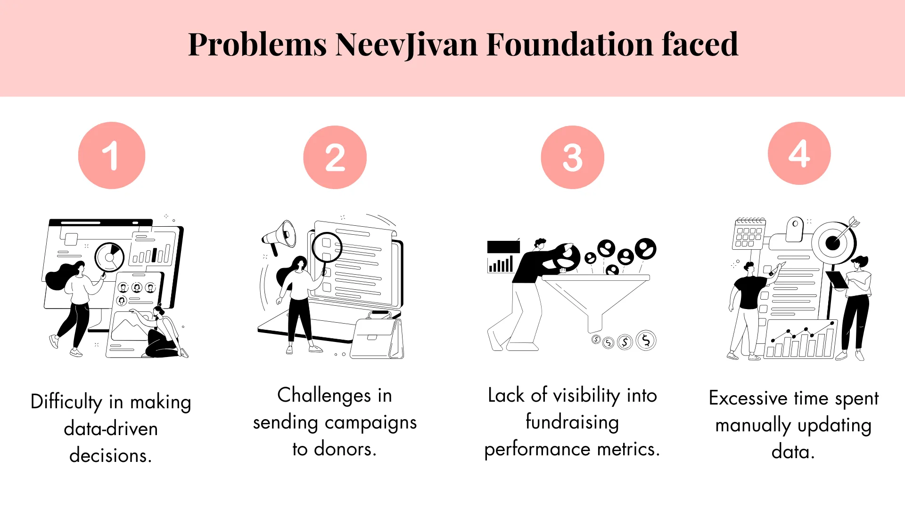
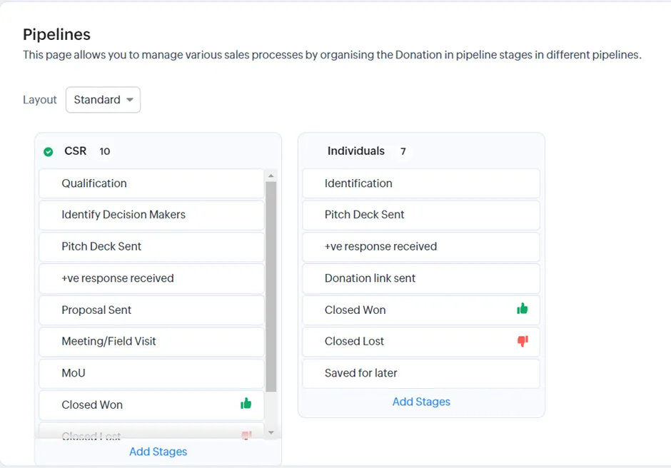
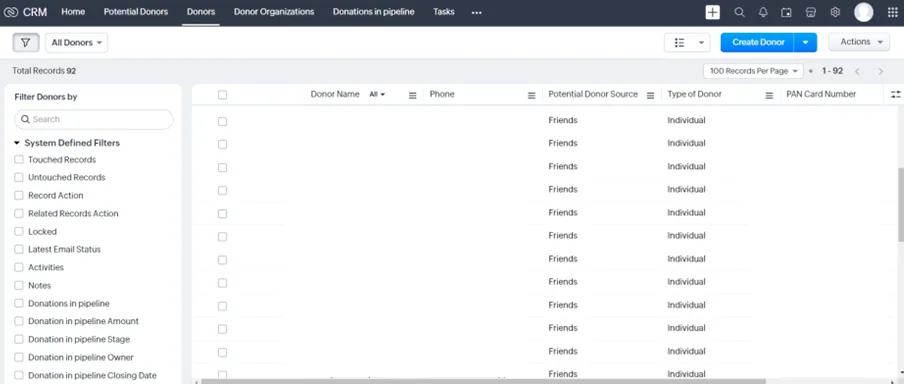
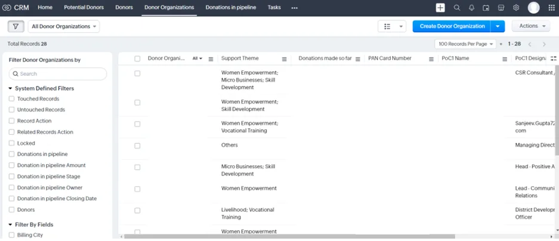
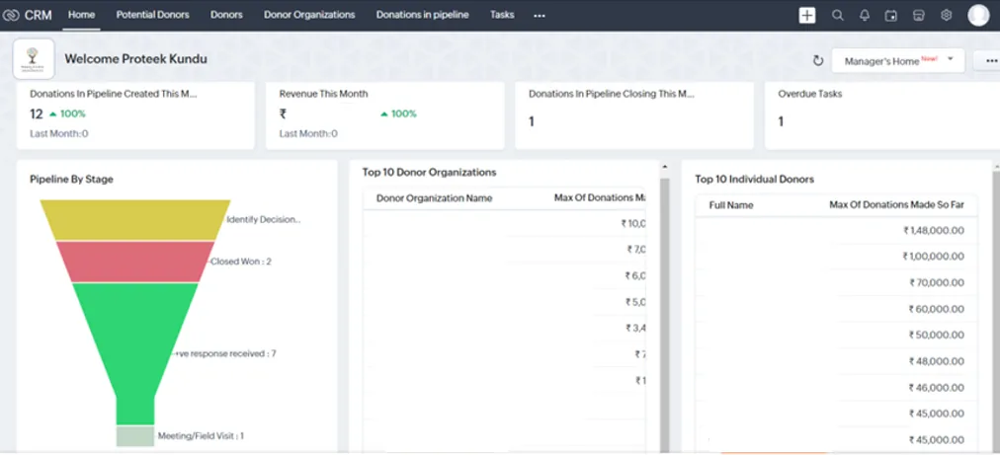
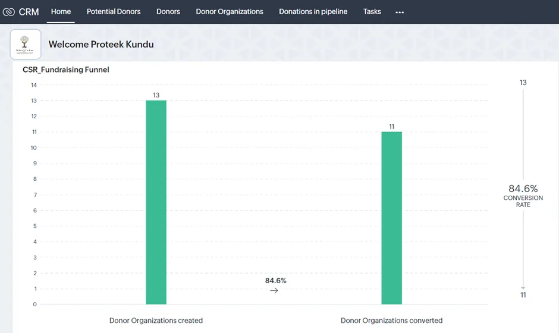
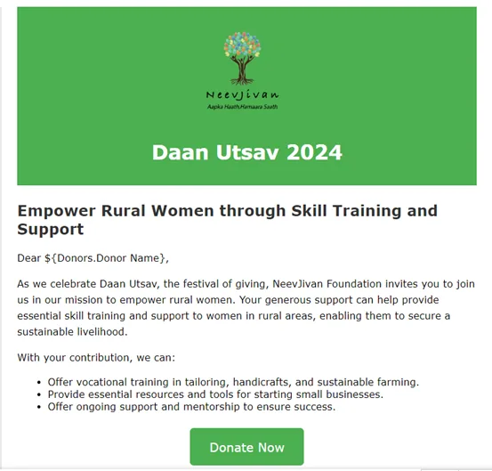
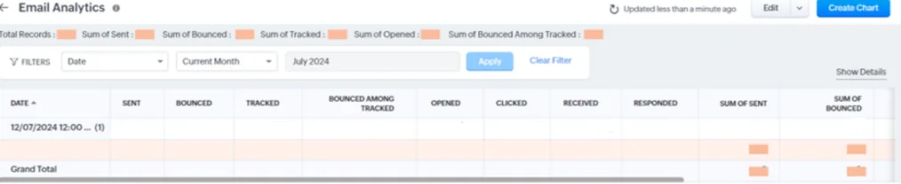
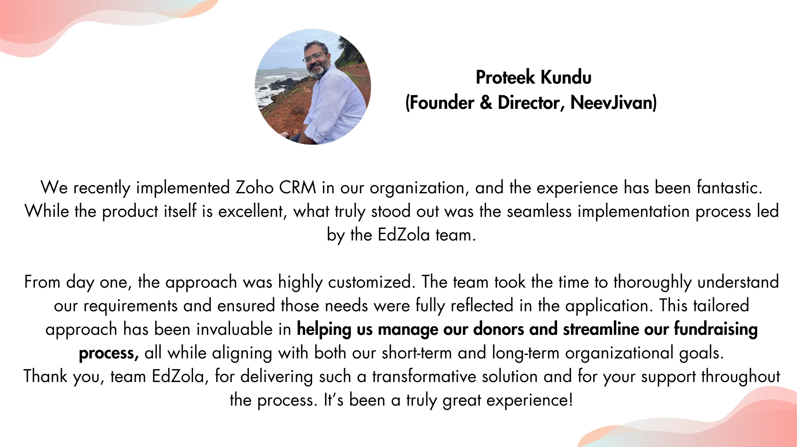

## Read how the NeevJivan Foundation optimized their fundraising process and donor management system to enhance data-driven decision-making using Zoho CRM

|  |
| --- |
| **Key Information**  Time taken for the project - 2 months  Results - Saved nearly 50 hours per month by streamlining donor data management, reducing targeted campaign time, and minimizing manual data analysis. |

## Key indicators

- [Challenges NeevJivan Foundation faced](#viewer-oelug16907)
- [What problems did it cause?](#viewer-bzgwd167)
- [Solution overview:](#viewer-gdfu2185) [Highlights of the](#viewer-gdfu2185) [donor management system](#viewer-gdfu2185)[build with Zoho CRM](#viewer-gdfu2185)
    [-](#viewer-w0q44204) Streamlined Fundraising process for Individual and CSR donors
    [-](#viewer-4psav227) Well-Organized Donor Data with Different Modules for Stakeholders
   [-](#viewer-pqy1f256) Hassle-free analytics dashboard that gives insights on crucial metrics to make data-driven decisions 
   [-](#viewer-kwfb2267) Targeted Email Campaigns with Analytics for Enhanced Donor Engagement
- [Tips for NGOs who are looking to implement similar solutions](#viewer-ihi0s307)
- [Impact metrics they track](#viewer-c316m81265)

## Challenges NeevJivan Foundation faced

- Lack of a defined fundraising process for CSR and individual donors, making it difficult to analyze each stage and determine what was working and what wasn't.
- Inadequate visibility into crucial fundraising metrics, such as conversion rates, key donors, engagement rates, and donation cycle duration.
- Scattered donor data hindered decision-makers from identifying problem areas and making informed, data-driven decisions.
- Sending targeted campaigns to donors and potential donors was expensive, time-consuming, and inefficient.

## What problems did it cause?

- Difficulty in making data-driven decisions.
- Excessive time spent manually updating data.
- Lack of visibility into fundraising performance metrics.
- Challenges in sending campaigns to donors.

## Solution overview: Highlights of the donor management system build with Zoho CRM

To solve these issues, we suggested setting up Zoho CRM as their Donor Management system, which is cost-efficient and highly customizable for unique use cases of Non-profit requirements. The platform was aimed to become the one-stop solution for all the above-mentioned challenges.

### The Process:

> ***Requirement analysis  → Streamlining the fundraising process → CRM configuration → Analytics and Dashboards***

### **1. Streamlined Fundraising process for Individual and CSR donors**

We Implemented a stage-by-stage pipeline for both CSR and individual donors, bringing clarity and structure to their fundraising process. This pipeline broke down the donor journey into distinct stages, from initial outreach to final donation, allowing the foundation to track progress, measure effectiveness, and identify bottlenecks. By analyzing how long donors remained in each stage, they could optimize their efforts and shorten the donation cycle. Additionally, separate pipelines for CSR and individual donors provided insights into which type of donor required more resources and helped inform future fundraising strategies for greater efficiency.

*Image1: Stage by stage pipeline for CSR and Individuals*

### **2. Well-Organized Donor Data with Different Modules for Stakeholders**

We created separate modules within Zoho CRM for different stakeholder groups, including potential donors, existing donors, and donor organizations, enabling better management of donor data. This modular approach allowed all relevant information to be stored and accessed in one centralized system, ensuring efficiency and reducing data duplication. By categorizing donors based on their status and type, we helped tailor engagement strategies and improve tracking of interactions. This organization also streamlined reporting, providing quick access to insights on different donor categories and enhancing the foundation’s ability to make informed, data-driven decisions.

*Image2:* *Donor information module*

*Image 3: Donor information according to their organization*

### **3. Hassle-free analytics dashboard that gives insights on crucial metrics to make data-driven decisions**

The system provided clear insights into top donors across various categories, allowing NeevJivan Foundation to monitor stage-wise donations in the pipeline and access real-time visualized data on key performance indicators (KPIs) directly through the dashboard. By tracking conversion rates for different fundraising categories, such as CSR and individual donors, the foundation gained a deeper understanding of the effectiveness of each fundraising process, enabling them to make more informed, data-driven decisions to optimize their strategies.

*Image 4: Donation analytics dashboards for organzations and individuals.*

*Image 5: Conversion rate analytics based on organization*

### **4. Targeted Email Campaigns with Analytics for Enhanced Donor Engagement**

Using Zoho CRM and our AI prompt guide, NeevJivan Foundation was able to create dynamic and visually appealing email templates with just a few clicks, eliminating the need for a graphic designer. This streamlined the process of designing and launching targeted email campaigns, making it faster and more efficient. Additionally, the CRM enabled them to track key donor engagement metrics—such as open rates, click-through rates, and response rates—directly within the system, without relying on external tools or trackable links. This seamless integration allowed them to monitor campaign performance in real-time, adjust their strategies accordingly, and enhance donor engagement without added complexity or cost.

Image 6: *Email campaign template*

Image 7: *Email analytics report*

## Tips for NGOs who are looking to implement similar solutions:

### Pitfalls that they might encounter and how to overcome them

My advice to other NGOs is that the Zoho CRM is a very simple and easy to use tool to manage your donor database and the pipeline of donations. It brings a structured approach to your fundraising activity and helps you plan your fundraising work and align the same to the mid and long term requirements of your organization.

**-*****Proteek Kundu, NeevJivan Foundation***

## Impact metrics they track

- Real-time visibility on conversion rates for CSR and individual donors.
- Visibility of the average fundraising cycle duration, along with stage history, helps understand the bottlenecks in the fundraising process. This will eventually lead to setting up a robust process with a reduced duration.
- Visibility on donor engagement metrics within Zoho CRM without the need for any expensive tool.
- Saved almost “50” hours every month in the following tasks, which can now be utilized for critical tasks:

  -Donor data collection and management from multiple sources

  -Sending out targeted campaigns has been reduced

  -Manually analyzing data has been reduced

## What does Proteek kundu, Founder and Director of NeevJivan Foundation, say about us?

## More about the organization

[**NeevJivan Foundation**](https://neevjivan.org/) empowers rural communities in India through skill development, education, and sustainable livelihood initiatives. Their focus includes vocational training for women to achieve financial independence, providing better learning opportunities for children and youth, and promoting health and wellness. Their holistic approach fosters self-reliance and sustainable growth, ensuring lasting positive change in rural areas.

Are you facing similar challenge and would like to implement a similar solution for your organization?

[Connect with us](https://www.edzola.com/contact)
