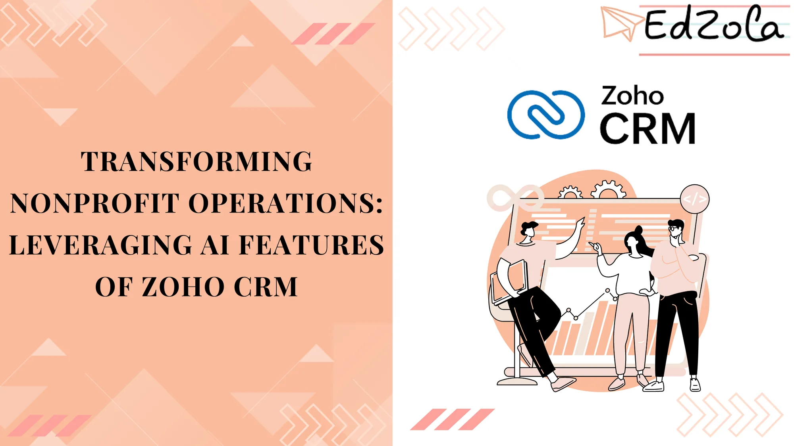
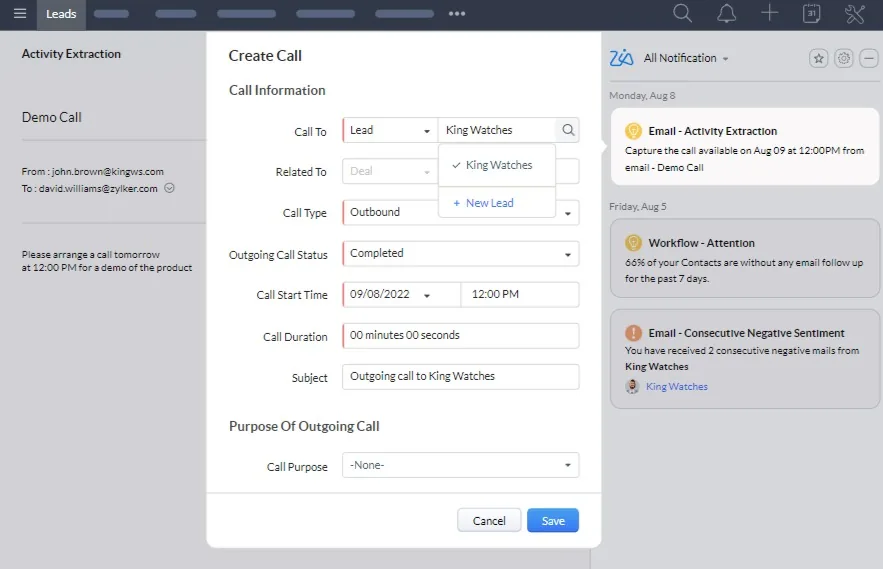
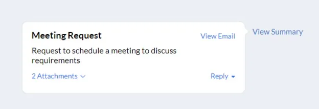
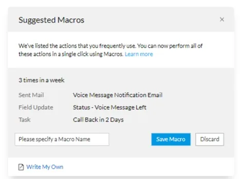
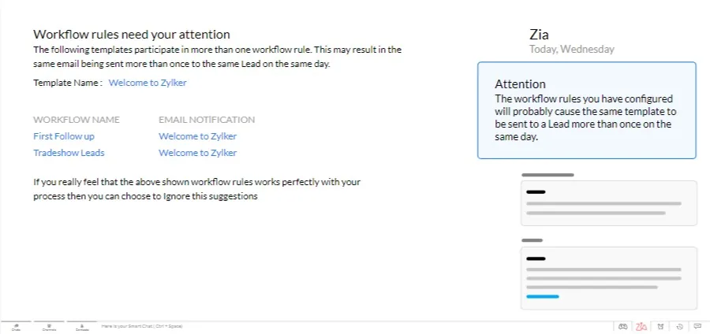
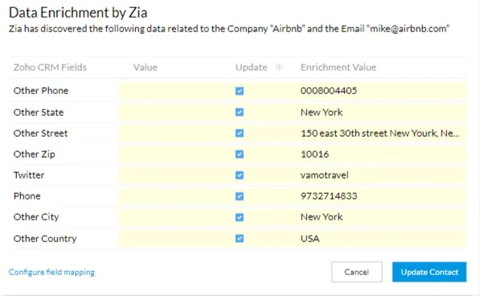
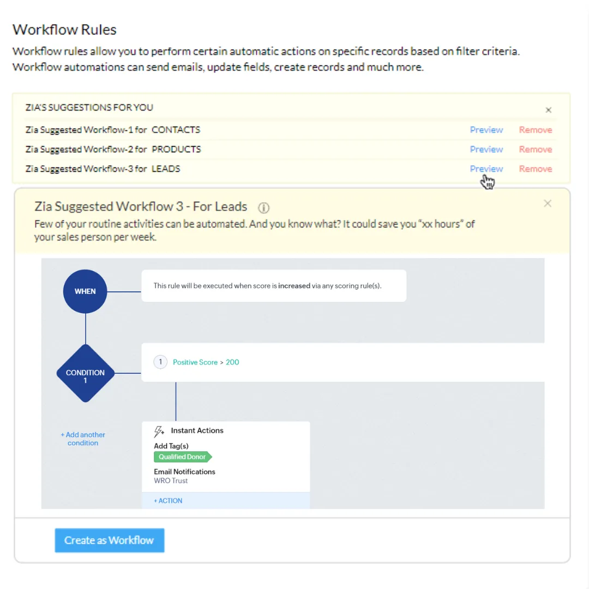

In the nonprofit sector, leveraging existing software systems is key to decreasing manual tasks, improving workflows, and boosting overall efficiency. Many NGOs, however, find it challenging to adapt and update their software tools to align with the latest advancements. In this blog post, we will delve into how nonprofits can effectively utilize the existing features of software platforms like Zoho CRM. By maximizing these tools, NGOs can enhance their operational efficiency and amplify their impact, overcoming common technological hurdles.

## Importance of Using Advanced Zoho CRM Features

For NGOs, tapping into the full potential of existing Zoho CRM features can transform their operations. This system offers more than mere contact management; it includes **AI-driven tools that can enrich data, automate repetitive tasks, streamline communications, and provide deep insights. By fully utilizing these capabilities, NGOs can enhance their operational efficiency, build stronger relationships with donors, deliver programs more effectively, and achieve sustainable growth.** This approach not only helps in keeping pace with technological advancements but also maximizes the impact of their existing resources.

[Explore Zoho CRM](https://edzola.com/zoho-products/zoho-crm)

## 1. Email Powered By AI - Zia

Leveraging the power of AI, Zoho CRM's Zia revolutionizes email interactions for nonprofits, offering a seamless solution to enrich CRM data effortlessly and engage with stakeholders effectively. By **automatically extracting vital contact information and analyzing email sentiments, Zia empowers NGOs to prioritize engagement, address concerns promptly, and foster stronger relationships with donors and partners.**

### Turn Emails into Events

Zia's ability to capture and sync important events mentioned in emails with the CRM calendar ensures that crucial activities such as calls, tasks, or meetings are not overlooked, facilitating timely follow-ups and task management.

### Understand the Essence of Emails in a Single Line

NGOs often receive a large influx of emails, ranging from donor inquiries to volunteer coordination. With **Zia's capability to summarize emails in a single line, NGO staff can quickly grasp the purpose of each message without the need to read through lengthy content.** This feature saves valuable time and ensures that critical emails are addressed promptly, enhancing efficiency in communication management.

## 2. Automate Repetitive Actions with Zia

NGO teams frequently encounter repetitive tasks in their day-to-day operations, such as **sending follow-up emails or updating contact information. Zia's observation of sales activities and identification of patterns enable personalized macro suggestions to automate these tasks.** By automating repetitive actions, nonprofits can streamline processes, reduce manual effort, and allocate more time to focus on impactful initiatives and programs.

### Let Zia Take Care of Busywork

Managing donor interactions and follow-up tasks can be time-consuming for nonprofit staff. **Zia's ability to learn from routine tasks enables the automation of busywork, such as updating contact statuses or scheduling follow-up calls.** By delegating these tasks to Zia, NGO teams can focus on building meaningful relationships with donors and stakeholders, enhancing engagement and support for their cause.

### Safety Checks in Automation Workflows

In the fast-paced environment of nonprofit operations, avoiding mistakes is crucial to maintaining credibility and trust with donors and supporters. **Zia acts as a safety check in by calculating the efficiency of workflows and alerting users to potential errors, such as sending duplicate emails.** This feature ensures that nonprofits maintain professionalism in their communication efforts and avoid costly mistakes that could impact donor relationships.

## 3. Data Enrichment

Maintaining accurate and up-to-date CRM records can be challenging for NGOs with limited resources. Zoho CRM's Zia AI assistant can revolutionize data enrichment for nonprofits, With provided information such as email, name and empowering them to **create comprehensive donor profiles, eliminate incomplete records, and customize data mapping to better serve their mission.**

### Populate Your CRM Records with Zia

###

For NGOs, understanding donor preferences and engagement history is essential for cultivating meaningful relationships. **Zia simplifies the process of data enrichment by automatically sourcing additional information on leads and donors from online sources based on minimal input.** With Zia's assistance, NGOs can create comprehensive donor profiles with a deeper understanding of their supporters' interests, preferences, and engagement history, facilitating personalized communication and targeted outreach efforts.

### No More Incomplete Profiles

Incomplete CRM profiles can hinder NGOs ability to effectively engage donors and stakeholders. **Zia addresses this challenge by crawling for information based on provided email addresses, account names, or websites and filling in the remaining fields. NGOs can choose to accept relevant data and discard irrelevant information, ensuring that CRM records are comprehensive, up-to-date, and actionable.** With Zia's proactive notification system, nonprofits can stay informed about new data updates, ensuring that their donor profiles remain accurate and relevant over time.

## 4. Workflow Automation

Identifying and implementing effective workflows can be challenging for NGOs with limited resources. Zoho CRM's Zia AI assistant can transform workflow management for NGOs, enabling them to identify patterns, suggest pre-built workflows, and streamline their operations to focus on their mission-driven work.

### Zia Finds Patterns and Suggests Workflows

NGOs often grapple with repetitive tasks and complex processes in their day-to-day operations. **Zia simplifies workflow management by analyzing audit logs and activity history to identify patterns in data and suggest pre-built workflows tailored to NGOs' specific needs.** Whether it's managing donor communications, processing donations, or tracking program outcomes, **Zia's intelligent algorithms identify inefficiencies and suggest automated workflows to streamline processes and save valuable time for nonprofit staff.**

### Customize Workflows to Suit Your NGO's Needs

Every NGOs operates differently, with unique goals, processes, and challenges. Zoho CRM's Zia AI assistant offers the flexibility for NGOs to customize suggested workflows to align with their specific requirements. **Nonprofits can choose to deploy suggested workflows immediately or edit them as needed, ensuring that workflows are tailored to their unique organizational structure and operational workflows.** By customizing workflows, NGOs can optimize efficiency, improve collaboration, and focus on driving impact in their communities.

### Focus on Mission Impact

For NGOs, time and resources are precious commodities that must be used strategically to advance their mission goals. By leveraging Zia's workflow suggestions, NGOs can streamline their operations, reduce manual effort, and empower their staff to focus on high-impact activities such as fundraising, program delivery, and advocacy. With Zia's support, NGOs teams can optimize their workflows, enhance productivity, and achieve greater impact in their communities.

Explore More Features: [Zoho CRM with AI assistant Zia](https://www.zoho.com/crm/zia.html?source_from=crm-header)

In conclusion, the integration of Zoho CRM's advanced features offers nonprofit organizations a transformative solution to overcome operational challenges and achieve greater impact. By harnessing the power of AI-driven functionalities, NGOs can streamline processes, enrich data, and enhance communication to strengthen donor relationships and drive organizational growth. From email automation to workflow optimization and anomaly detection, Zoho CRM's tailored solutions empower nonprofits to navigate the complexities of their operations with confidence and efficiency. With Zia as a trusted ally, NGOs can focus their efforts on advancing their mission objectives, making a meaningful difference in their communities, and creating a brighter future for those they serve.

[Explore Zoho CRM](https://edzola.com/zoho-products/zoho-crm)

## Getting Started with EdZola

> ***Where technology becomes a force for good, amplifying human potential and fostering global progress.***

Nonprofits need customized solutions to meet their specific requirements, particularly in areas of data and fundraising platforms. At [EdZola](https://www.edzola.com/), we specialize in creating customized solutions that align with your organization’s specific goals and needs. Our team works closely with you to identify pain points, develop a tailored plan, and implement the right tools to maximize your impact.

[Let's Connect](https://www.edzola.com/contact)
