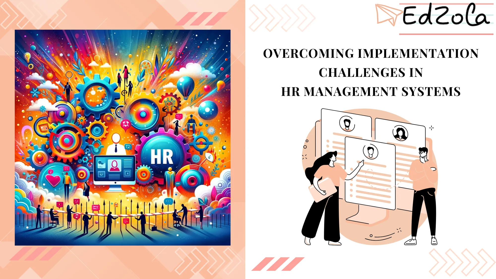

Human resources (HR) management systems have become an integral part of organizations, helping them streamline their HR processes and enhance overall operational efficiency. However, implementing these systems is not without its challenges. Organizations often face hurdles when it comes to adopting and integrating HR management systems effectively. In this article, we will explore the importance of HR management systems, identify common implementation challenges, discuss strategies for overcoming these challenges, and delve into evaluating the success of HR system implementation.

## Understanding the Importance of HR Management Systems

HR management systems play a crucial role in businesses, empowering organizations to efficiently manage their **workforce, track employee information, and streamline core HR processes such as payroll, benefits administration, and performance management.** These systems not only automate time-consuming tasks but also provide real-time insights into employee data, enabling HR professionals to make informed decisions and allocate resources effectively.

### The Role of HR Management Systems in Nonprofits

Effective HR management systems act as a centralized hub, consolidating employee data and ensuring data integrity, security, and accessibility. By **digitizing and standardizing HR processes, organizations can improve data accuracy, eliminate manual errors, and enhance compliance with labor laws and regulations.** Moreover, these systems facilitate employee self-service, empowering individuals to update their personal information, view pay statements, and request time off effortlessly.

Probe further: [The Ultimate Guide to HRMS for Non-Profits: Streamlining HR Processes with Zoho People](https://www.edzola.com/post/the-ultimate-guide-to-hrms-for-non-profits-streamlining-hr-processes-with-zoho-people)

### Key Features of Effective HR Management Systems

The market is flooded with various HR management systems, each offering different functionalities. However, the key features that distinguish effective systems include robust **applicant tracking, performance management, employee onboarding, and document management capabilities.** These features not only streamline the entire employee lifecycle but also foster collaboration, automate routine tasks, and enhance employee engagement.

## Identifying Common Implementation Challenges

Despite the numerous benefits of HR management systems, organizations often encounter obstacles when implementing them. Understanding these challenges is vital to overcoming them and ensuring successful adoption and integration.

### Technical Difficulties in HR System Implementation

One of the most common challenges organizations face during implementation is technical difficulties. Integrating an HR management system often involves complex software installations, data migration, and integration with existing systems. These technical hurdles can cause delays, system compatibility issues, and potential data loss. To mitigate these challenges, organizations need experienced IT professionals who can navigate the implementation process effectively and ensure a seamless transition. Now that we have explored the unique challenges faced by non-profits and the benefits of using Zoho People, let's dive deeper into how Zoho People can streamline HR processes for non-profits. Simplify your HR process with Zoho people with a **30-day free trial**.

[Explore Zoho People](https://www.edzola.com/zoho-products/zoho-people)

### Resistance to Change in HR Management

A significant challenge in implementing HR management systems is the resistance to change among employees. Transitioning from manual processes to a digital system requires organizations to educate and train employees on the benefits and functionality of the new system. Resistance to change can stem from fear of job displacement or unfamiliarity with technology. To overcome this challenge, organizations must invest in comprehensive user training, provide ongoing support, and communicate effectively, highlighting how the new system will simplify and enhance their day-to-day work.

### Budget Constraints and Cost-Effectiveness Concerns

Another challenge organizations face during implementation is budget constraints and cost-effectiveness concerns. Implementing an efficient HR management system often involves substantial upfront investment and ongoing maintenance costs. Organizations must carefully evaluate their budgeting capabilities and ensure the selected system aligns with their long-term goals, offers scalable solutions, and provides a good return on investment.

Dig Deeper: [How can small nonprofits be successful in strategic human resources management?](https://lodestar.asu.edu/blog/2022/07/how-can-small-nonprofits-be-successful-strategic-human-resources-management)

## Strategies for Overcoming Implementation Challenges

While the challenges of implementing HR management systems can be daunting, organizations can employ various strategies to overcome them and maximize the potential benefits of these systems.

### Ensuring Adequate Training and Support

Providing comprehensive training to employees is essential for successful system implementation. Organizations should **design training programs that cater to different learning styles and create user-friendly training resources, such as video tutorials and user manuals.** Additionally, offering ongoing support through dedicated help desks or forums can address any queries or concerns promptly, ensuring a smoother transition for all employees.

### Communicating the Benefits of the New System

To overcome resistance to change, organizations must effectively communicate the benefits of the new HR management system to employees. Highlighting how the system will simplify processes, reduce administrative burdens, and enhance employee experience can alleviate concerns and generate enthusiasm. Utilizing internal communication channels, such as email newsletters, intranets, and team meetings, allows organizations to convey the advantages of the new system and address any hesitations or misconceptions employees may have.

### Planning for a Gradual Implementation Process

Rather than implementing the new system in one abrupt change, organizations may opt for a gradual implementation process. This approach allows organizations to phase in the system, starting with one department or a specific module, and gradually expanding to other areas. By incorporating feedback from early adopters and continuously optimizing the system based on their input, organizations can identify and address any issues before full implementation, ensuring a smoother transition for all employees.

## Evaluating the Success of HR System Implementation

Once the HR management system is implemented, organizations must evaluate its effectiveness and measure its impact on business operations. This evaluation is crucial for continuous improvement, driving user adoption, and maximizing the return on investment.

### Key Performance Indicators for HR Systems

Measuring key performance indicators (KPIs) can provide valuable insights into the system's performance and identify areas for improvement. **KPIs may include employee satisfaction, recruitment and retention rates, time saved on manual processes, and data accuracy.** By tracking these metrics, organizations can demonstrate the value of the HR management system and make data-driven decisions.

### Feedback and Continuous Improvement in HR Systems

Collecting feedback from stakeholders is essential for the continuous improvement of HR systems. Organizations should establish channels, such as surveys or feedback sessions, to gather user input and identify areas for enhancement. Utilizing agile principles, organizations can prioritize system updates based on user feedback and ensure that the system evolves to meet the ever-changing needs of the organization.

### The Long-Term Impact of Successful Implementation

A successful HR system implementation can have a long-lasting impact on organizations. By **streamlining HR processes, organizations can allocate more time and resources to strategic initiatives, promote employee engagement and job satisfaction, and gain a competitive edge in attracting and retaining talent.** Investing in a robust HR management system and overcoming implementation challenges sets a solid foundation for long-term growth and success.

Explore more: [Nonprofit Human Resources Demystified: Your Ultimate Guide](https://astronsolutions.net/nonprofit-hr/#responsibilities)

In conclusion, while implementing HR management systems can present challenges, organizations can navigate these hurdles and reap the benefits by prioritizing user training and support, effectively communicating the advantages of the new system, and adopting a gradual implementation approach. By evaluating the system's success and continuously improving based on feedback, organizations can optimize their HR operations, drive employee satisfaction, and achieve their strategic goals. Embracing HR management system implementation is essential for organizations striving to stay ahead in the digital age of business.

## Getting Started with EdZola

> ***Let's innovate with purpose and use technology as a force for good.***

Every nonprofit is unique, and one size does not fit all when it comes to data solutions. At [EdZola](https://www.edzola.com/), we specialize in creating customized solutions that align with your organization’s specific goals and needs. Our team works closely with you to identify pain points, develop a tailored plan, and implement the right tools to maximize your impact.

[Let's Connect](https://www.edzola.com/contact)
