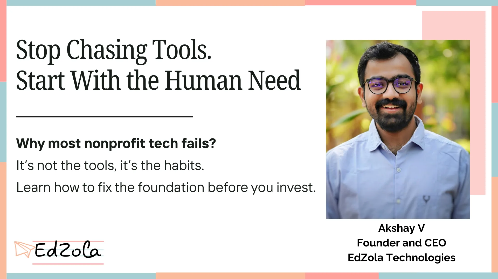

If you work in the nonprofit space, you’ve probably said something like this:

> ***“We need a CRM—our donor tracking is all over the place.”***
>
> ***“We can’t manage programs without a centralized system.”***
>
> ***“There must be a better way to run our community digitally.”***

We hear it all the time at EdZola.

The instinct makes sense. When things feel broken, we look for a tech solution—fast.

But here’s the truth:

**A Data management system or CRM won’t fix broken workflows. It will only amplify what’s already happening.**And if what's happening is chaos, the tool just adds another layer to the mess.

## The Pain We See (And You May Be Feeling)

- You’ve invested in a **CRM or MIS**, but it’s barely used.
- Donor data lives in scattered spreadsheets, inboxes and staff memory.
- Reports take days—not because they’re hard, but because data is outdated or incomplete.
- Teams are juggling tools with no clear process connecting them.
- And worst of all, your team is tired of learning one more tool that promises change and delivers confusion.

This is not a technology problem. It’s a behaviour and process problem. And tools alone won’t fix that.

## A Better Way to Think About Tech for Nonprofits

At EdZola, we flipped the question.

Instead of asking **“What tech tool do you need?”**,

we now ask:

**“What daily behaviour do you want the tool to scale?”**

To help organizations unpack this, we created a simple model called the **Tech Hierarchy of Needs**—inspired by Maslow’s pyramid, but built for digital transformation in nonprofits.

## Tech Hierarchy of Needs for Nonprofits

|  |  |  |
| --- | --- | --- |
| **Layer** | **Human Need** | **Ask Yourself...** |
| **Foundational** | Connect • Coordinate • Transact | Are staff talking to the right people at the right time? Are approvals, payments, or donor hand-offs getting lost in inboxes? |
| **Functional** | Know • Decide • Remember | Is data captured once and reused across systems? Are people working off live, accurate data—or outdated versions in email threads? |
| **Relational** | Nurture • Learn • Belong | Are we deepening relationships with donors, volunteers, and staff? Are we investing in learning and shared knowledge? |
| **Ethical / Secure** | Protect | Do our nonprofit data security practices respect privacy and consent? Would we feel proud explaining them to the communities we serve? |

Each layer builds on the one below it. Dashboards don’t matter if your team can’t even coordinate tasks reliably.

## Before You Buy That Tool, Try This:

Whether you're considering a **nonprofit CRM implementation** or a new **community engagement platform**, pause and reflect:

**1.Observe your current workflows :**
What are people already doing—manually or in makeshift ways? If outreach only happens occasionally, don’t expect a CRM to change that overnight.

**2.Start at the base of the pyramid :**
Fix coordination before focusing on dashboards or automation.

**3.Prototype with what you have :**
A shared spreadsheet can reveal whether there's a real need for an MIS. A WhatsApp group can test community interaction before you invest in a custom portal.

**4.Let tech amplify, not initiate :**
Tools don’t build habits. People do.

**5.Revisit data ethics often :**
Responsible, consent-driven data handling is not an afterthought. It’s part of your relationship with the people you serve.

## One Question That Changes Everything

**When was the last time your team practised the behaviour this software is meant to scale?**

If the answer is “rarely,” don’t rush the purchase.

> Build the habit first. Then bring in technology to amplify what’s already working.

**Want to dig deeper into your organization’s Tech Hierarchy of Needs?**

We’ve helped nonprofits validate needs using simple tools like Google Sheets before committing to complex platforms.

[Connect with us](https://www.edzola.com/contact)
