## Read how TAP India Foundation streamlined their central program management system to enhance data-driven decision-making using Zoho Creator

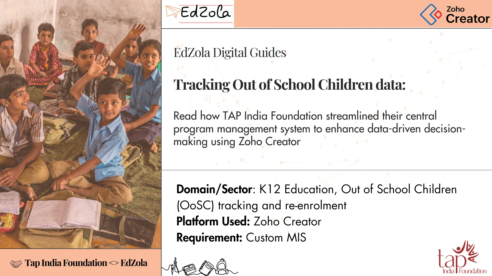

|  |
| --- |
| **Key Information**  Time taken for the project - 8 months  Results - They are managing more than 16K students and the number is growing |

## Key indicators

- [Challenges TAP India Foundation faced](#viewer-5982y114)
- [What problems did it cause?](#viewer-bzgwd167)
- [Solution overview: Highlights of the central Program Management System built with Zoho Creator](#viewer-gdfu2185)
    [- Different modules for different stages](#viewer-w0q44204)
    [- User profile configurations for accessibility](#viewer-4psav227)
   [- Aggregated dashboards for different stakeholders](#viewer-pqy1f256)
   [- Supplementary program needs](#viewer-kwfb2267)
- [Tips for NGOs who are looking to implement similar solutions](#viewer-ihi0s307)
- [Impact metrics they track](#viewer-c316m81265)

## Challenges TAP India Foundation faced

The scattered student data hindered the decision makers from having proper visibility into the program data and therefore they faced issues in identifying problem areas and making data-driven decisions.

## The four stages are as follows:

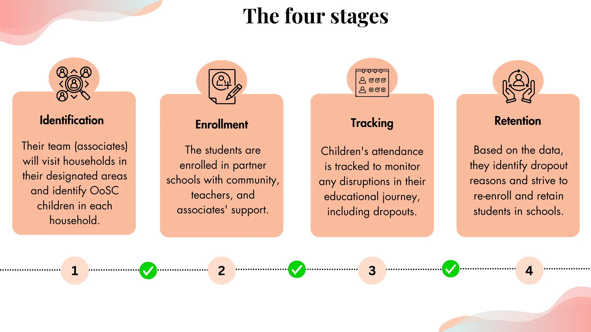

- **Identification**

Their team (associates) will visit households in their designated areas and identify OoSC children in each household.

- **Enrollment**

The students are then enrolled in their partner schools with the help of community, teachers and associates.

- **Tracking**

All these children’s attendance are tracked, so that they know whenever a disruption happens in the student journey, which is dropping out again.

- **Retention**

Based on the above data, they identify the reason behind dropping out and try to re-enroll and retain them in schools.

### The major issues that they faced were related with:

**Multi-stage program**

As mentioned above, their program has various stages to increase OoSc enrolment & also includes regularization of enrolled but not attended children. Each stage has unique processes. Within that, there are many data touchpoints involving various stakeholders, which means a lot of data collection forms are involved. All this humongous data, not only posed an issue for tracking, it was also hard to store and manage them properly for later use.

**Data aggregation based on multiple parameters:**

They needed to track their data using various parameters, such as

- What is the student dropout rate at a village or district level?
- How many of them have been re-enrolled?
- What is the reason a particular area’s children are unable to pursue their education? And many more.

Proper data aggregation had to be done in order to be able to communicate impact to stakeholders with the data. This requires a lot of charts (dashboards) with various combinations of data points. And with a lack of systems for such detailed analysis, it slowly became difficult to derive any insights into various data pointers. 

**Stakeholders management:**

In addition to that, many stakeholders have to be involved in the main platform. There were senior level managers who needed to monitor and evaluate the program impact, followed by associates who took care of the ground work throughout the processes (from identification to retention). In addition to that, students and partners' data have to be maintained within the same platform. So, with such a diverse set of users and non-users\*, the stakeholder data maintenance was hard to do and so was managing data accessibility.

*\*People who don’t directly use the data but are important - students, fo**r instance*

## What problems did it cause?

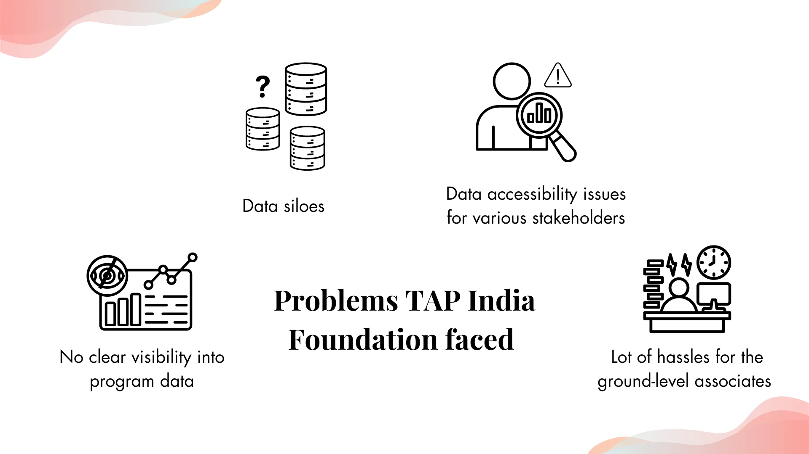

- Inability to have clear visibility into program data for the decision makers
- Too many disconnected forms and data silos
- Lot of hassles for the ground-level associates
- Data accessibility issues for various stakeholders

## Solution overview: Highlights of the central Program Management System built with Zoho Creator

To solve these issues, we suggested the low-code application development platform Zoho Creator, which is very cost-efficient and gives 10x faster turnover than traditional development methods. The platform was aimed to become the one-stop solution for all the above mentioned challenges.

### The Process:

> ***Requirement analysis → Platform evaluation → License Purchase → Solution architecture → User profiles configuration → Forms & Workflow Building → Reports and Dashboards → Additional program needs → App delivery → Support and maintenance***

### 1.Different modules for different stages

The most important breakdown of data was done at the program level. And, in order to manage the extensive stages of the program, the app is designed in a way that each module belongs to one stage of the program. This enabled the program heads to have an overview of stages of their beneficiary easily.

Below is a sample of identification module - *The report of all identified students*

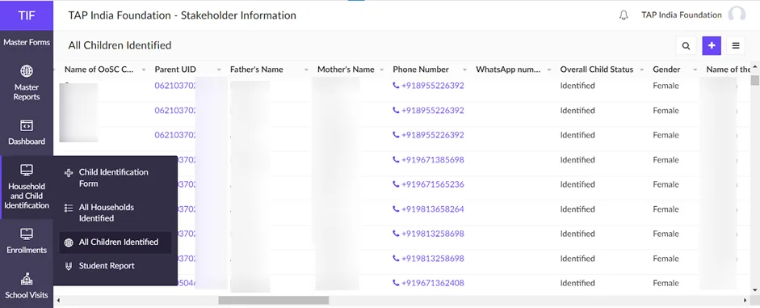

*Enrolment module - A dashboard for enrolment data on partner level - No.of students enrolled by each partner organizations*

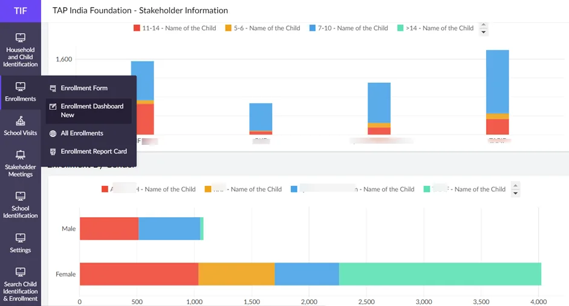

*Attendance tracking for retaining the enrolled out of school children*

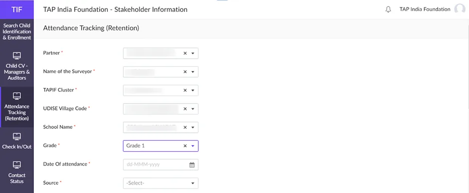
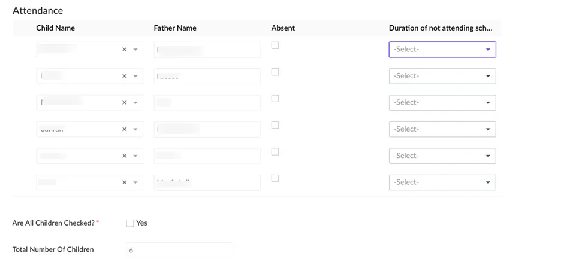

### 2.User profile configurations for accessibility

Not everyone involved in the program will need access to all the data. That gives rise to both data security issues and the risk of overwhelming people with unnecessary data. This is where controlled accessibility comes into play. And we build ‘profiles’ where we add the types of stakeholders and configure the systems to limit the accessibility to the data and reports.

In their case, multiple users had to use the platform, which included

1. Managers - who oversaw the program’s efficiency and decision makers.
2. Associates - who did the groundwork management.
3. Influencers - individuals who have the local expertise and assist the associates with executing the various stages of the program
4. There were partners involved in their programs and for them the accessibility needs to be limited.

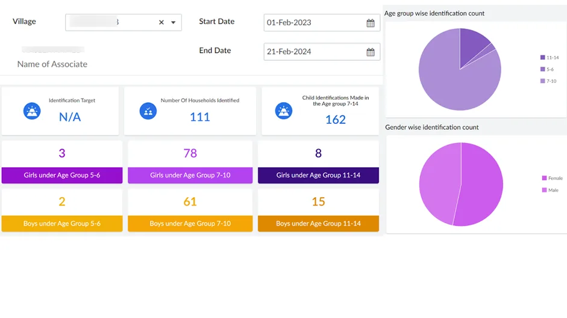

*A dashboard that only shows data of the students/programs engaged by this specific associate.*

### 3.Aggregated dashboards for different stakeholders

One of the core pain points was the inability to derive insights from various rows of collected data. When all the forms and reports were streamlined, building dashboards became a piece of cake! We understood the key data points that the decision makers needed for effective monitoring and evaluation. Based on this information, we built various dashboards that give tons of insights at just a glance. The associates also had access to their own dashboards where they could see their progress towards goals. Take a look at the samples below.

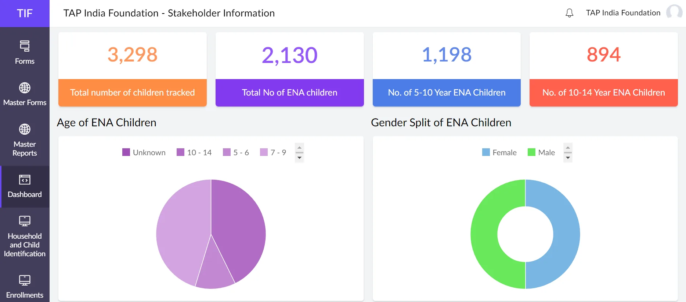
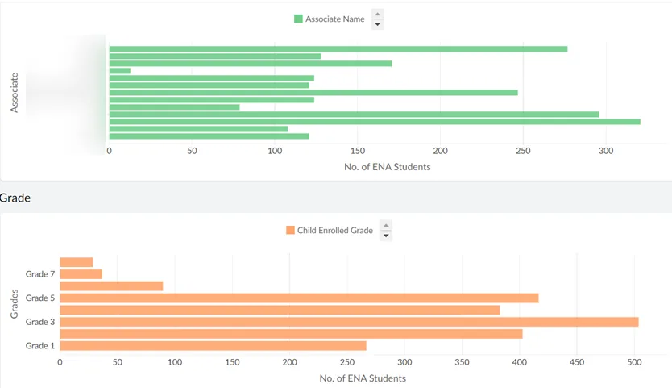

### 4.Supplementary program needs

In addition to the primary program requirements, they had many supplementary needs that had to be built within the platform.

Some of them include

1. Cross verification of collected data by TAPIF personnel
2. School visits reports
3. School identification process management
4. Automatic location registration for the associates’ attendance tracking
5. Search feature across the application for ease of access
6. Ease of collecting data of multiple children in single household (Refer image below)

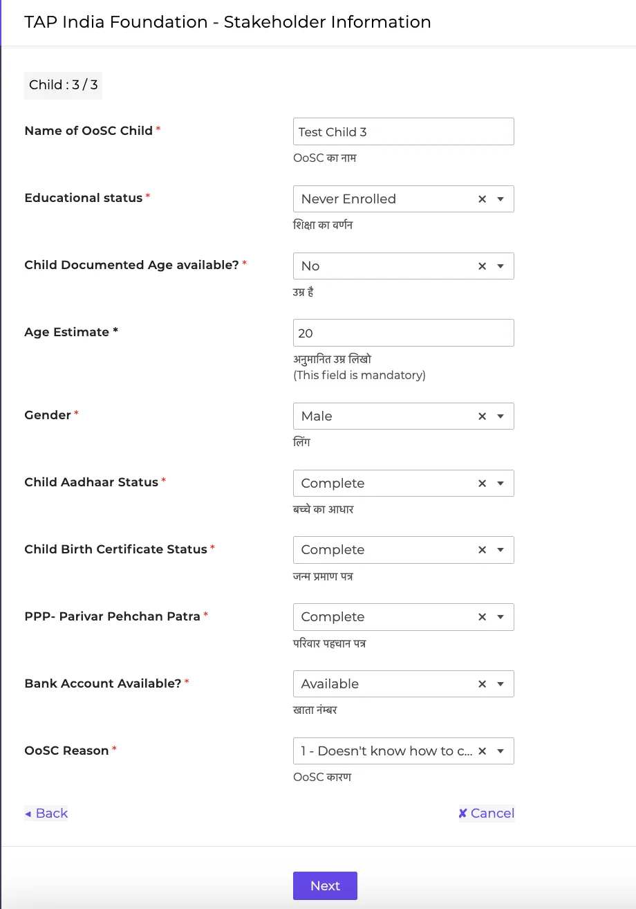

Example: If a household has three children, then three forms open within the main form to collect all the children’s data in one go.

## Tips for NGOs who are looking to implement similar solutions:

### Pitfalls that they might encounter and how to overcome them

1.**Lack of clear objective -** Define specific, measurable objectives for the technology implementation. Align these goals with the organization's mission and strategic plan. 

2. **Budgeting -** Develop a detailed budget that includes not just initial costs but also ongoing maintenance, training, and support. 

3. **Resistance to change -** Involve staff early in the process, provide comprehensive training, and highlight the benefits of the new technology to gain buy-in 

4. **Data privacy & security concerns -** Inadequate data protection measures can lead to breaches and loss of trust. 

5. Start with pilot projects to test the technology in a smaller, controlled environment before scaling up 

 **-*****Pallavi, Tap India Foundation***

## Impact metrics they track

- Reduce course correction timing
- Real time visibility
- Able to increase our efficiency and impact
- Quality assurance

## What does Pallavi Singh, CEO of TAP India Foundation, say about us?

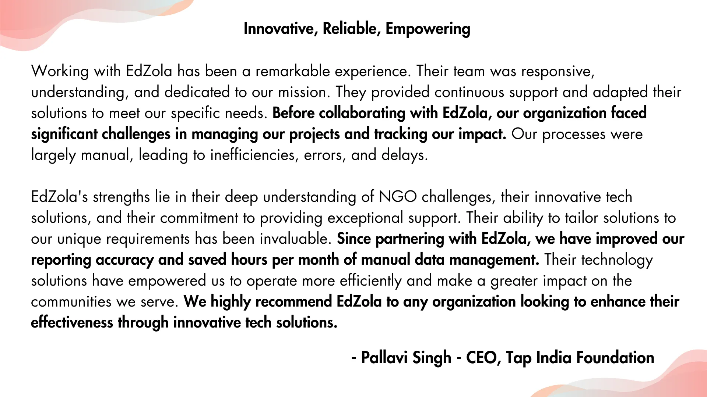

## More about organization

[**TAP India Foundation**](http://tapindia.org)was started back in 2014 with the aim of integrating 60-70% of the out-of-school children population into schools for continued learning. In order to achieve this vision they partner with network NGOs to enable Out-of-School Children aged 5-14 years old, providing sustainable access to the right to education. Their program manages all stages starting right from identifying dropped out or never enrolled children to enrolling and retaining them in schools.

Are you facing similar challenge and would like to implement a similar solution for your organization?

[Connect with us](https://www.edzola.com/contact)
