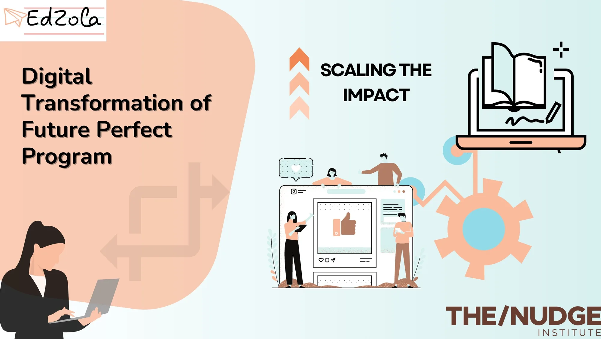

The/Nudge Institute focuses on alleviating poverty and skill development, concerning the underprivileged youth and rural livelihoods. Future Perfect program (part of The/Nudge Institute) is providing training on the most needed skills of 21st century - English and soft skills for youth from lower-income communities to make them job-ready.

They didn't want to be restrained to traditional methods of running the operations. So together with EdZola, they utilized the benefits of technology to create more impact.

This case study is about how EdZola helped them with technology to better manage admission processes, operations and much more.

[Read how they scaled their impact significantly with technology](https://www.edzola.com/the-nudge-future-perfect)
