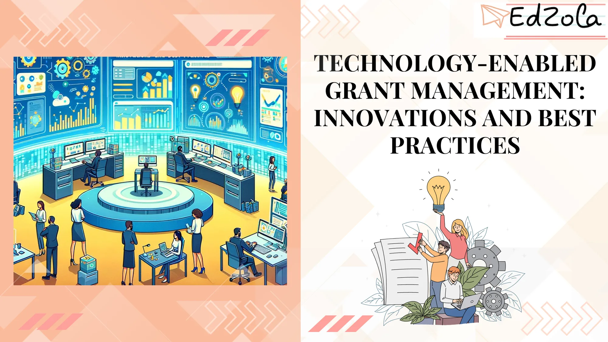

In today's digital age, technology has permeated almost every aspect of our lives, and grant management is no exception. Nonprofit organizations are constantly seeking innovative practices and technologies that can transform their grant management processes, ensuring efficiency and compliance. One such technology is low-code development platforms like Zoho Creator, which empower organizations to create custom grant management solutions without the need for extensive coding knowledge.

## **Understanding Technology-Enabled Grant Management**

Before diving into the innovations and best practices, let's first explore the concept of technology-enabled grant management. Technology-enabled grant management refers to the use of [digital tools](https://www.edzola.com/post/non-profit-tech-tips-streamlining-operations-with-digital-tools) and software solutions to streamline the various stages of the grant management lifecycle. From grant application and review to monitoring and reporting, technology plays a crucial role in enhancing efficiency and reducing administrative burdens.

> *Managing grants effectively is essential for nonprofits to fulfill their mission. However, outdated systems and manual processes can hinder their progress.*

### The Importance of Technology in Grant Management

**Efficiency** and **compliance** are two core aspects of grant management, and technology acts as a catalyst in achieving these goals. With automated workflows and centralized databases, technology enables nonprofits to streamline their grant application and review processes. This not only saves time but also ensures transparency and consistency in decision-making.

> *Nonprofits can now access real-time data, automate repetitive tasks, and ensure transparency, improving their operational efficiency and ultimately maximizing the impact of their grants.*

Moreover, technology helps nonprofits stay compliant with ever-changing regulations and reporting requirements. By leveraging advanced reporting and tracking features, organizations can easily monitor the utilization of grant funds and generate accurate reports that comply with audit standards.

> *By adopting technology-enabled approaches, nonprofits can revolutionize the way they manage their grants and focus more on their core mission**.*

**Probe further** - [Tech To The Rescue: How Nonprofits Can Simplify Grant Management](https://www.forbes.com/sites/forbestechcouncil/2023/09/20/tech-to-the-rescue-how-nonprofits-can-simplify-grant-management/?sh=57c5b3ea158f)

## **Innovations in Technology-Enabled Grant Management**

As technology continues to evolve, new innovations are emerging in the field of grant management. These innovations not only streamline processes but also enhance decision-making capabilities and overall efficiency.

### Emerging Technologies in Grant Management

Emerging technologies like **artificial intelligence** (AI) and **machine learning** are disrupting traditional grant management practices. AI-powered algorithms can analyze vast amounts of data, simplifying the review process and identifying the most deserving grant applicants. Machine learning algorithms can also help in predicting success rates and identifying potential risks, enabling grantmakers to make informed decisions.

In addition to AI and machine learning, blockchain technology is revolutionizing grant management by ensuring **transparency** and **security**. With blockchain-based platforms, grant applications and disbursements can be securely recorded and tracked, reducing the risk of fraud.

> *The use of emerging technologies like AI and blockchain in grant management holds immense potential, These technologies can streamline processes, enhance data security, and enable data-driven decision-making, ultimately benefiting both grantmakers and recipients.*

### The Role of Artificial Intelligence and Machine Learning

Artificial intelligence and machine learning technologies have become instrumental in grant management. The ability to analyze large datasets and identify patterns allows grantmakers to make data-driven decisions effectively. AI-powered chatbots can also simplify the application process for nonprofits, providing instant responses to frequently asked questions and guiding applicants through the submission process.

> *AI and machine learning can greatly improve the efficiency of grant management, These technologies can automate repetitive tasks, identify trends, and provide valuable insights, ultimately enabling nonprofits to focus more on mission-critical activities.*

## **Best Practices for Implementing Technology in Grant Management**

While embracing technology is essential for efficient grant management, it is crucial to follow [best practices](https://www.linkedin.com/pulse/best-practices-grant-management-nonprofits-queen-israel-m5pdf) during implementation to ensure optimal outcomes. Let's explore some key best practices when incorporating technology into grant management processes.

### Choosing the Right Technology for Grant Management

When selecting a technology solution for grant management, it's vital to consider the specific needs and requirements of your organization. Conduct a comprehensive assessment of your current workflows, pain points, and desired outcomes. Seek solutions that offer flexibility, customization, and scalability to accommodate your evolving needs.

> *Choosing the right technology is fundamental to successful grant management, Ensure the solution aligns with your organization's goals, integrates with existing systems, and provides robust reporting and data analysis capabilities.*

### Ensuring Data Security and Privacy

With the increasing reliance on technology, data security and privacy have become paramount concerns for nonprofits. When adopting technology-enabled grant management solutions, organizations must prioritize data protection. Encrypting data, implementing secure access controls, and regularly updating security protocols are indispensable practices in safeguarding sensitive information.

> *Nonprofits must be vigilant in protecting donor and grant recipient data, Adhering to industry best practices, such as encryption, regular audits, and staff training, is crucial to maintaining data security and privacy.*

## **The Future of Technology-Enabled Grant Management**

Technology-enabled grant management is continuously evolving, and it is essential to stay up-to-date with the latest trends and developments that shape the industry's future.

### Predicted Trends in Technology-Enabled Grant Management

Experts predict that the integration of artificial intelligence and machine learning into grant management will become even more prevalent in the coming years. AI algorithms will improve their decision-making capabilities through continuous learning and adaptation, facilitating more efficient and accurate grant evaluations.

Furthermore, there is an increasing focus on user-friendly interfaces and low-code development platforms like [Zoho Creator.](https://www.edzola.com/zoho-products/zoho-creator) These platforms empower nonprofits to create customizable grant management applications without extensive coding knowledge, efficiently addressing their unique requirements.

> *Low-code development platforms provide the flexibility and agility that nonprofits need in today's rapidly evolving grant management landscape, These platforms democratize technology, enabling organizations of all sizes to implement tailored grant management solutions at a fraction of the cost of traditional development.*

### The Impact of Technology on Grant Management Efficiency

Technology has undeniably revolutionized grant management by improving efficiency, transparency, and compliance. By automating time-consuming tasks, reducing manual errors, and enhancing collaboration, technology-enabled grant management solutions enable nonprofits to allocate more resources to their core mission, maximizing the impact they make in the communities they serve.

As organizations continue to embrace innovative technologies and adopt best practices, the future of technology-enabled grant management looks promising. Nonprofits will undoubtedly reap the benefits of increased efficiency, improved decision-making, and enhanced accountability as they strive to create positive change.

**Dig Deeper:** [The Future of Grants Management: Embracing Technology and Innovation](https://www.linkedin.com/pulse/future-grants-management-embracing-technology-shoaib-chaudhary-bcmue)

In conclusion, technology-enabled grant management has ushered in a new era of efficiency and compliance for nonprofits. By understanding the concept, embracing innovations, and following best practices, organizations can leverage technology to transform their grant management processes. As we look towards the future, it is clear that technology will continue to shape and redefine the grant management landscape, empowering nonprofits to achieve their missions with greater ease and impact.

## Getting Started with EdZola

> *Let's innovate with purpose and use technology as a force for good.*

Every nonprofit is unique, and one size does not fit all when it comes to data solutions. At [EdZola](https://www.edzola.com/), we specialize in creating customized solutions that align with your organization’s specific goals and needs. Our team works closely with you to identify pain points, develop a tailored plan, and implement the right tools to maximize your impact.

[Let's Connect](https://www.edzola.com/contact)
