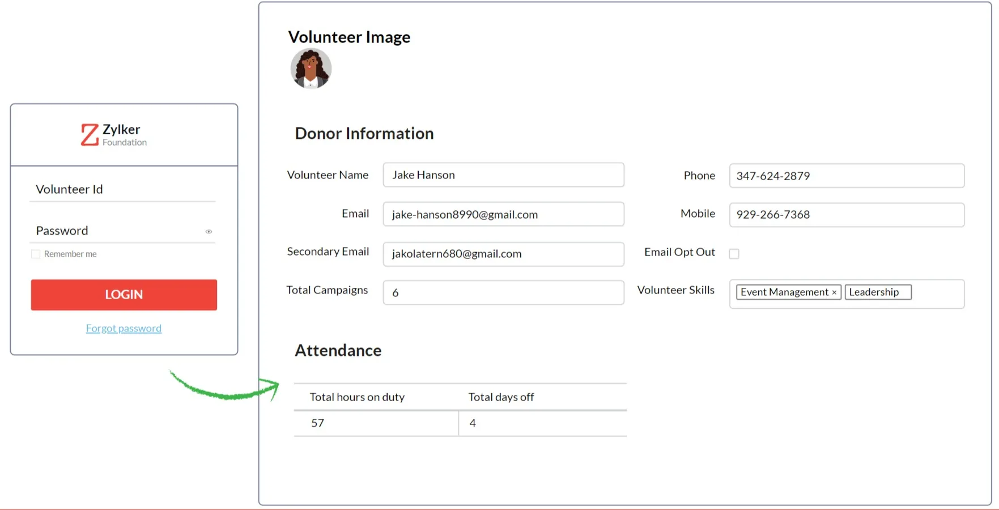
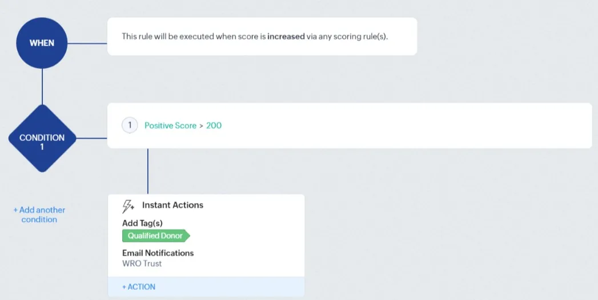
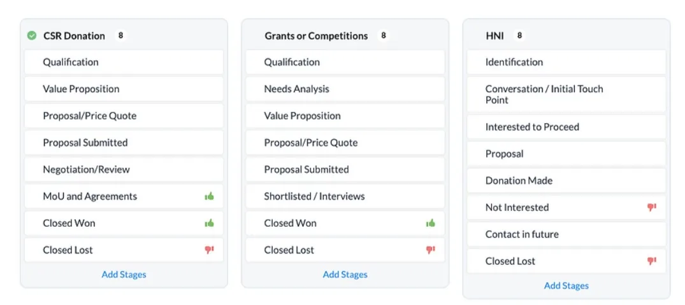
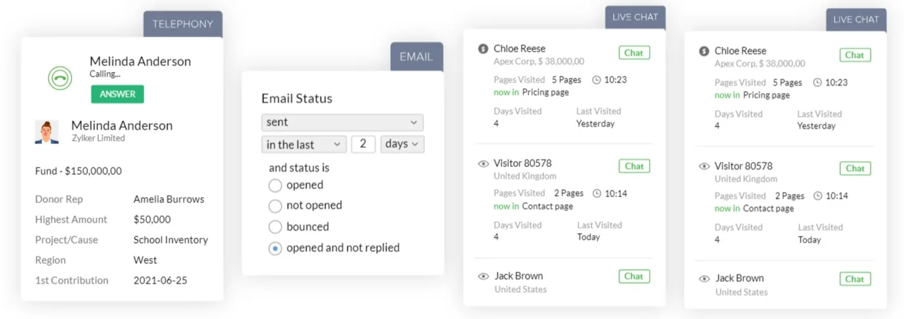
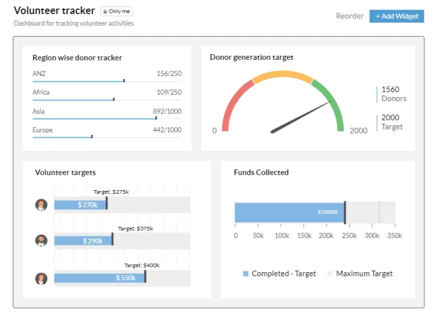

In the nonprofit sector, the art of relationship management is key to success. It's not just about tracking donations; it's about building a community of support. Yet, many NGOs struggle with off-the-shelf CRM systems that don't speak their language. Zoho CRM for Nonprofits emerges as a beacon in this landscape, offering a suite of tools designed specifically for the unique needs of nonprofits. This blog explores how Zoho CRM can revolutionize the way nonprofits connect with their audience and outlines the top 10 reasons why Zoho CRM should be your go-to choice.

### Understanding the Nonprofit Challenge

Nonprofits face a distinct set of challenges. From managing diverse donor bases to coordinating volunteer efforts and tracking funds, the operational complexities are vast. Traditional CRMs often fall short in addressing these specific needs. Zoho CRM steps in to fill this gap, offering a platform that’s not just a tool but a partner in mission fulfillment.

### 1.Customization at Its Core

One standout feature of Zoho CRM for Nonprofits is its unparalleled customization. Recognizing that no two NGOs are the same, Zoho allows organizations to tailor its functionalities. This includes custom fields, modules, and workflows, ensuring that the CRM aligns perfectly with the unique processes and language of each nonprofit. This adaptability allows NGOs to align the CRM closely with their mission and activities.

### 2. Enhanced Fundraising Campaigns and Analytics

For NGOs, fundraising is the lifeline. Zoho CRM's robust analytics tools aid in planning, executing, and analyzing fundraising campaigns. Whether it's a seasonal appeal or a thank-you email, the system's robust analytics help track the effectiveness and reach of each campaign, ensuring your message hits the mark.

Dig Deeper: [Transforming Fundraising Strategies for Non-Profits: How Technology Makes a Difference](https://www.edzola.com/post/transforming-fundraising-strategies-for-non-profits-how-technology-makes-a-difference)

### 3.Empowering Volunteers through Efficient Management

Volunteers are the backbone of any nonprofit. Zoho CRM's volunteer management feature ensures that their contributions are effectively utilized. By organizing volunteer information, tracking their availability, and aligning their skills with suitable tasks, NGOs can maximize their volunteer engagement and impact. Going beyond basic volunteer tracking, Zoho CRM allows for detailed management of volunteer profiles, preferences, and availability, fostering a more engaged and effective volunteer workforce.

Source: Zoho

### 4. User-friendly Automation Builder

Nonprofit staff often wear multiple hats. Zoho CRM's automation builder simplifies repetitive tasks, from donor communications to internal notifications, freeing up valuable time for more strategic activities.

### 5. Effective Donor Management with Deals and Pipeline

Donor management is the heartbeat of any nonprofit. Zoho CRM’s pipeline management provides a comprehensive system for tracking donor interactions, managing donation cycles, and analyzing giving patterns. This data-driven approach enables nonprofits to build stronger, more personalized relationships with their donors, leading to increased engagement and retention.

Explore More: [Customizing Your Donor Management for Optimal Engagement](https://www.edzola.com/post/donor-delight-customizing-your-donor-management-for-optimal-engagement)

### 6. Streamlined Task Management

Internal coordination is key in nonprofits. Zoho CRM's task management feature helps in assigning, tracking, and completing tasks, ensuring all team members are on the same page.

### 7. Role-based Access Control

With sensitive donor data, security is non-negotiable. Zoho CRM offers role-based access, ensuring staff see only what they need to, safeguarding your data while promoting efficiency.

### 8. Enhanced Communication with Omnichannel Messaging

Communication is key in building relationships. Zoho CRM’s omni channel messaging feature allows nonprofits to connect with their audience through various channels, ensuring that their message is heard loud and clear, whether it’s through email, social media, or direct mail.

Source: Zoho

### 9. Comprehensive Event Management

From small meetings to large fundraisers, event management is seamless with Zoho CRM. It helps in organizing, promoting, and tracking events, ensuring they run smoothly and achieve desired outcomes. **Donors can track their contributions' impact with customizable dashboards.** Volunteers can log attendance and record activity info with CRM's multi-page layouts.

Source: Zoho

### 10. Wide Range of Integrations

The strength of Zoho CRM for Nonprofits also lies in its integration capabilities. From financial software to marketing tools, these integrations streamline processes and offer a holistic view of operations.

Explore More: [Top 7 reasons why Zoho One is right for small Nonprofits](https://www.edzola.com/post/zoho-one-for-non-profits)

### Why choose Zoho CRM for NGOs?

Zoho CRM for nonprofits is a dynamic, multifaceted tool tailored to meet the specific needs of the nonprofit sector. It enhances organizational efficiency and engagement through omnichannel presence across various platforms, targeted communication campaigns, and streamlined donor management. The CRM also offers a comprehensive overview of stakeholder actions, facilitating effortless and secure transactions. With robust integration capabilities, it's a versatile solution that boosts operational effectiveness, ensuring nonprofits can focus more on their mission and less on administrative complexities.

[Explore Zoho CRM](https://edzola.com/zoho-products/zoho-crm)

In Conclusion, Zoho CRM for Nonprofits isn't just another CRM; it's a comprehensive solution designed to meet the specific needs of the nonprofit sector. With its customizable platform, robust donor management, and powerful analytics, it empowers nonprofits to foster stronger relationships, drive engagement, and maximize their impact. Its bespoke features for the nonprofit sector make it a standout choice, helping organizations focus on what they do best: making a difference.

## Getting Started with EdZola

> ***Let's innovate with purpose and use technology as a force for good.***

Every nonprofit is unique, and one size does not fit all when it comes to data solutions. At [EdZola](https://www.edzola.com/), we specialize in creating customized solutions that align with your organization’s specific goals and needs. Our team works closely with you to identify pain points, develop a tailored plan, and implement the right tools to maximize your impact.

[Let's Connect](https://www.edzola.com/contact)
