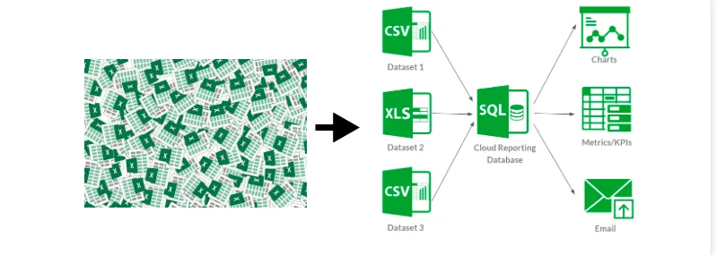
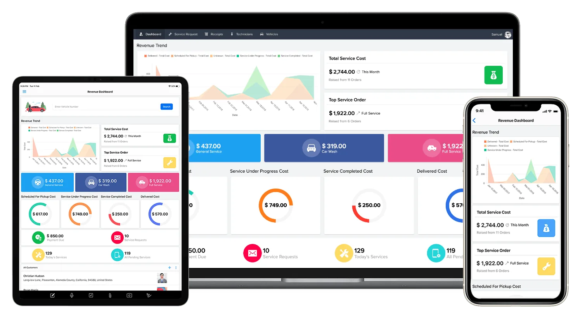

Spreadsheets are a lifesaver. Be it complex formulas, data collection, process/program management, spreadsheets work like a charm. The important point here is not whether spreadsheets work. We all know it does. But **for how long?**

Many organizations start with spreadsheets for their data management needs and rely on the same for decision making, reporting, etc. Over a few years, organizations reach a point where they have a **dump of static spreadsheets** with no real meaning/insight which can be derived from the same.

In this article, I am trying to decode the possible signs you might want to consider moving out of spreadsheets in your organization.

**Lack of a centralized data repository.**

With spreadsheets, data is scattered in different places. Data from WhatsApp, Forms, Mails, Surveys and Program Data spread across different spreadsheets which do not talk to each other. It's during Annual / Donor / Impact Reports or any critical milestone do we consolidate all the data to a new spreadsheet for reporting which again is not an efficient way because now we have redundant data. (Same data copied to multiple places)

Medium to Large scale organizations needs to start having **a centralized database** for all their data and streamline data inflow and outflow from that database. This will ensure the integrity of the data, reduce redundancy, and also will enable scope for better analytics and data-driven decision making.

**Data visibility and sharing across stakeholders.**

Let's take the example of an educational Non-Profit organization that works in low-income schools. All stakeholders in this system work centrally with student data.

- *As a teacher in the school, I would enter and see details of students with whom I am directly working with.*
- *As a Program Manager, I would want to know how the classrooms of teachers I am managing are performing.*
- *As a Program / Strategy Lead, I would want to see how the intervention across cities is working.*
- *As a Donor, I would like to see if the intervention is creating the desired impact.*

While all of the above stakeholders work directly with student data, It is extremely difficult to give data visibility to certain aspects of the spreadsheet for the same. With better data access and permission features, you can define your organization hierarchy and manage data flow from one stakeholder to another seamlessly. Every stakeholder sees data that only they have to see.

**Analytics and Reporting**

Unless you are someone who is extremely proficient with Macros / Apps Script, Creating automated dashboards in spreadsheets is a huge pain point. And also with large datasets, reporting and analytics get even more tricky.

In the fast-paced digital world that we are living, Analytics and Reporting should be as simple as dragging and dropping fields and creating charts. This is possible with many data visualization tools. With Analytics Dashboards, Not only can you visualize your data better, but also take better data-driven decisions which will help scale the impact of your organization.

Ok... But what are the **alternatives to a spreadsheet anyway?**

This is the question we set out to ask ourselves when we started EdZola, 8 months back. After working with multiple technologies, tools, and software providers, The only tool that met the bar was **Zoho Creator especially** for the needs of a Non-Profit Organization.

**What is Zoho Creator?**

Zoho Creator is a low-code application development platform that allows users to create custom applications on their own, with minimal coding experience with 3x faster deployment time compared to a traditional development environment.

**Why Creator is best for Non-Profits?**

- Your one-stop solution to streamline all your database and process needs within your organization. Your organization can go paperless with Zoho Creator in a very quick span of time.
- With Zoho Creator's robust set of features, your internal processes can be streamlined and automated. Be it sending emails, reporting, running schedules, sending automated donation receipts, connecting with external apps via APIs, data access customizations, separate portal users for different stakeholders, Zoho Creator **has it all**.
- Pre-loaded set of applications for managing a Non-Profit. Check it out here. Many Non Profits like Saahas Zero Waste, Team Everest, Bhumi, Nudge Foundation, Make A Difference, and many others are already using Zoho Creator!

**But.. We do not have an in-house tech team to do this!**

That's where we can help you! EdZola Technologies is a Registered Zoho Creator Partner and we have a team of passionate techies who can help you set up your Zoho Creator account and even develop custom solutions as per your needs. This way we believe, the gap between Non-Profits and Technology is truly bridged.

[#zohocreator](https://www.linkedin.com/signup/cold-join?session_redirect=https%3A%2F%2Fwww%2Elinkedin%2Ecom%2Ffeed%2Fhashtag%2Fzohocreator&trk=ugc-post-bar__share-text)[#nonprofits](https://www.linkedin.com/signup/cold-join?session_redirect=https%3A%2F%2Fwww%2Elinkedin%2Ecom%2Ffeed%2Fhashtag%2Fnonprofits&trk=ugc-post-bar__share-text)[#techforNonProfits](https://www.linkedin.com/signup/cold-join?session_redirect=https%3A%2F%2Fwww%2Elinkedin%2Ecom%2Ffeed%2Fhashtag%2Ftechfornonprofits&trk=ugc-post-bar__share-text)

**Wish to learn more about implementing technology for data management?**

**Watch webinar "Streamlining your Non-Profits Data Stack with Zoho Creator"**

[Video: https://www.youtube.com/watch?v=KgNaNAJ0KS4](https://www.youtube.com/watch?v=KgNaNAJ0KS4)
