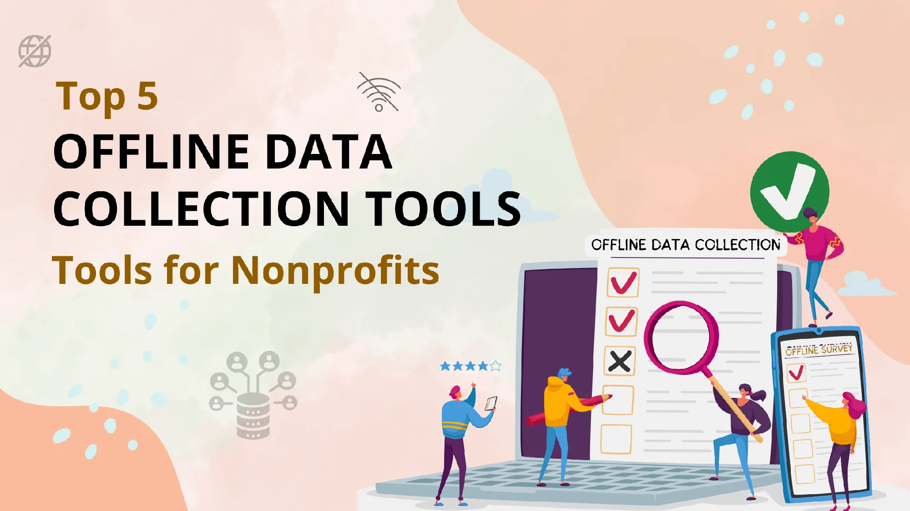
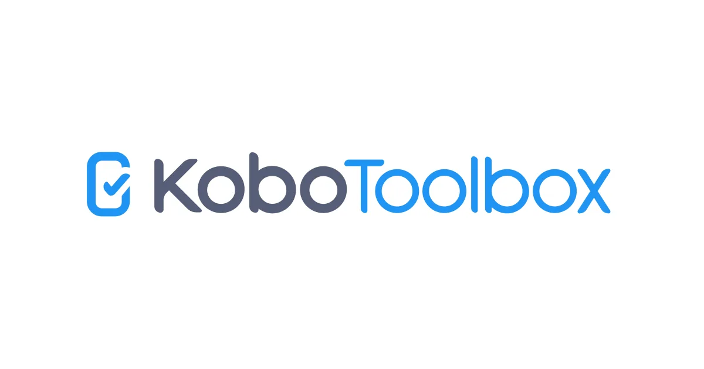
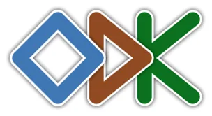
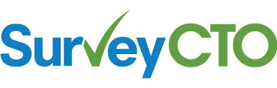
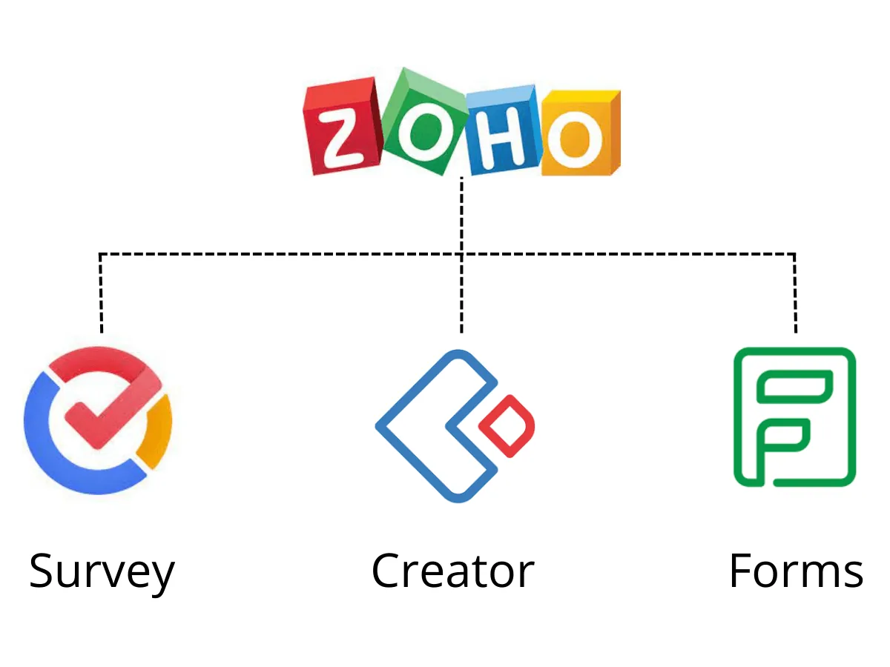

According to the Ministry of Communications **25,067 villages in India lack mobile connectivity and Internet**, based on [Telecom Service Providers (TSP) data](https://www.businesstoday.in/industry/telecom/story/over-25000-villages-lack-mobile-connectivity-govt-data-shows-321376-2022-02-03).

While many Non-profits mainly work with rural people (of course, it’s not the case for every organization), it is important to think of a way to get data from such areas. And Non-Profits collect a lot of data; different types of data from their beneficiaries. And they are really **invaluable assets when it comes to decision-making**.

There’s no denying that paper forms have proved to be a problem when there’s a need to collect such loads of data and then use it for analysis. And as the workload grows while the time to get things done reduces, it has become nearly impossible to collect and maintain all of these without some help from the tech that meets the growing needs of Non-Profits.

So what could solve these problems? Offline data collection is the solid answer. So, we’ve compiled a list of offline data collection tools that were developed especially for Non-Profits after a lot of research and experimentation which could help in multiple ways like **field surveys, offline quizzes, recording feedback, and more.**

## KoBo Toolbox

[Kobo Toolbox](https://www.kobotoolbox.org/) is a comprehensive platform for humanitarian data collection and it works on phones, tablets, and any browser. Data is immediately made available after collection. In addition to collecting data, it also facilitates building forms where one can use logic and validation to build complex forms. It supports a variety of questions where you can include images, videos, ratings, etc., It also takes care of the ‘post-collection’ processes where it is put into use like managing and analyzing data. Reports, graphs, and tables can be created or one could visualize data to get insights. Check their [plans](https://www.kobotoolbox.org/#home:~:text=GET%20STARTED,can%20choose%20from%3A) here.

## Avni

[Avni](https://avniproject.org/) Project is an open-source platform that can support most fieldwork use cases - primarily made for health workers, now implemented for water, social welfare services, and educational outcome assessment. The benefits of this all-rounder platform cover all the users like fieldworkers. field facilitators, program coordinators, program designers, and program analysts. Key features include building powerful forms with logic, enabling offline and multilingual data collection, and a centralized database. Avni offers a demo and a 3-month free trial, for more check [pricings](https://avniproject.org/pricing) here.

## Open Data Kit

ODK is a popular globally used data collection software and is used across sectors like public health, global development, crisis response, climate monitoring, and more. ODK possesses the basic features - building forms, collecting data, and analyzing them. It is customizable as per the needs of your organization. You can request a demo call which will last 30 minutes with an ODK expert, more like a consultation call. They offer three different plans with benefits of different ranges. For more details, visit [ODK website](https://getodk.org/).

## SurveyCTO

Built atop the Open Data Kit, [SurveyCTO](https://www.surveycto.com/) says that they aim towards simplifying the lives of research team members, reducing project costs, and improving data quality. Users can build forms using ‘drag and drop designs’ of different data categories and then monitor them easily. It has a full-time development and support team that can help quickly with support requests. Integrations through Zapier, Google Sheets, and Open Fn are available, or one can develop their own integration. People from sectors like agriculture, education, health, economics, humanitarian aid, etc., are using SurveyCTO in 165 countries. There is a 15-day free trial, after which you can opt for a paid plan - see details [here](https://www.surveycto.com/plans/).

## Zoho Forms, Survey, Creator

[Zoho forms](https://www.zoho.com/forms/) are another powerful data-collecting tool that can be used both online and offline. Forms can be integrated with multiple apps and have some handy features like auto-filling details by scanning business cards, turning them into kiosk mode, etc. Create, manage, share and notify using only mobile. [Zoho survey](https://www.zoho.com/survey/) facilitates surveys in multiple languages. One can also create forms using Creator and can collect data offline. The creator is a low-code development platform and thus the possibilities for building various forms are countless.

Check pricing for each software here - [Creator](https://www.zoho.com/creator/pricing.html), [Forms](https://www.zoho.com/forms/pricing.html), [Survey](https://www.zoho.com/survey/pricing.html)

## Why should you start using one for your Nonprofit?

As we said before, Non-profits collect a lot of data and have to do it efficiently in order to make use of them in the future. That speaks of data collection in general. Offline data collection tools ease this process. They help field workers who work in remote areas - they **don’t have to worry** about the **bad internet connection and data loss caused by it**. Data collected offline can be then synced when an internet connection is available and can be stored in a database for later use. They also ensure a wider reach and thus more useful and quality data from surveys.

So, choose the right software and start using it to actually see the benefits that we’ve written here. And EdZola is always here to take much more burden off of you by implementing, customizing, and setting them up for you.

[Start collecting quality data with EdZola](https://www.edzola.com/contact)
