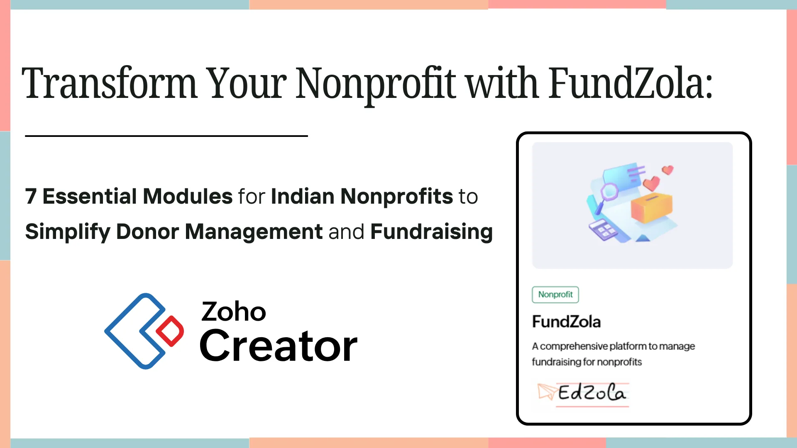

If you’re an NGO leader, finance head or Fundraising manager you’ve likely faced this situation:

“We spend more time fixing donor records than fundraising.” 
“Generating 80G and Fund Utilization Certificates manually? It’s a full-time job.”

Whether you're managing hundreds of donors, reporting to corporate funders or preparing for audits, working across Excel files, Google Drive folders and WhatsApp confirmations drains time and creates clunky processes. Manual donor tracking, certificate generation and fragmented expense logs often hold back your impact. We heard you. And we built something better.

## Wh**at is inside FundZola : Built for Indian Nonprofits**

FundZola helps Indian nonprofits run fundraising and program finance with clarity without messy spreadsheets. If you’re looking for a donation management software in India, a donor management system for NGOs, or a CSR fund tracking tool, FundZola brings everything into one place: donors, donation deals, receipts, 80G certificates, FUCs, budgets, and program-level expenses.

Built on **Zoho Creator** is low-code application development platform that lets organizations build and deploy custom web and mobile apps quickly. FundZola enables faster rollout, easy customization, and secure access for fundraising, finance, and program teams. Track donor history, manage recurring donations, reduce manual errors in documentation, and generate compliance-ready reports for internal reviews and partner updates. With real-time dashboards, you can monitor fundraising performance, program spend, pending certificates, and utilization status so leadership can make timely decisions.

Use FundZola to streamline 80G certificate automation, improve donor engagement, and strengthen audit preparedness with structured data and standardized workflows. Whether you’re an NGO, foundation, or CSR implementing agency, FundZola scales with your operations.

FundZola is your central hub for:

- **Donor and donation tracking:** Track every donor’s profile, giving history, and communication details in one place. View donations by campaign/program, payment mode, and status so your team can follow up quickly and build stronger donor relationships.
- **Automated 80G certificate generation:** Generate 80G certificates automatically after donation verification, with consistent formatting and accurate donor details. Reduce manual work, avoid errors, and ensure donors receive certificates on time for tax filing.
- **Fund Utilization Certificates (FUCs):** Maintain program-wise utilization records and supporting documentation to simplify FUC preparation. Create clear, donor-ready summaries of how funds were used, improving transparency and reporting confidence.
- **Budgeting and program-level expense tracking:** Plan budgets at the program level and track expenses against approved allocations. Monitor burn rate, spot overspend early, and keep finance + program teams aligned on spending controls.
- **Real-time reporting across donors, donation deals and programs:** Access dashboards that show fundraising performance, pending certificates, utilization status, and program spend in real time. Share quick insights with leadership and donors without waiting for manual report consolidation.

## 1.**Program Management**

As an NGO, you probably run multiple programs with different budgets and goals. With this module, you can keep everything organized in one place. You’ll clearly see the total budget, how many beneficiaries you’re reaching, allocate funds to major heads like administrative expenses or field trips, and set the program as Active or Inactive whenever needed.(Refer pic 1.1)

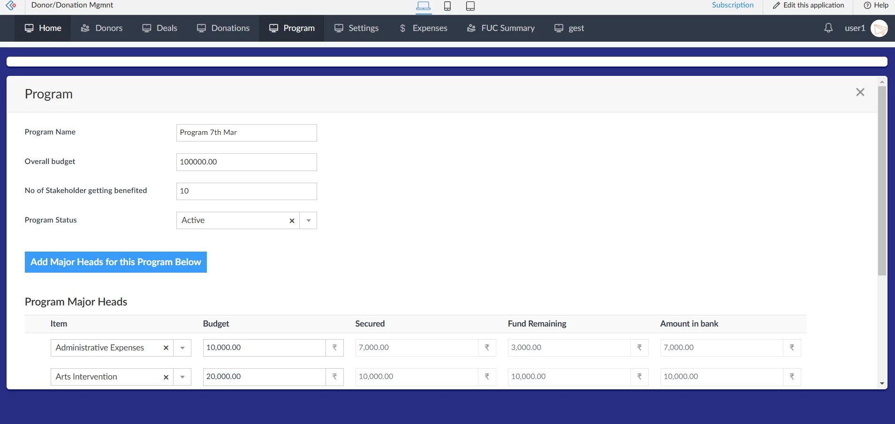

*Picture 1.1: Program module*

## 2**. Deals Pipeline (Pre-Donation Tracking)**

Track potential donations before they’re confirmed. In this module, you can:

- Enter the deal name
- Select the program
- Assign the donor
- Add the deal amount

(Refer pic 1.2)

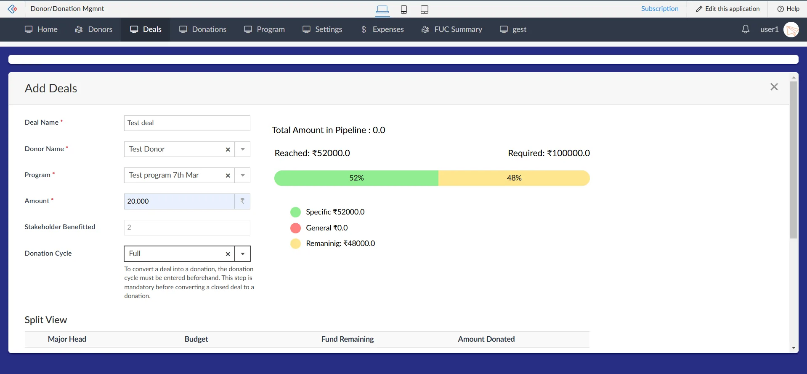

*Picture 1.2: Deal pipeline (Pre donation tracking)*

**Deal Pipeline & Tracking**
Visually manage deals using a Kanban board just drag and drop deals across stages like Follow-up, Confirmed, and Closed.(Refer pic 1.3)

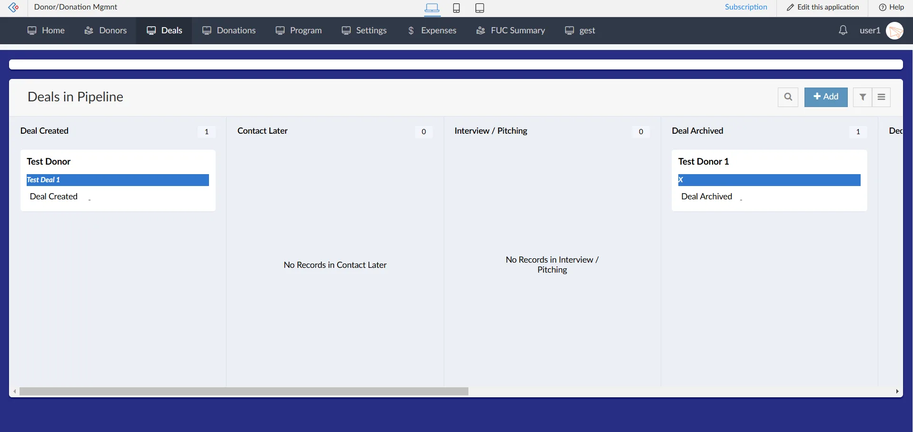

*Picture 1.3: Deal pipeline tracking*

**Deal to Donation Conversion**

Once a deal is closed, convert it into a donation with one click. It’s auto-recorded in the Donation Module, and you can instantly generate and send the 80G certificate to the donor.(Refer pic 1.4)

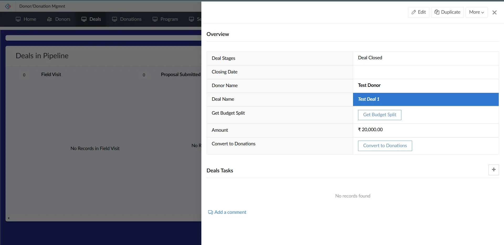

*Picture 1.4: Deal to donation conversion*

## 3. Donor Management

Managing and tracking donor data is important for sending program updates, tracking contributions and maintaining compliance. With the Donor Module,  you can capture key details like name, email, phone, and other details for KYC compliance.(Refer Pic 1.5)

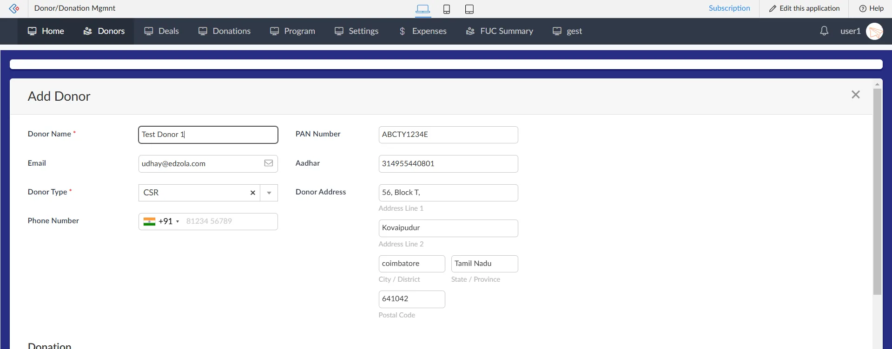

*Picture 1.5: Donor Module*

Each donor is assigned a unique ID to avoid duplication. All donations are automatically linked to the respective donor.(Refer Pic 1.6) This gives you a complete, searchable donation history to help you view all donations and analyze your engagement. It ensures transparency and simplifies audit reporting.

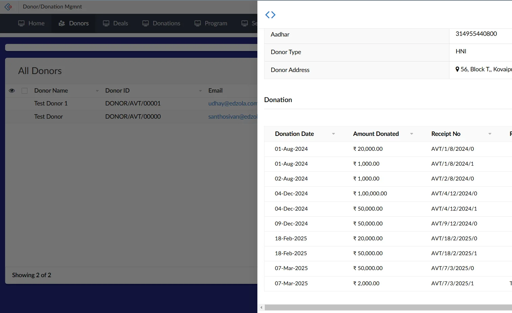

Picture 1.6: *Donor report & history*

## 4.80G Certificate Management

To ensure compliance with tax exemption regulations, the system enables automated generation of 80G certificates(Refer pic 1.7), offering:

- Pre-configured, customizable email templates.
- Options to send certificates via email or download them manually.

  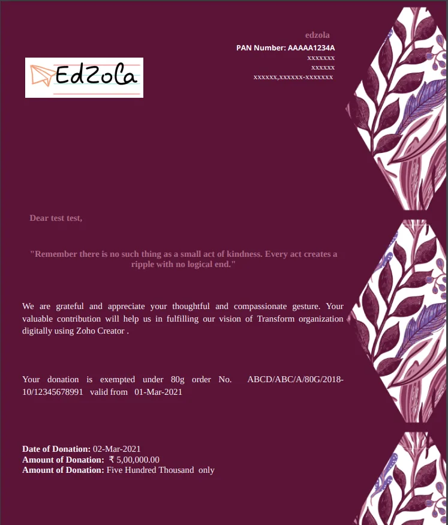

  *Picture 1.7: 80G certificate*

## 5.Donation Management

In the Donation Module, you can easily track and manage all contributions with complete clarity.

**Auto-Generated Donation Numbers**

Each donation is assigned a unique ID, helping you stay organized and audit-ready.(Refer pic 1.8)

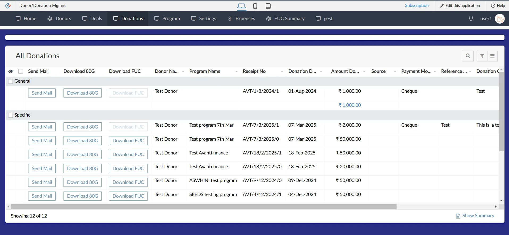

*Picture 1.8: Auto generated donation*

**Flexible Donation Handling** You can record:

- **Direct Donations** without linking to deals
- **Tranche Donations** for installment-based contributions
- Larger commitments can be managed through the **Deals Module** and converted once confirmed

(Refer pic 1.9)

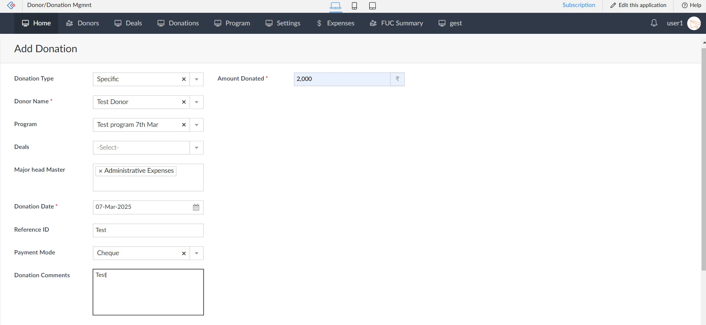

*Refer pic 1.9 : flexible donation handling*

This ensures every type of donation is captured accurately, whether it’s a one-time gift or a multi-part pledge.

## **6. Expense Tracking**

In the Expense Module, you can track how donations are used within each program offering full transparency to donors.(Refer picture 2)

- **Program-wise expense mapping:** Every expense is tagged to a specific program, so utilization reports stay clean and auditable.
- **Major Head & Sub-head budgeting:** Track expenses against defined heads (e.g., Training, Travel, Material), helping teams stay within approved budgets.
- **Document attachment support:** Upload bills/invoices and supporting proofs against each expense entry for audit readiness.
- **Approval workflow readiness:** Expenses can follow an internal review/approval process (if enabled) to strengthen financial control.
- **Reporting & donor updates:** Generate quick summaries for donors/CSR teams on how funds were spent—without manual consolidation.
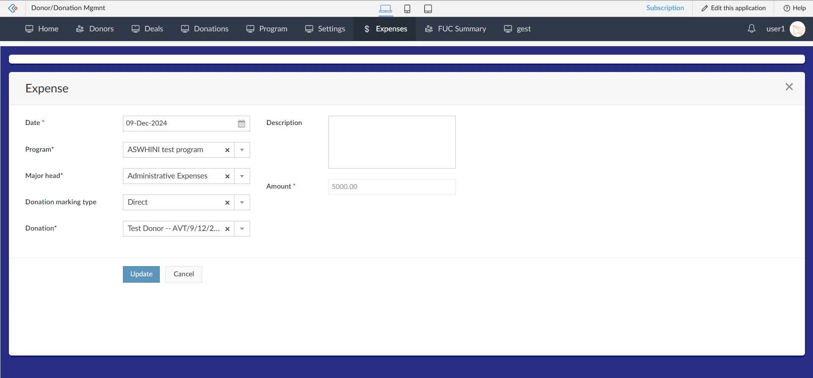

*Picture 2 : Expense module*

**users can categorize expenses as Direct or Split Expenses:**

- **Direct Expense:** Allocated to a specific major head and applied to open donations linked to the program. Use this when an expense belongs to **one specific program and one major head** (e.g., Training, Travel, Materials). The system will allocate it directly to the **open donations** linked to that program, making utilization tracking straightforward and clean for reporting.
- **Split Expense:** Expenses can be manually distributed across multiple donations if needed.(Refer Pic 2.1: ) Use this when a single expense needs to be **shared across multiple donations** for example, a shared venue cost or travel expense that supports more than one activity or funding source. Users can manually distribute the amount across selected donations as needed.
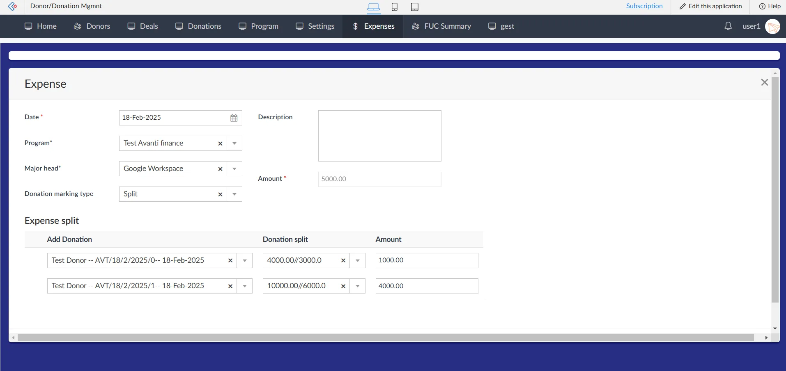

*Picture 2.1 : Direct and split expense*

**Real-Time Tracking:** Expenses update the Donation Module, showing:

- Budgeted Amount
- Total Expenses
- Remaining Balance(Refer Picture 2.2)

##

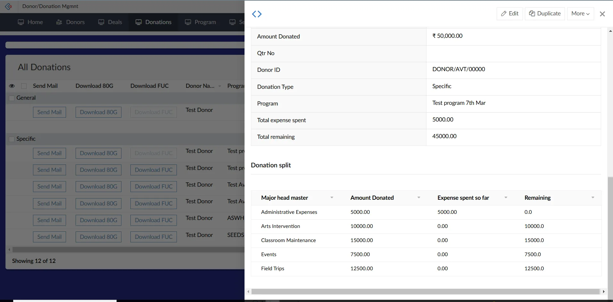

*Picture 2.2: Real time tracking the donations*

## 7️. Fund Utilization Certificates (FUCs)

**Generate FUCs**

Easily create and send Fund Utilization Certificates to donors using customizable templates. A standard format is available and can be tailored to meet donor requirements. (Refer Picture 2.3)

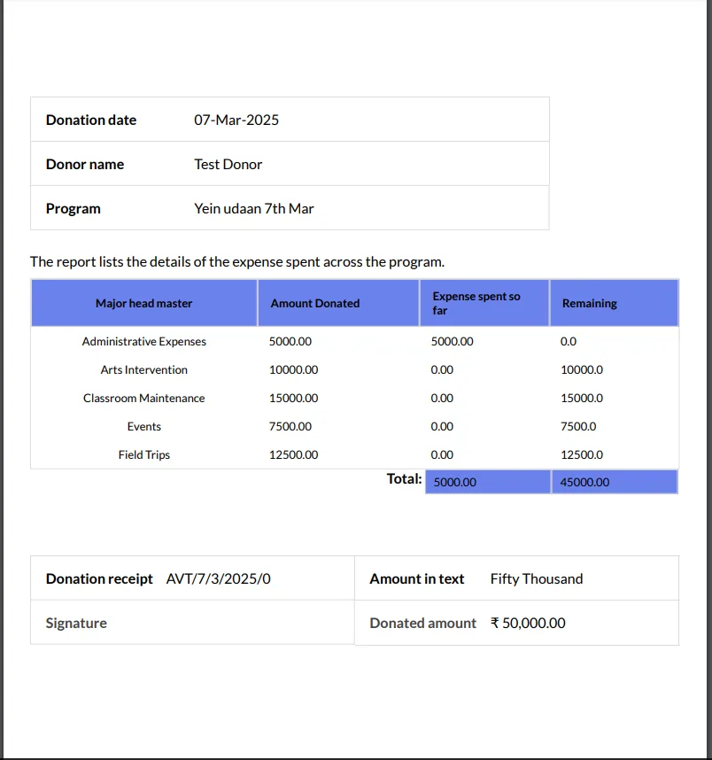

*Picture 2.3: FUC view*

**Interactive Reports & Charts** View organization-wide donation utilization with filters for donors, programs, and deals.

**Pivot Summary**

Get a clear breakdown of total budget, expenses spent, and remaining funds—ensuring every rupee is transparent and traceable.(Refer Picture 2.4)

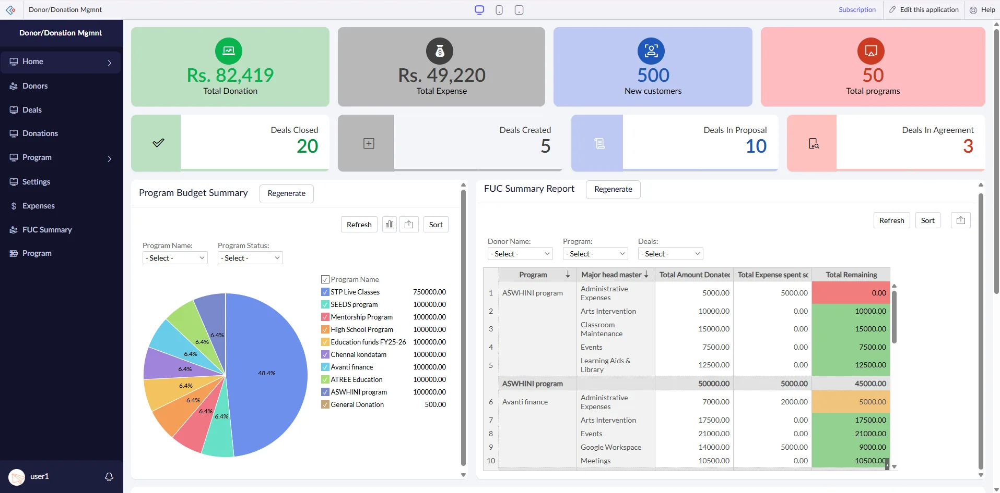

*Picture 2.4 ; pivot table summary*

**Mobile View:**

FundZola offers a seamless and consistent experience across all devices.(Refer Pic 2.5) Access it anytime, anywhere, to manage your nonprofit’s donations and finances effortlessly.

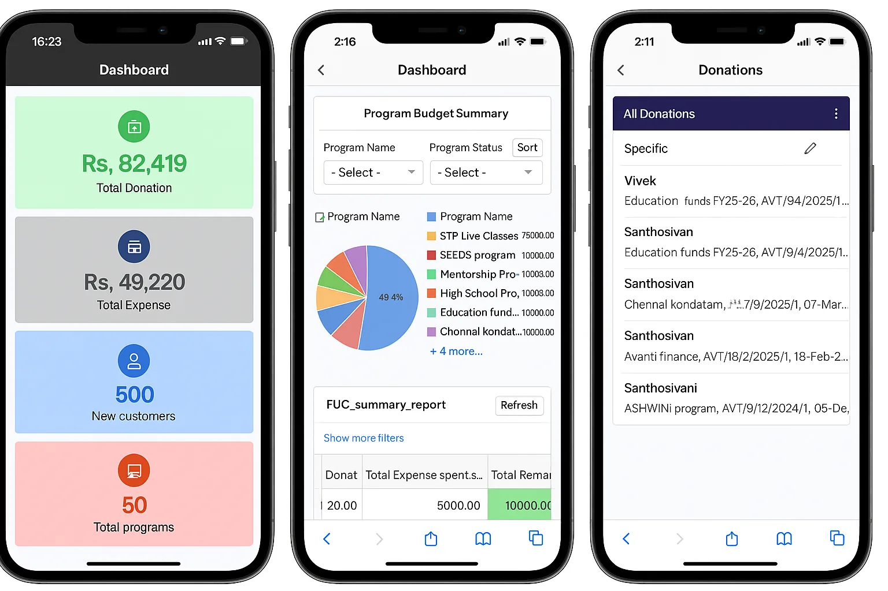

*Picture 2.5: FundZola Mobile View*

## Getting Started with EdZola

Whether you’re looking to streamline donation management or improve financial tracking with compliance and audit readiness, FundZola has you covered. Leading NGOs in education and livelihood are already leveraging it to amplify their impact.

[Book a demo with us today!](https://www.zoho.com/creator/partner/solutions/funzola-fundraise-management-system.html)

Zoho Creator enables nonprofits to streamline operations with ease. Its low-code platform eliminates costly IT dependencies and offers an affordable solution that teams can quickly adopt. If you want to explore Zoho Creator, [start your 15-day free trial.](https://store.zoho.in/ResellerCustomerSignUp.do?id=7b02f2ab5c8f7eeb3bf04bad5f5f65ae)

> *Where technology becomes a force for good, amplifying human potential and fostering global progress.*
