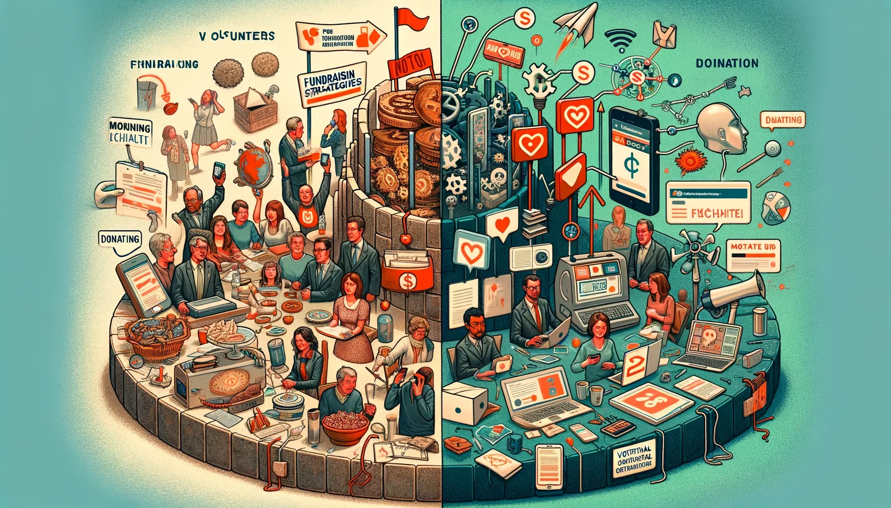
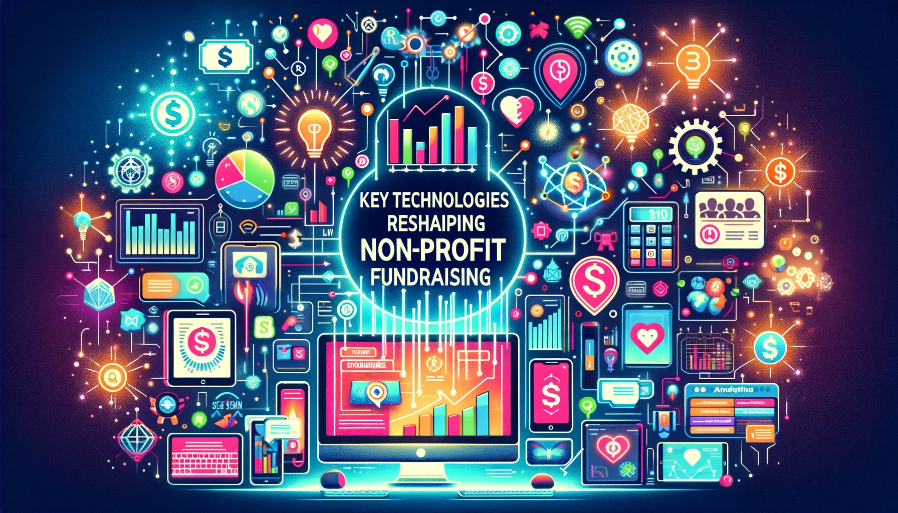

In today's rapidly evolving digital landscape, fundraising strategies for non-profits have undergone a profound transformation. Technological advancements have not only revolutionized the way organizations operate but have also opened up new avenues for donor outreach and engagement. In this article, we will explore how technology is reshaping the fundraising landscape and discuss key technologies that are making a difference for non-profits.

## **Understanding the Evolution of Fundraising Strategies**

Fundraising has always been a vital component of non-profit organizations' survival and growth. Traditionally, fundraising efforts largely relied on face-to-face interactions, direct mail campaigns, and telephone solicitations. While these methods proved effective to a certain extent, they often faced limitations in terms of reach and scalability.

However, with the advent of technology, non-profits are now able to broaden their horizons and extend their outreach to a larger audience. The shift towards technology-driven [fundraising strategies](https://idronline.org/creating-fundraising-strategies-for-nonprofits/) has proven to be a game-changer, enabling organizations to tap into the immense potential offered by digital platforms and tools.

## **The Role of Technology in Modern Fundraising**

Technology has revolutionized the way non-profits engage with their donors and supporters. It has not only enhanced the overall donation experience but also streamlined fundraising operations. Let's delve into two key areas where technology has made a significant impact:

### Enhancing Donor Engagement Through Technology

Gone are the days when fundraising campaigns meant one-way communication and limited interaction with donors. Today, non-profits can leverage technology to foster meaningful relationships with their supporters. The emergence of customer relationship management (CRM) systems specifically designed for non-profits has dramatically improved donor engagement.

These CRM platforms enable organizations to track donor interactions, manage fundraising events, and personalize communications effectively. By harnessing the power of donor data, non-profits can tailor their messages to resonate with individual supporters, resulting in increased engagement and, ultimately, higher donations.

> ***CRM systems have become an essential tool for non-profits looking to take their fundraising efforts to the next level. These platforms offer a holistic view of donor engagement, allowing organizations to manage and nurture relationships effectively.***

### Streamlining Fundraising Operations with Digital Tools

In addition to donor engagement, technology has revolutionized the way non-profits manage their fundraising operations. In the dynamic world of philanthropy, digital innovations like online donation platforms and peer-to-peer fundraising software have emerged as game-changers. These tools empower organizations to effortlessly collect donations and orchestrate campaigns with precision and ease. So, seize the opportunity to transform your fundraising efforts today, embracing technology to [streamline your donation process](https://www.edzola.com/post/3-tips-to-streamline-your-donation-process-today) and pave the way for a brighter future of giving.

For instance, crowdfunding platforms have emerged as a powerful tool for non-profits to raise funds for specific projects or causes. With the ability to create compelling campaigns and share them across social media channels, non-profits can reach a wider audience and inspire individuals to contribute to their cause. Non-profits can leverage crowdfunding platforms to tap into the power of collective giving. These platforms provide an easy-to-use interface, allowing organizations to create visually appealing campaigns and encourage supporters to share them within their networks.

## **Key Technologies Reshaping Non-Profit Fundraising**

While the role of technology in modern fundraising is undeniable, certain key technologies are reshaping the landscape and driving substantial results for non-profits. Let's explore three technologies that are making a remarkable difference:

### The Impact of Social Media on Fundraising

Social media has transformed the way people connect, communicate, and even support causes they believe in. Being present on popular social media platforms like **Facebook, Twitter, and Instagram** has become a necessity for non-profits seeking to engage with a broader audience. As Gen Z's are becoming donors, it's no longer a choice, it's a must. Read more on [Nten's article here](https://www.nten.org/blog/leveraging-generation-z-3-engaging-fundraising-trends)

> ***Social media has the potential to be a game-changer for non-profits, p******roviding an avenue to create awareness, build relationships, and inspire donations.***

Non-profits can harness the power of social media to share success stories, promote fundraising campaigns, and encourage individuals to make a difference by contributing to their cause.

### The Power of Crowdfunding Platforms

As mentioned earlier, crowdfunding platforms have gained immense popularity and have proven to be an effective means for non-profits to raise funds for specific projects or initiatives. These platforms enable non-profits to reach a vast audience of potential donors and inspire them to contribute.

Crowdfunding platforms have revolutionized fundraising by democratizing the process and providing individuals from all walks of life with an opportunity to support causes they believe in.

Moreover, crowdfunding has also enabled non-profits to tap into the power of collective giving, where a small donation from many can have a significant impact on their overall fundraising goals.

### The Rise of Mobile Giving: The New Frontier in Fundraising

> ***According to a*** [***survey taken by 360 Matchpro***](https://360matchpro.com/fundraising-statistics/)***, Mobile users grew as a portion of donation transactions by 17% compared to the previous year and made up 33% of online donation transactions last year.***

In an era where smartphones have become an integral part of our daily lives, **leveraging mobile technology** can be a **game-changer for non-profits**. Mobile giving has emerged as a powerful tool to empower individuals to make donations conveniently and instantaneously.

Non-profits cannot afford to overlook the potential of mobile technology. By providing individuals with the ability to donate at their fingertips, organizations can significantly boost their fundraising efforts.

## **Overcoming Challenges in Implementing Tech-Driven Fundraising**

Implementing technology-driven fundraising strategies does come with its fair share of challenges. Non-profits need to be aware of these challenges and take proactive steps to address them. Here are two key areas that must be considered:

### Addressing Technological Barriers

Not all non-profit organizations have the necessary resources or technical expertise to implement and manage fundraising technologies effectively. **Smaller organizations**, in particular, **may face financial constraints, limited staff,** or a **lack of technical understanding**.

However, by **leveraging the expertise of IT professionals or partnering with technology-focused nonprofit organizations** like [Edzola](https://www.edzola.com/), non-profits can overcome these barriers and ensure successful implementation of technology-driven solutions.

### Ensuring Data Security and Privacy

With the increasing reliance on technology, the **security** and **privacy** of **donor data** have become paramount concerns. Non-profits must take the necessary steps to protect sensitive donor information and comply with relevant data protection regulations.

> ***Non-profits must prioritize data security and privacy to build trust with their donors. Implementing robust data protection measures and regularly reviewing security protocols are essential steps in this process.***

## **Future Trends in Non-Profit Fundraising Technology**

The world of fundraising technology is continuously evolving, and non-profits must stay ahead of the curve to maximize their fundraising potential. Here are two future trends that hold immense promise:

### The Rise of Virtual Reality and Augmented Reality in Fundraising

Virtual reality (VR) and augmented reality (AR) technologies are increasingly being used by non-profits to create immersive experiences that resonate with potential donors. By transporting individuals into simulated environments or superimposing digital content onto the real world, non-profits can provide unique and engaging experiences that inspire generosity.

> ***Virtual reality and augmented reality have the power to create empathy, allowing non-profits to showcase their impact in a way that goes beyond words and images.***

This technology has the potential to transform the way non-profits tell their stories and connect with donors.

### The Potential of Blockchain and Cryptocurrency in Non-Profit Fundraising

Blockchain technology, most commonly associated with **cryptocurrencies** like **Bitcoin**, has gained significant attention. Non-profits can leverage blockchain to ensure transparency and accountability in their fundraising efforts.

> ***Blockchain technology has the potential to revolutionize non-profit fundraising by providing a decentralized and transparent platform for donors to track their contributions.***

By utilizing cryptocurrencies and blockchain technology, non-profits can establish **trust, eliminate middlemen**, and **provide donors** with **real-time visibility** into how their donations are being utilized. It's a [rising trend in many developed countries](https://timesofindia.indiatimes.com/business/cryptocurrency/blockchain/growing-presence-of-crypto-in-philanthropy/articleshow/90771143.cms) and it's steadily growing in India.

In conclusion, technology has transformed fundraising strategies for non-profits in remarkable ways. From enhanced donor engagement to streamlined operations and the utilization of key technologies like social media, crowdfunding platforms, and mobile giving, technology has opened up new possibilities for non-profits to achieve their fundraising goals. While challenges exist, addressing technological barriers and ensuring data security and privacy are essential for successful implementation. Looking ahead, non-profits should embrace future trends such as virtual reality, augmented reality, blockchain, and cryptocurrency to continue making a difference in the world.

## Wrapping Up

New technologies are constantly emerging, and along with them come better ways for nonprofits to serve their communities and make a lasting difference. If you're ready to embark on CRM centered solutions with us,

[Let's Connect](https://www.edzola.com/contact)
