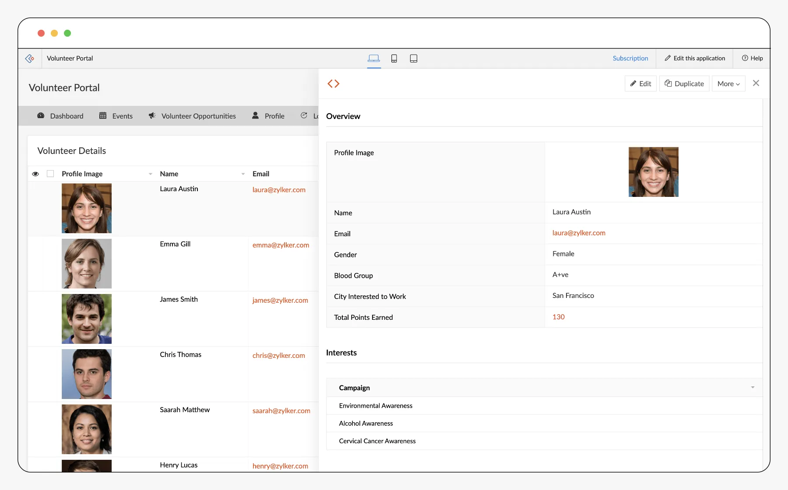
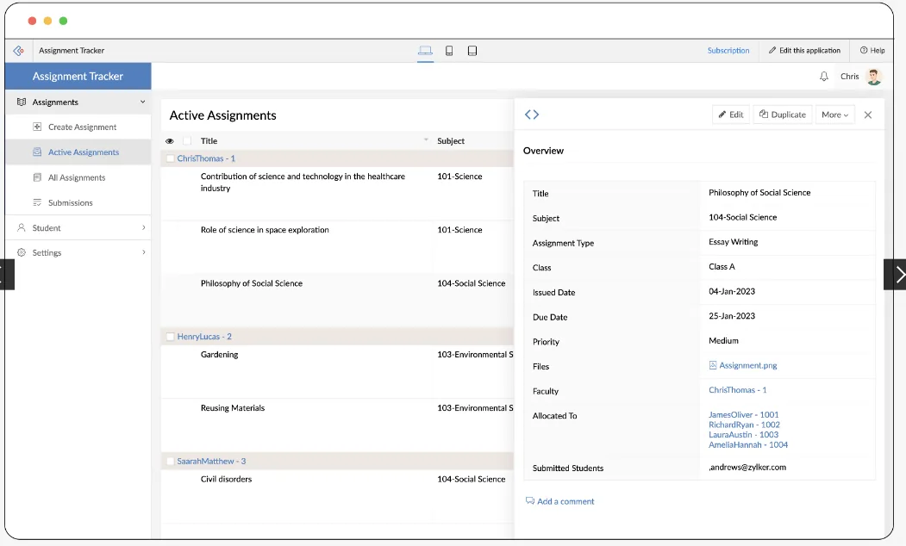

Nonprofits face the dual challenge of fulfilling their mission while adapting to technological advancements. As they strive to engage stakeholders, streamline operations, and maximize impact, the role of technology becomes increasingly crucial. One powerful tool that can help nonprofits achieve these goals is to leverage user portals available in Zoho Creator. This blog explores how nonprofits can leverage Zoho Creator's user portal to empower volunteers, donors, employees, and beneficiaries, with use cases tailored to different domains within the nonprofit sector.

## What are User Portals?

Many applications are built to be used by various stakeholders. And in huge number of cases, not everyone needs access to everything in the app. For example, let's consider that your organization is running a 'Financial Training' course for semi-urban women, and you're managing all their data in a central platform. As the program scales, you realize it would be better to have the beneficiaries upload their data and view their progress whenever they want. Now instead of doing all this manually for, say 100 beneficiaries, you can leverage the use of 'Self-Service portals' that will enable you to streamline the data in a better way.

This can be used to provide personalized access to various important stakeholders such as volunteers, donors, employees, and beneficiaries. **In Zoho Creator, user portals can be customized to cater to each group's specific needs, facilitating tasks such as data management, event coordination, communication, feedback collection etc.,**

[Explore Zoho Creator with a 15-day free trial!](https://www.edzola.com/zoho-products/zoho-creator)

## Why are User Portals Essential for NGOs?

###

User portals are integral to NGOs as they foster engagement, collaboration, and efficiency. By offering stakeholders a centralized platform to access relevant information and participate in activities, NGOs can strengthen relationships, streamline operations, and amplify impact. Moreover, user portals simplify administrative tasks, enhance data management, and improve overall organizational effectiveness.

Explore More: [Build secure online self-service portals with Zoho Creator](https://www.zoho.com/creator/online-customer-portal/?utm_source=website&utm_medium=organic&utm_campaign=lowcodesolutions)

## How to Design an Impact-First User Portal Experience

While enabling a user portal in Zoho Creator offers powerful backend control, the true value lies in creating an experience that **aligns with your nonprofit’s mission and serves your stakeholders meaningfully**.

Here are 5 design principles to keep in mind when building your nonprofit’s portal:

**1. Keep it Simple and Mobile-Friendly**

Most field teams, volunteers, or beneficiaries access the portal via mobile devices. Use a clean layout, clear CTA buttons, and large font sizes. Avoid clutter and prioritize mobile responsiveness.

**2. Customize the Portal Based on User Roles**

Zoho Creator lets you create role-based access. Tailor dashboards, forms, and menus to match what different users need. For example:

- Donors should see impact reports and donation receipts.
- Field teams should see attendance forms, stock updates, and task lists.
- Beneficiaries may just need a survey link or progress tracker.

**3. Include Real-Time Updates**

A dynamic portal builds trust. Show real-time updates like:

- Funds raised
- Beneficiaries reached
- Tasks completedThis data can be automatically pulled from your app using Creator’s workflows.

**4. Add Visual Dashboards**

Visual elements like bar charts, KPIs, or progress wheels help users quickly understand their activity or project impact. Zoho Creator supports integrating Zoho Analytics widgets into the portal to show live dashboards.

**5. Make It Feel Personal**

Small touches go a long way:

- Greet users by name
- Allow profile photos or preferences
- Send auto-reminders or thank-you notes via Zoho Mail/Flow

Your portal shouldn’t just be a tool—it should be an extension of your organisation’s purpose, helping users feel connected to the cause.

## How Nonprofits can leverage Zoho Creator's User Portals

### Volunteers Portal:

For NGOs reliant on volunteers, a dedicated volunteers portal in Zoho Creator streamlines various tasks. **Volunteers can easily sign up for events, track attendance, receive event reminders via email or notifications, earn rewards based on participation, and provide valuable feedback on their experiences.** Additionally, NGOs can use the portal to communicate volunteer opportunities, share updates, and recognize outstanding contributions.

### Donors and Corporate Social Responsibility (CSR) Portal:

NGOs can leverage Zoho Creator's user portal to engage donors and CSR partners effectively. **Donors can access the portal to make donations, view campaign progress, and learn about the organization's impact. NGOs can also use the portal to showcase fundraising campaigns, highlight success stories, and express gratitude to donors.** The portal facilitates communication and collaboration between NGOs and CSR partners, fostering meaningful partnerships and driving social change.

### Employee Portal:

For NGO staff members, an employee portal in Zoho Creator streamlines HR processes and enhances productivity. Employees can use the portal to log in, mark attendance, enroll in training programs, track performance goals, and manage leave requests seamlessly.

###

## Domain Specific Portal Usecases:

### 1. Education & Upskilling NGOs

#### Student/Participant Portals

**Access to Academic Resources**

The portal can be used for providing curated educational materials such as lecture notes, textbooks, videos, and practice exercises. Students can access these resources anytime, anywhere, fostering independent learning and academic success.

**Viewing progress and grades**

Students can view their grades for completed assignments, quizzes, and exams directly through the portal. This will help them keep track of their progress overtime, which serves as a factor for motivation. Trainers can ensure transparency and accountability by providing personalized feedback via portals on student performance.

#### Trainers/Teachers Portal

Trainers or teachers can maintain comprehensive records of student information who belong to their batch, including demographics, attendance, and performance metrics. Teachers can later use this data to track student progress, assignments, identify at-risk learners, and tailor interventions as needed.

Another important use case is that teachers can use such portals to enter their attendance, track their learnings, performance and goals etc.,

### 2. Climate action & Sustainability

### Exploring self-service carbon tracking for employees with Zoho Creator

A Carbon Footprint Tracking Portal enables employees, volunteers, and members to log commuting, energy usage, and travel data. Users access visualizations of their carbon footprint, receive personalized emissions reduction suggestions, and administrators monitor overall progress towards sustainability goals.

And if your NGO helps track a set of organizations maintain their carbon footprint or assist them in any environmental activities, portal access can be provided for each organization to get up to date information. This ensures a better process of monitoring enabling you to have a smooth analysis and reporting processes.

## Getting Started with EdZola

> ***Let's innovate with purpose and use technology as a force for good.***

Every nonprofit is unique, and one size does not fit all when it comes to solutions. At [EdZola](https://www.edzola.com/), we specialize in creating customized solutions that align with your organization’s specific goals and needs. Our team works closely with you to identify challenges, develop a tailored plan, and implement the right tools to maximize your impact.

[Let's Connect](https://www.edzola.com/contact)
