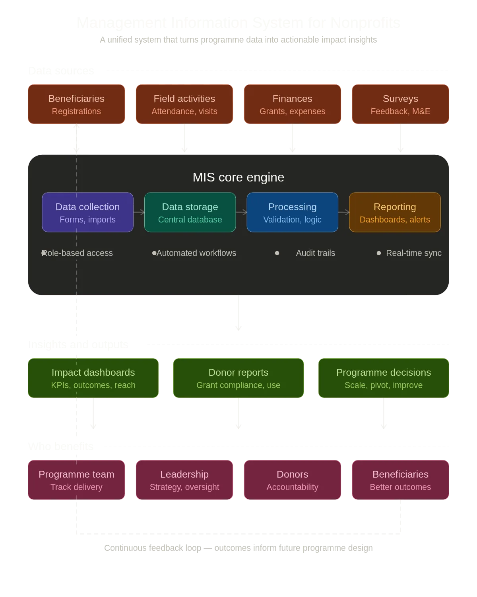

A Management Information System (MIS) for nonprofits is a centralized digital platform that collects, stores, organizes, and reports on all the data your organization needs to deliver programs, manage donors, track outcomes, and report to funders from one connected system instead of dozens of disconnected spreadsheets.

If you run a nonprofit or charity and your team spends more time hunting for data than acting on it, this guide is for you. We will walk through what an MIS actually does, why it matters in 2026, how it differs from a CRM, what it costs, and how to know when your organization is ready for one.

## What Does an MIS Actually Do for a Nonprofit?

At its core, an MIS replaces the fragmented, manual systems most nonprofits rely on spreadsheets, paper forms, email chains, WhatsApp groups with a single platform that your entire team uses. It connects program delivery data with donor information, finance records, and impact metrics so that everything is visible, up to date, and trustworthy.

A well-built nonprofit MIS typically handles these functions:

•        **Program tracking:**Record beneficiary enrolment, attendance, milestones, and outcomes across all your program in one place.

•        **Data collection:**Replace paper forms with digital collection tools mobile-friendly forms, offline-capable apps, or even AI chatbots for field teams.

•        **Dashboards and reporting:**Generate real-time dashboards that show program performance, not last quarter’s numbers pulled together in a panic before a board meeting.

•        **Donor and funder reporting:**Pull grant-ready impact reports without spending two weeks manually compiling data from five different spreadsheets.

•        **Workflow automation:**Automate repetitive tasks like follow-up reminders, approval chains, data validation, and notification triggers.

•        **User access control:** Give field staff, program managers, and leadership exactly the data they need - no more, no less.

## Why Do Nonprofits Need an MIS in 2026?

**The short answer:** because the sector has changed, and spreadsheets have not kept up.

In 2026, nonprofits face a convergence of pressures that make proper data systems essential rather than aspirational. In the US, federal funding uncertainty means organizations must prove impact to private donors and foundations more convincingly than ever. In the UK, the average charity digital maturity score sits at just 5.1 out of 10, and only 44 per cent of charities have a digital strategy. Meanwhile, over 80 per cent of nonprofits are now using some form of AI but without clean, connected data, AI tools have nothing useful to work with.

Funders are also getting more sophisticated. They want real-time portfolio dashboards. They want outcomes linked to expenditure. They want to see evidence, not anecdotes. An MIS gives you the infrastructure to deliver all of this without hiring a dedicated data team.

## MIS vs CRM: What Is the Difference?

This is one of the most common questions we hear. Here is the simplest way to think about it:

**A CRM (Customer Relationship Management system)**tracks relationships — donors, supporters, volunteers, partners. It manages your fundraising pipeline, donor communications, and engagement history.

**An MIS (Management Information System)**tracks operations — program delivery, beneficiary data, field activities, outcomes, and reporting. It is the backbone of how your organization runs.

Many nonprofits need both, and in an ideal setup they are connected. Your CRM tells you who gave money and why. Your MIS tells you what you did with it and what happened as a result. Together, they close the loop between investment and impact.

## What Does a Nonprofit MIS Look Like in Practice?

Let us make this concrete. Imagine a nonprofit running education program across 30 schools in three regions. Without an MIS, their data reality looks something like this: attendance tracked in school-level Excel files, student assessments stored in Google Sheets, teacher training records in a shared drive, and donor reports assembled manually by copying and pasting from all of the above.

With an MIS, every teacher logs attendance on a mobile-friendly form. Assessment scores feed into the same system. Dashboards update automatically, showing completion rates by school, region, and cohort. When a funder asks for quarterly data, the program manager exports a formatted report in minutes, not days.

That is what **“moving beyond spreadsheets”** actually looks like. Not a technology upgrade for its own sake a fundamental shift in how confidently and quickly your team can make decisions.

## How Much Does a Nonprofit MIS Cost?

Cost varies significantly depending on the complexity of your programs, the number of users, and whether you build custom or use an off-the-shelf platform. Here are rough benchmarks:

•        **Off-the-shelf platforms (e.g. Salesforce Nonprofit Cloud, Plinth, Lamplight):**
$125 – $2,500+ per month depending on scale, plus implementation costs.

•        **Custom-built systems (e.g. built on Zoho Creator, Airtable, or similar):**
$6,000 – $38,000+ for initial build, with lower monthly licensing fees.
*(Highly Recommended)*

•        **Enterprise implementations (large multi-program organizations):**
$38,000 – $125,000+ including data migration, training, and ongoing support.

The critical question is not “How much does it cost?” but “How much is it costing us not to have one?” When your team spends 15 hours a week on manual data compilation, that is salary cost. When a funder asks for data you cannot produce, that is a missed grant. When your board makes decisions based on three-month-old numbers, that is strategic risk.

## When Is Your Organization Ready for an MIS?

Not every nonprofit needs a custom MIS on day one. But there are clear signals that your organization has outgrown its current systems:

•        You have more than one program running simultaneously.

•        Multiple team members enter or use the same data, but in different files.

•        Producing a funder report takes more than a day of manual work.

•        Your leadership team does not trust the numbers they see.

•        You have tried to “fix” your spreadsheets more than twice and the problems keep coming back.

•        You are planning to scale, and you know your current systems will not hold.

If three or more of those sound familiar, you are ready.

## How to Choose the Right MIS for Your Nonprofit

Choosing an MIS is not a technology decision. It is an operational one. Here are the questions that matter:

•        **Does it fit how your programs actually run?** The system should bend to your workflows, not force you to change them.

•        **Can your team actually use it?**The best system in the world is worthless if field staff avoid it. Prioritize ease of use, mobile access, and minimal training time.

•        **Does it connect to your other tools?**Your MIS should integrate with your CRM, finance system, and communication tools not create another silo.

•        **What happens after go-live?**Implementation is only half the battle. Ask about training, ongoing support, and how the system evolves as your programs grow.

•        **What is the total cost of ownership?**Factor in licensing, implementation, training, data migration, customization, and ongoing maintenance not just the sticker price.

## Get Zoho Credits for Your Charity — £4,500 / $5,000 / ₹3,00,000 Through Built for Impact

Through our **Built for Impact initiative with Zoho for Nonprofits**, eligible organizations can access up to [**£4,500 (UK) / $5,000 (US) /**](https://www.edzola.com/zoho-for-nonprofits) [**₹3,00,000 (IN)**](https://www.edzola.com/zoho-for-nonprofits) in Zoho software credits.

Build systems for donor management, program tracking, and reporting without the usual upfront cost barriers.

## Frequently Asked Questions

**What is the difference between an MIS and a database?**

A database stores data. An MIS stores data and provides tools to collect, analyze, visualize, and report on it. Think of a database as a filing cabinet and an MIS as an entire office system.

**Can small nonprofits benefit from an MIS?**

Yes. Small organisations often benefit the most because they have the least capacity to waste on manual data work. Even a lightweight MIS can save hours per week.

**How long does it take to implement a nonprofit MIS?**

A typical implementation takes 8 to 16 weeks depending on complexity. Simpler setups can go live in 4 to 6 weeks. Enterprise-scale builds may take 3 to 6 months.

**Is Zoho Creator a good platform for building a nonprofit MIS?**

Zoho Creator is a low-code platform that is particularly well suited for nonprofits because it offers flexible customization, affordable licensing [**(with nonprofit discounts)**](https://www.edzola.com/zoho-for-nonprofits), and strong integration with other Zoho tools like CRM, Books, and Analytics.

**What is ImpactOS?**

ImpactOS is EdZola’s proven MIS design methodology for nonprofits. It combines structured discovery, agile development, and post-deployment support to build systems that organizations actually use.

|  |
| --- |
| Ready to move beyond spreadsheets?  [Book a free consultation](https://www.edzola.com/contact) |
