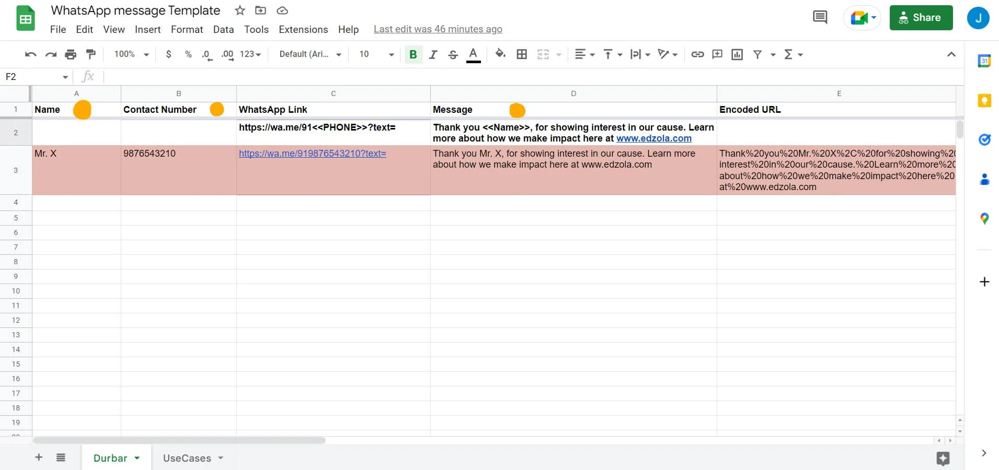
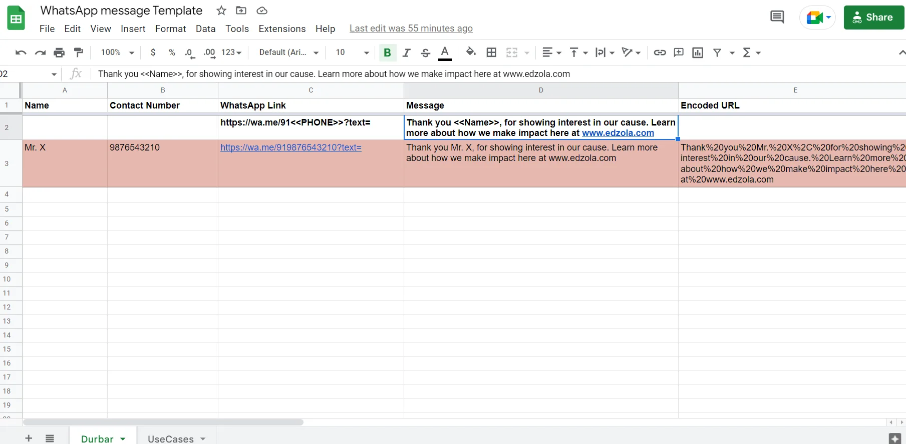
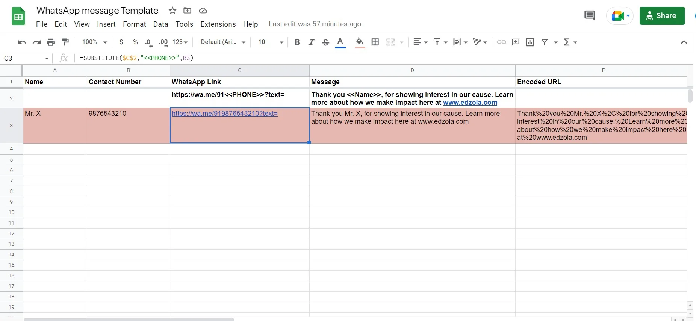
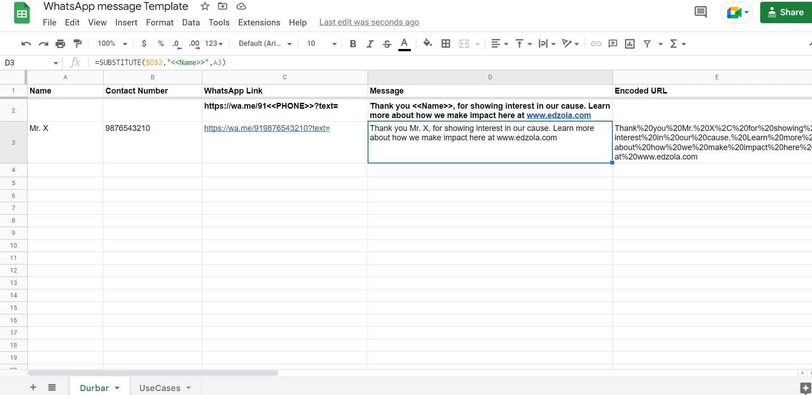

Let’s say you have a list of beneficiaries to whom you need to send the same message and you’d also like a little personalization. But you don’t want to spend a lot of time typing the same message over and over again with slight edits to personalize it (let’s say, name). And then you might start wishing for software but find out it’s pricey… That’s when this simple zero-cost sheet trick can step in and save your day!

## Why choose WhatsApp?

Before we get into the 'how to' part of this article, we'd like to put in some mind-bending statistics on WhatsApp for you that speak in favor of this chatting app.

The usage of WhatsApp is increasing every year. According to [this article](https://www.oberlo.in/blog/whatsapp-statistics#:~:text=Here's%20a%20summary%20of%20the,million%20times%20in%20August%202022.) by Oberlo, the number of WhatsApp users has been **increasing by half a billion every two years** (more than 2 billion total users as of 2022) with people sending out 100 billion messages daily! Not only that, India has the most WhatsApp users too - the numbers being 487.5 Million users. This huge number would definitely pull every marketer's attention from every sector. Catching up with the for-profits, many Non-Profits are currently leveraging WhatsApp for communicating with stakeholders. And WA has continuously proven to be effective.

Despite its heavy usage, it still is not very suitable for some sort of business communication. That's why there are so many platforms, software, and DIY tricks to get the best out of WA, no matter its limitations. This is a DIY method where you don't need to build any complex flows or need any coding skills to use it.

##

## When can you use this WhatsApp template?

There are multiple software out there to fulfill this need, but they come at a price. So, if you are thinking of a simple way and need it to be free, then this sheet is your answer. You can use this template to send out the same message for multiple users/profiles. You might think of using broadcast messages, but there's a limitation to that which is all your clients should **save your number** on their devices.

## How to use a Google sheet for sending out bulk WhatsApp messages?

First of all, make a copy of this template - [Bulk WhatsApp Message Template](https://docs.google.com/spreadsheets/d/11zCnkDyEiBKF9ya3cdivmMVoWQIIUq6YgJEvXOYOttc/edit?usp=sharing).

### Understanding the cells

The following is the list of fields in the sheet we've included:

Fields that you need to fill

The columns with orange dots should be filled out by you

- Name
- Contact number
- Message - general format

Fields that can be filled by dragging from the top (formulas are added)

- WhatsApp link for specific contacts (before adding the text message)
- Message (for specific contacts)
- Encoded URL
- Final Link (that one should click to send out the messages)

#### Name and Contact number:

Name **(Column A)** and Contact Number **(Column B)** are the only fields that you will need to fill in with the help of your database (CRM or sheets where you've stored their names and numbers). You can include new contacts as you get them.

#### Message:

Edit the message as per your need

Let's say, for example, you need to send - 'Thank you for showing interest in our cause. Learn more about us at [www.edzola.com](http://www.edzola.com)'. And with this sheet, you'll for sure send it to multiple contacts with ease. But you can do more to personalize it by adding names to the message. Now it would be 'Thank you <<name>> for showing interest...'. And you can do this with absolutely no extra effort.

To do this, move to the **D2 cell**, where we have added a placeholder text for you to understand. Type your message and wherever you want to add the name, type it as <<name>>.

*(You can read the following sections to understand how it works, so you won't make any mistakes in the future. If you're familiar with the nuances of sheets and their formulas, you can skip these and go straight to send out your messages!)*

An example is shown in 3rd row. Don't erase them, keep the values so you can drag from there to automatically fill in the below fields.

#### WhatsApp links for specific contacts:

Drag it down as long as you need - till the last contact

This is in **Column C** with the format typed in C2 (where you don't have to do anything). Select **C3** and drag from there to as many columns as you need to create the WA link for all numbers.

Formula used for C3 is =SUBSTITUTE($C$2,"<<PHONE>>",B3).

#### Message for specific contacts and Encoded URL:

Drag down the same way you did for creating WA link

Now that you've added the name (Column A), contact number (Column B), and the message you need to send in, it's time to personalize it and add the message in all fields for respective contacts. Select D3 and drag down as long as you need. This will automatically fill columns E and F. (In case, columns E and F are not automatically filled, drag down from E3 and then from F3 to fill the cells).

Formula for D3 - =SUBSTITUTE($D$2,"<<Name>>",A3)

Formula for E3 - =ENCODEURL(D3)

Formula for F3 - =CONCAT(C3,E3)

That's it, now click the links generated in Column F to send out the messages to all contacts from one place.

## **Other Use Cases**

If you’re familiar with how excel works, this sheet can shapeshift into a multi-purposer! We have given an example of how it can be used for providing feedback on students’ performance. There, we’ve added a set of conditions for what feedback should be given depending on the marks each student received. Wonderful, right? So, experiment with the sheets and you might discover more opportunities that suit your organization’s needs.

## **The Other Options for Sending Bulk WhatsApp messages:**

As your non-profit grows, there might come a need for you to switch to APIs and other software that saves you much more time and helps manage more complex message flows. This is where chatbots come into play and [Glific](https://glific.org/) is one of the software that offers these features, more specifically to Non-Profits.

So, before venturing into different options available, use this sheet method when you have restraints on the budget too. Or, if you’re ready to dive into other options as mentioned before, do let us know here. We’ll get back with what can fulfill your needs!

[Contact to learn about the other options](https://www.edzola.com/contact)
