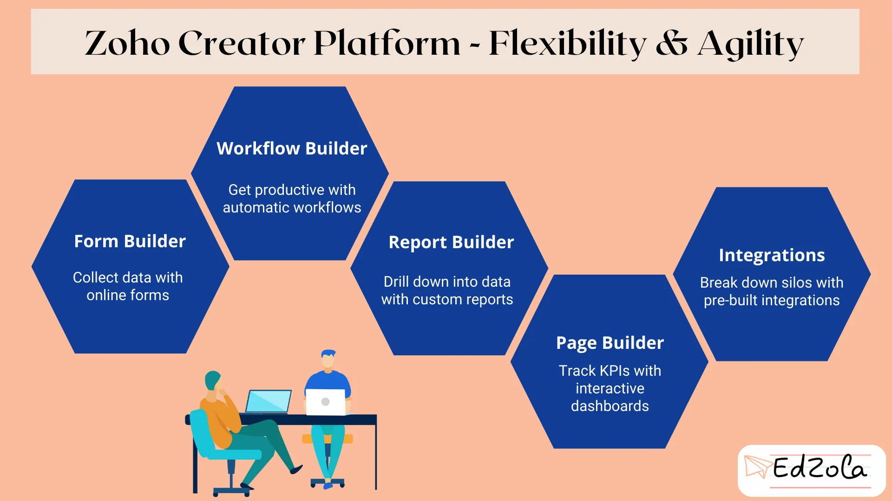
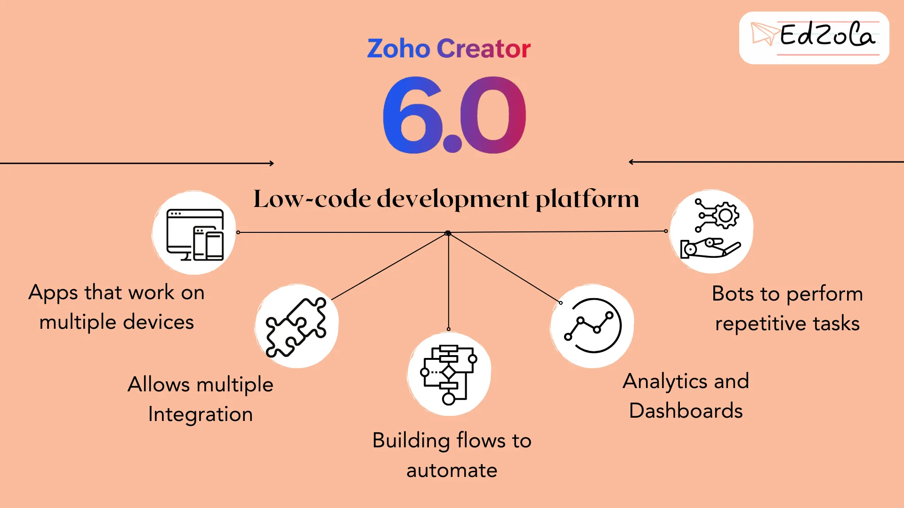
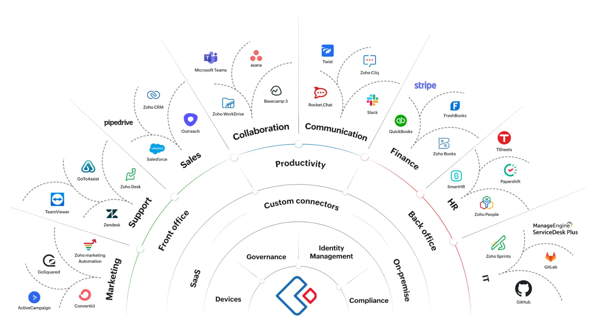

Effective program management is essential for the success of any nonprofit organization. With limited resources and a constant need to drive impact, nonprofits face unique challenges that require innovative solutions. Enter Zoho Creator, a powerful and versatile platform that empowers nonprofits to streamline their program management processes and achieve their mission with ease. In this article, we will explore Zoho Creator and delve into its key features and benefits for nonprofits. Let's dive in and discover how Zoho Creator can unleash the expertise in program management for nonprofits.

## **Understanding Zoho Creator: A Comprehensive Overview**

Zoho Creator is a **cloud-based platform** that allows organizations to build custom applications and databases without the need for extensive coding knowledge. With its intuitive drag-and-drop interface and powerful features, Zoho Creator empowers nonprofits to create tailored solutions that address their unique program management needs. From managing volunteer data to tracking program outcomes, Zoho Creator provides a unified data management system that streamlines operations and enhances efficiency. Let's take a closer look at some of the key features that make Zoho Creator an ideal choice for nonprofits.

### Key Features of Zoho Creator

Zoho Creator offers a wide range of features that enable nonprofits to manage their programs effectively:

- **Drag-and-Drop Interface:** With Zoho Creator, you don't need to be a coding expert to build powerful applications. Its intuitive drag-and-drop interface allows users to create custom workflows and forms effortlessly.
- **Automated Workflows:** Zoho Creator enables nonprofits to automate routine tasks and processes, reducing manual efforts and saving valuable time. From sending automated notifications to generating reports, Zoho Creator streamlines program management workflows.
- **Data Integration:** Zoho Creator seamlessly integrates with other Zoho applications and third-party tools, allowing nonprofits to consolidate their data in one place. This unified data management approach enhances decision-making and improves overall efficiency.

### Why Zoho Creator is Ideal for Nonprofits

Nonprofits face unique challenges when it comes to program management, and Zoho Creator is designed to address these pain points:

- **Unified Data Management:** [With Zoho Creator, nonprofits can consolidate their data from different s](https://www.edzola.com/post/unlocking-nonprofit-efficiency-overcoming-data-silos-and-centralizing-your-systems)[o](https://www.edzola.com/post/unlocking-nonprofit-efficiency-overcoming-data-silos-and-centralizing-your-systems)urces into a single platform. This unified approach allows for better decision-making and eliminates data silos.

  Explore more: [Unlocking Nonprofit Efficiency: Overcoming Data Silos and Centralizing Your Systems](https://www.edzola.com/post/unlocking-nonprofit-efficiency-overcoming-data-silos-and-centralizing-your-systems)

- **Volunteer Management:** Managing volunteers is crucial for nonprofits, and Zoho Creator provides a comprehensive solution for tracking volunteer information, scheduling shifts, and communicating updates.
- **Data Management:** Nonprofits working in the education sector can benefit from Zoho Creator's student data management capabilities. From enrollment to progress tracking, Zoho Creator simplifies the process of managing student information.

  Case Study: [Tech for Impact - Case Study on The Nudge Institute](https://www.edzola.com/post/tech-for-impact-case-study-fp)

## **Streamlining Program Management with Zoho Creator**

Zoho Creator goes beyond just managing data. It offers a range of tools and features that streamline program management processes and enhance collaboration and communication among team members. Let's explore some of these features in more detail.

### Simplifying Program Management

Managing programs can be a daunting challenge for nonprofits. With multiple programs, deadlines, and team members involved, it is essential to have a streamlined program management system. **Zoho Creator offers a comprehensive program management tool that allows nonprofits to assign tasks, track progress, and ensure deadlines are met. With automated reminders and real-time updates,** Zoho Creator simplifies program management and improves overall efficiency.

### Enhancing Collaboration and Communication

Collaboration and communication are crucial for successful program management. Zoho Creator provides a range of features that enable seamless collaboration among team members, even when working remotely. From real-time document sharing to integrated messaging, Zoho Creator facilitates effective communication and enhances teamwork.

Effortlessly streamline your non-profit operations with Zoho Creator's seamless integration capabilities. Seamlessly connect program tracking, volunteer coordination, and resource allocation within one platform. With intuitive workflows and customizable features, Zoho Creator enables organizations to enhance efficiency and increase their impact.

Popular Integrations

## **Customizing Zoho Creator for Your Nonprofit**

One of the biggest advantages of Zoho Creator is its ability to be customized according to the specific needs of a nonprofit organization. Let's explore how nonprofits can tailor Zoho Creator to meet their unique program management requirements.

[Explore Zoho Creator with a 15-day free trial!](https://store.zoho.in/ResellerCustomerSignUp.do?id=7b02f2ab5c8f7eeb3bf04bad5f5f65ae)

### Tailoring Zoho Creator to Meet Your Needs

Zoho Creator offers a wide range of customization options, allowing nonprofits to create applications and workflows that align with their program management processes. With its drag-and-drop interface and extensive library of pre-built templates, Zoho Creator empowers nonprofits to build customized solutions without the need for extensive coding knowledge.

Dig Deeper: [Streamlining Non-Profit Operations with Zoho Creator](https://www.edzola.com/post/need-to-check-streamlining-non-profit-operations-with-zoho-creator-apps)

### Leveraging Zoho Creator's Flexibility for Nonprofit Success

Zoho Creator provides a flexible platform that can be easily adapted as the needs of a nonprofit evolve. From adding new fields to modifying workflows, Zoho Creator allows nonprofits to stay agile and ensure that their program management processes are always aligned with their organizational goals.

## **Maximizing Impact with Zoho Creator**

Zoho Creator is not just a tool for managing programs; it is a platform that empowers nonprofits to maximize their impact and drive better outcomes. Let's explore how Zoho Creator helps nonprofits improve efficiency and productivity while leveraging the power of data.

### Improving Efficiency and Productivity

Zoho Creator automates routine tasks and processes, reducing manual efforts and freeing up valuable time for nonprofit staff. By eliminating manual data entry and streamlining workflows, Zoho Creator improves overall efficiency and allows nonprofits to focus on what matters most - delivering their programs with excellence.

### Driving Better Outcomes with Data

Data is a powerful tool for nonprofits, enabling them to make informed decisions and drive better outcomes. Zoho Creator provides advanced analytics and reporting capabilities that allow nonprofits to gain valuable insights from their data. From tracking program effectiveness to identifying areas for improvement, Zoho Creator empowers nonprofits to make data-driven decisions and achieve their mission with greater impact.

## **Securing Your Nonprofit's Future with Zoho Creator**

Data security and future-proofing are crucial considerations for any nonprofit organization. Zoho Creator understands these concerns and provides robust security features and continuous updates to ensure the safety of your data and the longevity of your program management efforts.

### Ensuring Data Security and Compliance

Zoho Creator follows industry best practices to ensure the security and confidentiality of your data. With data encryption, role-based access control, and regular backups, Zoho Creator provides peace of mind for nonprofits, knowing that their data is secure. Additionally, **Zoho Creator complies with industry regulations such as GDPR, HIPAA, and CCPA, ensuring that nonprofits meet their legal and ethical obligations.**

In conclusion, Zoho Creator is a game-changer for nonprofits seeking advanced program management solutions. With its robust features, customizable interface, and focus on data security, Zoho Creator empowers nonprofits to streamline their program management processes, improve efficiency, and drive better outcomes. Whether it's volunteer management, student data management, or data integration, Zoho Creator provides a unified platform for nonprofits to unleash their expertise in program management and create lasting impact. Discover the power of Zoho Creator and take your nonprofit's program management to the next level.

## Getting Started with EdZola

> ***Where technology becomes a force for good, amplifying human potential and fostering global progress.***

Every nonprofit is unique, and one size does not fit all when it comes to data solutions. At [EdZola](https://www.edzola.com/), we specialize in creating customized solutions that align with your organization’s specific goals and needs. Our team works closely with you to identify pain points, develop a tailored plan, and implement the right tools to maximize your impact.

[Let's Connect](https://www.edzola.com/contact)
