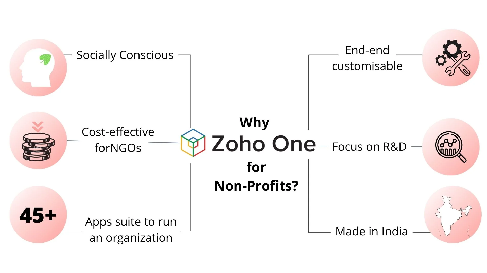

500+ Non-Profits! That's the number of non-profits who are benefitting from Zoho Creator ([for non-profits](https://www.zoho.com/creator/industries/nonprofits-organization-management-software.html)) - just one among 45+ apps.

Zoho has been a socially conscious company that has unique offering for impact driven organizations. It has become that one place where one can manage every processes that are involved in running an organization. It may sound too good to be true, but Zoho has made it possible!

With our experience working with non-profits exclusively, we understand the specific needs that can be addresses and solved by technology. In this webinar, as an Authorized partner we aim to help you learn how Zoho can be used to create impact at scale and in turn reach and serve more beneficiaries.

[Video: https://www.youtube.com/watch?v=Twkv0hCvuYg](https://www.youtube.com/watch?v=Twkv0hCvuYg)

Access the [deck](https://show.zohopublic.com/publish/7pdvc7c562a068dde41228317315b83d4012b) here
