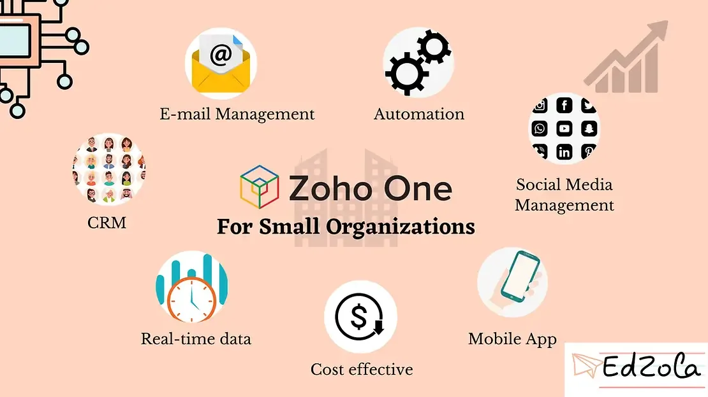
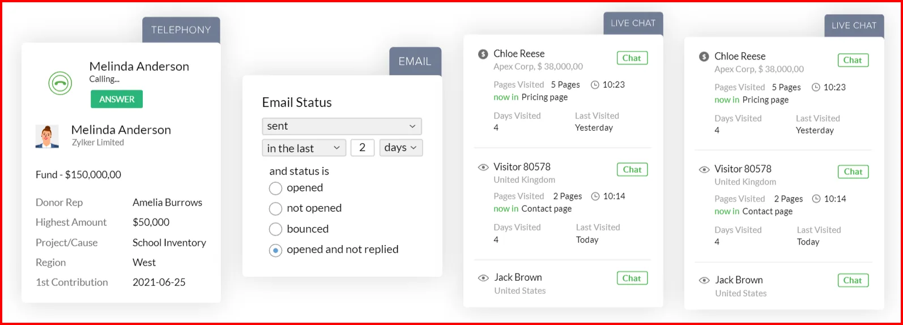
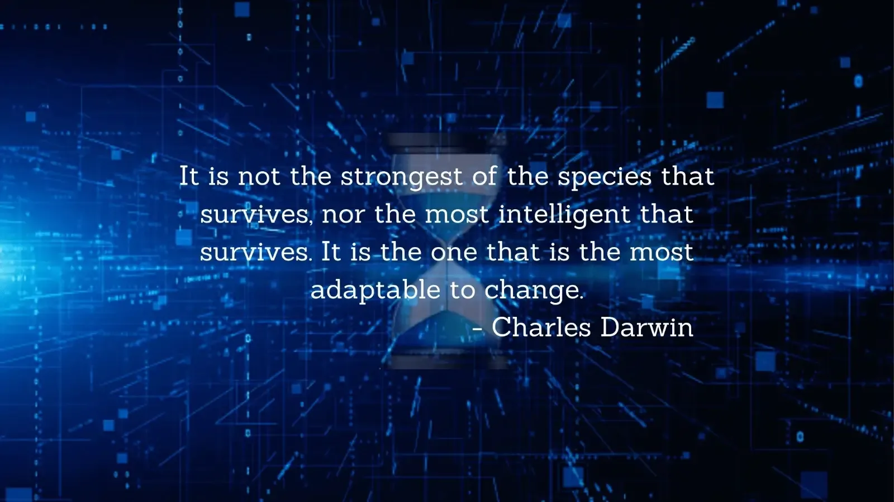
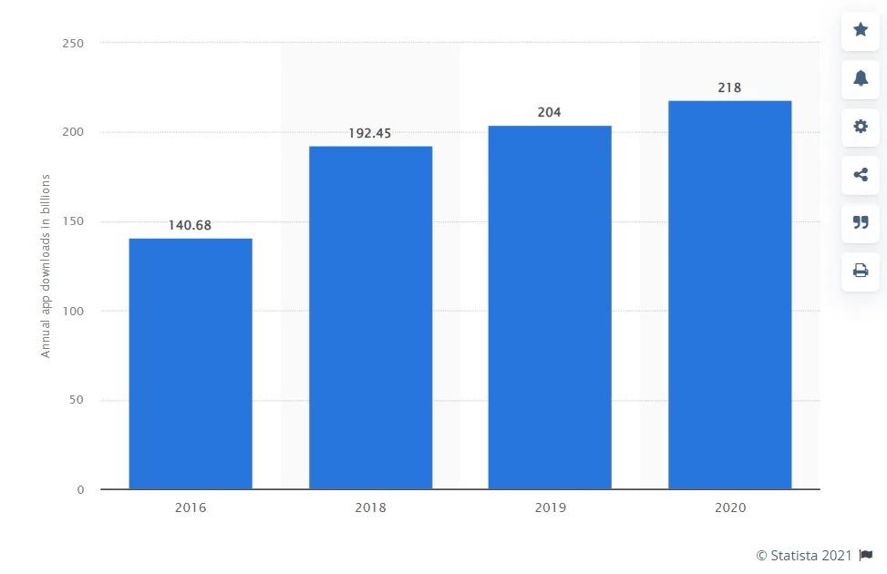

Zoho One for Nonprofits

When you’re running a nonprofit, you might have to wear multiple hats and at most times juggle a lot of tasks. You also might take pleasure in taking care of all the work in order to realize your mission, to actually bring the big change you wish to see. But what we’d like to say is **technology can wear some hats for you** and help you in creating your desired impact, while you can work on things that require human attention and intelligence.

‘What to choose?’ could be your next question. You might be considering the **budget** because that’s the biggest concern for any organization’s digital transformation, you might be thinking if the **migration process would be time-consuming**, or even consider the time taken for adapting to the new technology. This blog intends to answer all your questions and also states why Zoho One can be the perfect solution for Nonprofit organizations. But before that, let us give a short introduction to Zoho and Zoho One.

## Zoho for Nonprofits

Zoho is an Indian-based software company that provides web-based tools to run organizationsand has become one of the most popular web-based software that helps nonprofit organizations transform the way they work. [Zoho One](https://www.zoho.com/one/) is a suite of **45+ apps** that can take care of your **fundraising campaigns, event planning, donor and donation management, communications, productivity, volunteer management, finances, internal processes and more**. Most of the apps require *no-coding skills and an easy-to-use interface*, even the app development platform Zoho Creator can be used by a non-developer. (Still, some specific features should be developed with code)

With the help of valuable yet affordable software and applications, you can manage your resources and time easily to create greater social impact.

Let’s now dive into the top 7 reasons that make Zoho One the go-to choice for Non-Profits' digital transformation today.

## Cost-Effective

As we said already, the **budget becomes the first factor** of consideration when it comes to digital transformation in Nonprofits. And this will lead you to your tiring journey of searching for an affordable yet one of the best tools in the market. In the high-priced market, you feel like you are on cloud nine when you come across a comprehensive web-based tool with all the features your organization requires. But the price may hit you like a plane!

You can cut back on that journey because Zoho is that affordable software that you'll end up finalizing. The [price for the entire suite of apps](https://www.zoho.com/one/pricing/) is just Rs. 1800 per employee per month when billed annually, certainly the most economical option out there.

In addition to that you can avail Zoho for startups credits through this link: <https://survey.zohopublic.com/zs/6yD7Dn>

Send a mail to [reachus@edzola.com](mailto:reachus@edzola.com) to know more.

## Easy-to-Find Emails

Even though there are so many communication platforms available like Social Media apps, Nonprofits usually prefer emails since they’re more *professional, direct yet personal.* WhatsApp is on the rise for communication purposes in Non-Profits, but that’s a topic for another day.

Back to the emails, you probably have a lot of them. You don’t have to scroll through thousands of emails to find that one email you desperately need. Zoho mail comes with modern technology that understands and prioritizes your needs to reduce your email hustle. You can collect, handle and organize your **emails from many accounts in a single location**. It can sync from several platforms. Wasting time linking numerous accounts into separate pages is a thing of the past now.

That’s not all, it also comes with much more useful features, like email reminders which inform you if you read your emails and produce an **analytical report** on the effectiveness of your email with your clients. There are **smart filters** that can even separate newsletters and notifications. This is an effective first step in giving a digital makeover to your nonprofit as it gives you a sense of control over everything.

## Metrics and goal tracking made simpler

Knowing what you are working towards is the first and foremost thing to determine. Then, you’ll need to measure the progress of your organization which could be understood by analyzing essential metrics. Read why [analyzing your data for insights is as important](https://www.edzola.com/post/analyze-collected-data) as collecting and storing them properly. They possess a huge part in the growth and sustainability of your Non-Profit. Working hard with no direction is just a huge waste of time, money and energy and especially nonprofits can’t afford that. That’s why it’s vital to do it the easy and the right way.

The good news is you can quit worrying about the tables and graphs. [There are better replacements.](https://www.edzola.com/post/top-3-reasons-your-non-profit-organisation-should-get-rid-of-spreadsheets)

- The right CRM software acts as a storehouse of your relationship status with stakeholders and your mission. Zoho CRM integrates all elements which would assist you when your Nonprofit is witnessing growth and helps you manage the relationships better with your stakeholders.

- Zoho Analytics or a custom application built with Zoho Creator can help you analyze your humongous data. In the present world, guessing games are being taken over by data. For decision-making, metrics are tracked to truly understand (not assuming, but understanding) how closer you’re to the goal.

As you take responsibility for the broader picture, technology takes care of the nuts and bolts.

## Automation of Daily and Repetitive Processes

You don’t set your alarm every night manually, right? Our gadgets are intelligent enough to ring the alarm based on time and date repetitively if we set it up for once. Most operations inside an organization **are repetitive and can be automated**. This ensures that your team works on something that’s worth spending their time and energy on.

Recurring donation management is one such example. Tasks like field updates, scheduling calls, outreach campaigns and so on are important factors for growth and scaling impact but they eat up your time tremendously, if not automated. CRM or custom-built solutions gain you time for things that really need your attention by automating daily monotonous operations.

Not only automation but also [visualization of your data](https://www.edzola.com/post/dashboards-vs-spreadsheets) and progress can save you a huge amount of time.

## Social Media Management

Everyone’s on social media from day to night, consuming the content they love thanks to easier access to technology. So, why not go digital and get your nonprofits in front of the right potential donors through social media? Social media has become **another go-to marketing strategy for many organizations**. Be it fresh and small start-ups or corporate giants, no one should miss out on an opportunity to target their audience.

Non-Profit digital transformation is no different

So, when your donors adapt, you have to adapt along with them right away. Zoho Social helps with easy social linking. Link all your social accounts to the app and manage all of them from one place. The benefit? You can **save a lot of time by scheduling posts in multiple social media channels in a single click**, i.e., you don’t have to manually post an update in Facebook, LinkedIn, Twitter, and Instagram separately. It also offers great info on when to post, what to post, and how to enhance them.

##

## Real-Time Data

You may make use of past data to identify trends and more for the betterment of communication. But with real-time data, you can have a wider picture of what’s going on and so have **better communication with your donors or beneficiaries by providing a quick response**. Such a feature helps you make smarter and better judgments and decisions with little to no space for errors.

## Mobile-Compatible Applications

Applications that are built with Zoho, either to take care of your internal processes or something for your stakeholders, are accessible through mobile.

[Statista](https://www.statista.com/statistics/271644/worldwide-free-and-paid-mobile-app-store-downloads/) shows a steady increase in the usage of Mobile applications

Zoho One provides a full-functional apps on any device that incorporates most of its browser-based functions from account administration to account management. Any app that is built using Zoho platform is fully functional on your mobile so you could manage your organization on the go. You can better maintain the remote control of your donors and other stakeholders and **all information can be accessed from a smartphone**.

## Creator App:

Still haven’t found the right reason and technology for your business to undergo digital transformation? Then, the creator app is for you. You can create ([or we can do it for you!](https://www.edzola.com/zoho-for-impact)) completely new modules using [Zoho Creator](https://www.zoho.com/creator/industries/nonprofits-organization-management-software.html) that fulfills your organization's specific needs, or you can deploy and customize its ready-to-use applications for donor management, event management and more!

These are all the general reasons that you might hear for many software, but the more unique reason is Zoho One's 45 plus apps are interconnected that are flexible and heavily customizable which is important for fulfilling Non-Profits' specific needs. Zoho also facilitates integrations with a huge number of apps, one can also build custom integrations to connect with any desired app. This makes the entire migration easier to complete! And also check out [Zoho Creator for Nonprofits](https://www.zoho.com/creator/industries/nonprofits-organization-management-software.html) and [Zoho CRM for Nonprofits](https://www.zoho.com/crm/non-profit/) which is a customized version of the platforms for Non-Profits.

## Takeaway

Zoho One is your solution to remove manual work and get into the process of automation. If you are looking for implementing Zoho One solutions, then **EdZola** is your partner. Collaborate with EdZola to handle the implementation and customization process with ease.

[Connect with us now](https://www.edzola.com/contact)

Not enough reasons to opt for Zoho? You can learn more about how Zoho is being used to create impact in this 50-minute webinar, where we talk about **different use cases of Zoho for Nonprofits.**

[Video: https://www.youtube.com/watch?v=Twkv0hCvuYg](https://www.youtube.com/watch?v=Twkv0hCvuYg)
