## Read How MukkaMaar Streamlined Program Processes and Enhanced their Operational Efficiency with Zoho Creator

## MukkaMaar

Located in Mumbai, Maharashtra

## Key information:

**Domain/Sector:** Women Empowerment

**Platform Used:** Zoho Creator

**Implementation method:** Collaborated with Tech4Good Partner (EdZola)

**Requirement:** Custom MIS

## About the Project:

MukkaMaar Girls is a transformative education initiative empowering young & adolescent girls (6th - 8th grade) in Mumbai through in-school bi-weekly self-defence classes and enabling them to speak up against the violence and abuse.

## The Problems they faced:

*The major issues that they faced were related with:*

### Multi-level Data clusters

They had multilevel data clusters, where there was a necessity to categorize and aggregate data into building level, school level, gender wise, etc., And with a lack of these systems in place, it slowly became harder and harder to have insights into various data pointers that made sense.

### Managing promotion cycles

As they were collaborating with schools to execute their programs, the yearly rotation of new students joining 6th grade and the leaving of promoted 8th grade students caused trouble in managing the cleanliness of the data.

### Trainer development

For MukkaMaar fellows, they had learning sessions and feedback systems in place. But they were struggling to manage all that initiatives within a single platform.

## What problems did it cause?

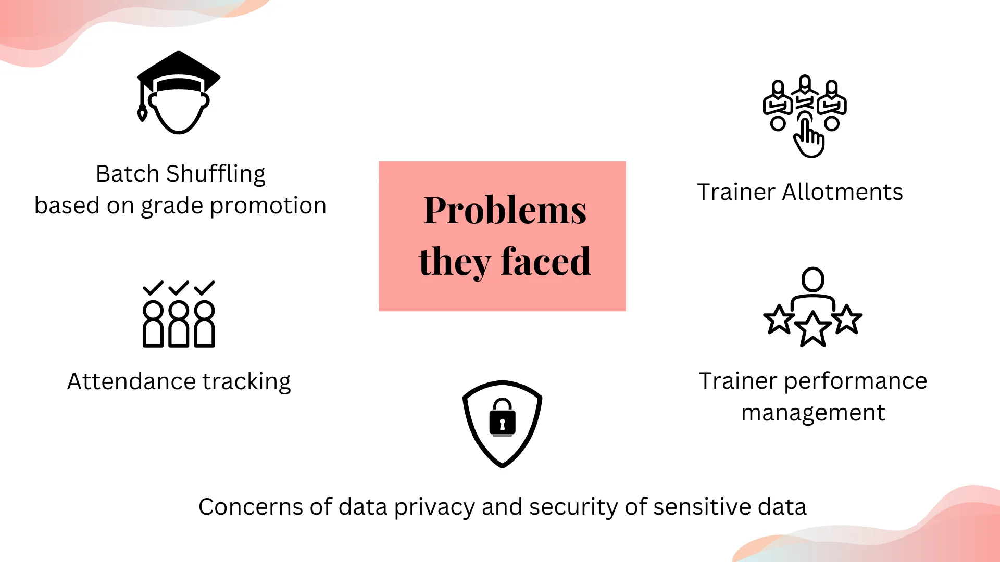

- Lot of manual work in maintaining batch shuffling (promotion cycle) and trainer allotments
- Challenges in consolidating and tracking attendance across diverse batches and schools
- Mapping and monitoring trainer (fellow) performance with specified parameters over various programs
- Increased concerns of data privacy and security of the students’ data
- Lack of donor reports for the donations they individually make

## Solution overview:

### The Process:

**Phase 1:**

In this initial phase, we worked closely with their team to assess their unique needs, evaluate their existing technology infrastructure, and identify opportunities for technology to enhance their operations.

> ***Requirement analysis → Platform evaluation → License Purchase → Solution architecture***

**Phase 2:**

Development and implementation of core modules:

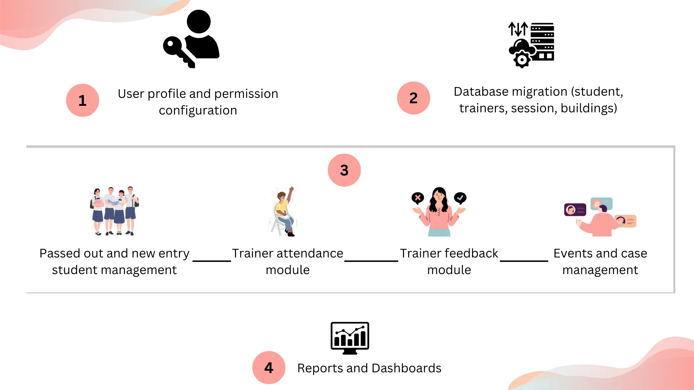

Phase 3:

> ***Support and maintenance***

Post implementation, support phase begins and encompasses technical assistance, resolution of issues, and bug fixes to ensure smooth operations.

## Highlights of the Training management solution built with Zoho Creator:

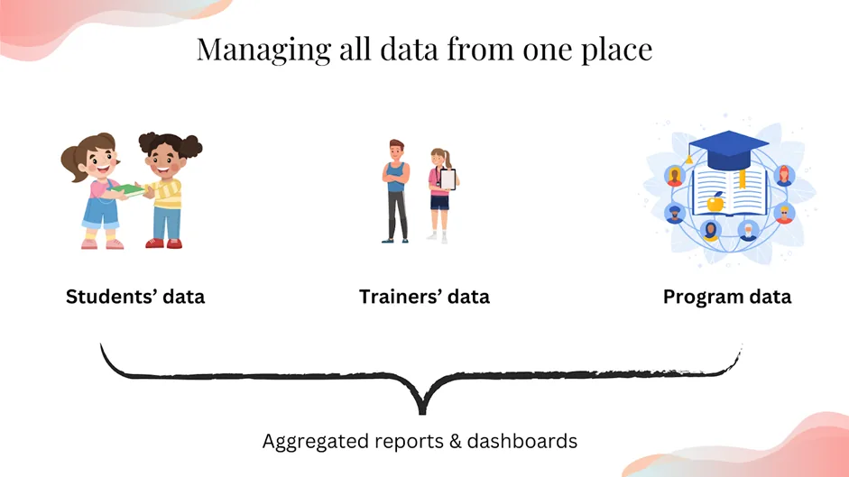

### Students Management:

Other than setting up the database of students within Creator for management, the platform was used to address the other core issue of maintaining grade promotions and making relevant changes in the upcoming batches for training sessions. A lot of data were centered around the students' database and pivot tables and aggregated dashboards were built.

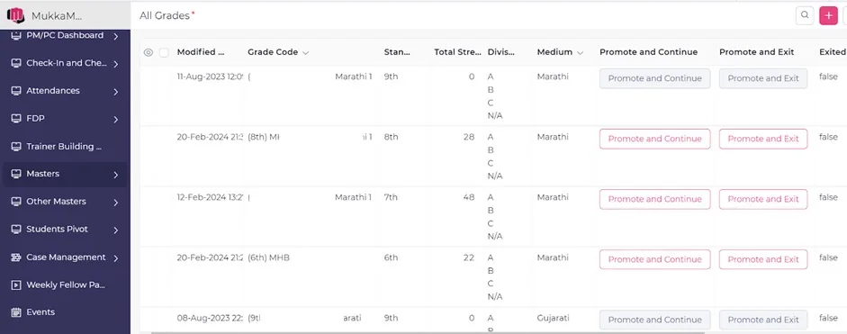

*Student promotion cycle management*

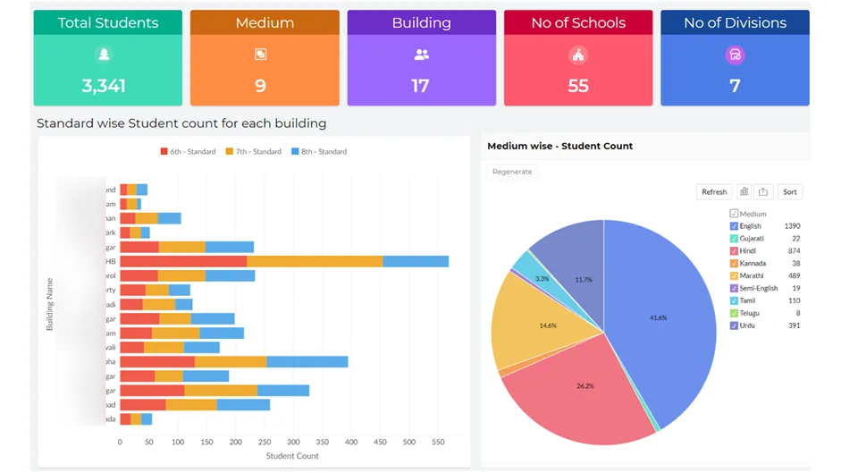

*Student centric dashboard view*

### Trainers Management:

Trainers, along with the Program managers are the core users of the app. So, we included multiple modules for trainers such as - attendance management (with a special feature of capturing a trainer’s location), trainer learning session management, fellow partner feedback management with defined parameters etc., We also integrated trainer performance with batch and school metrics, enabling correlations for deeper understanding. 

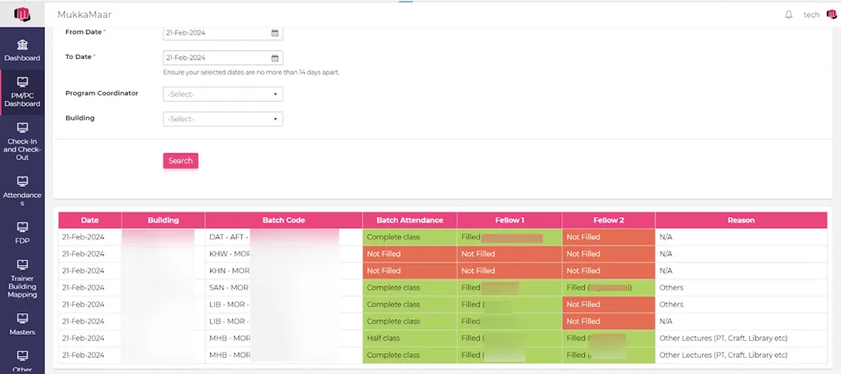

*Trainer attendance for Program coordinators & Managers*

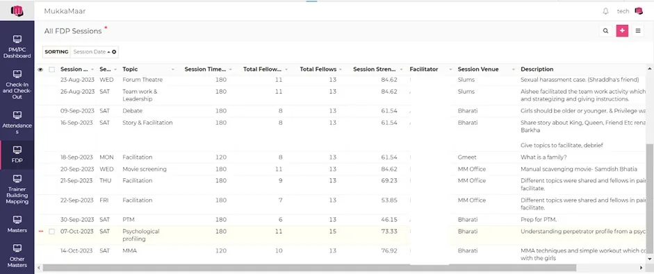

*Trainer learning session management*

### Program Management:

Other than the stakeholder data management, the entire program’s efficiency has to be tracked alongside with the available data. They wanted to track the

- Number of sessions conducted
- Quality of the sessions
- A school’s investment level in their programs etc.,

Besides conducting the training sessions, they also needed a dedicated module for ‘case management’ - an initiative where they identify, and resolve any abuse cases of their program’s students. 

They occasionally conducted events to strengthen their programs and this was also managed within the same app that we built within Creator.

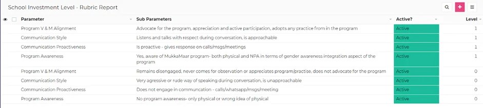

*School investment level rubrics*

### Data aggregation for dashboard purposes:

We utilized Zoho Creator's real-time monitoring features for viewing attendance, class cancellations etc., Reports enabled quick insights into the impact of the program on girls' education. As mentioned before, they had multiple variables and data had to be tracked in different combinations to derive insights. Take a look at the dashboards below:

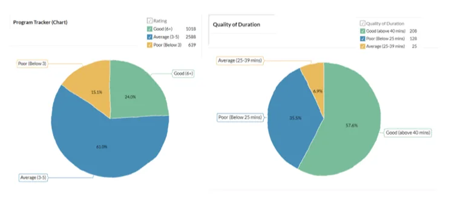

*Program trackers (Count and Quality) for Program coordinators and managers*

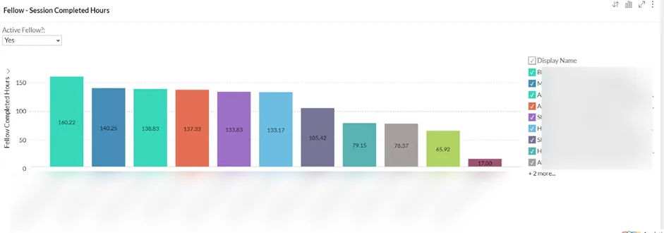

*Fellows and the time for the session they conducted*

## What were the results?

- They are managing more than **3.3 K** students and the number is growing
- The stakeholders now have a single system to work on to ensure the program’s success and growth
- Ease of data extraction for decision making and reporting without manual data manipulation.

## What does Ishita, Founder of MukkaMaar say about us?

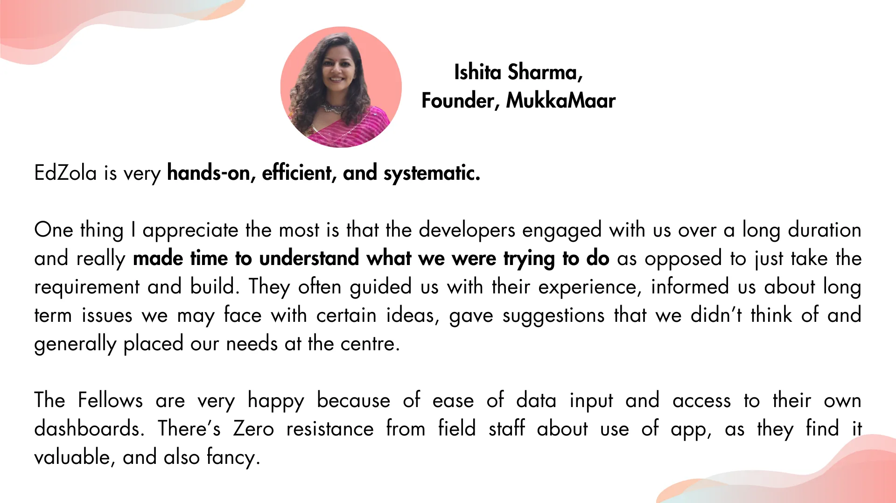

"EdZola is very **hands-on, efficient, and systematic**.

One thing I appreciate the most is that the developers engaged with us over a long duration and really made time to understand what we were trying to do as opposed to just taking the requirement and building. They often guided us with their experience, informed us about long term issues we may face with certain ideas, gave suggestions that we didn’t think of and generally placed our needs at the centre.

The Fellows are very happy because of the ease of data input and access to their own dashboards. There’s Zero resistance from field staff about the use of the app, as they find it valuable, and also fancy.

**EdZola’s Top Strengths:**

- Understanding of programs and non-profit needs
- Systematic processes for issue raising and transparency of communication
- Collaborative, friendly staff and way of working"

Are you facing similar challenge and would like to implement a similar solution for your organization?

[Connect with us to learn more](http://www.edzola.com/contact)

Impressed with MukkaMaar's intiative and work? Join the cause

[Learn more about their work here](https://mukkamaar.org/defend-not-depend/)
